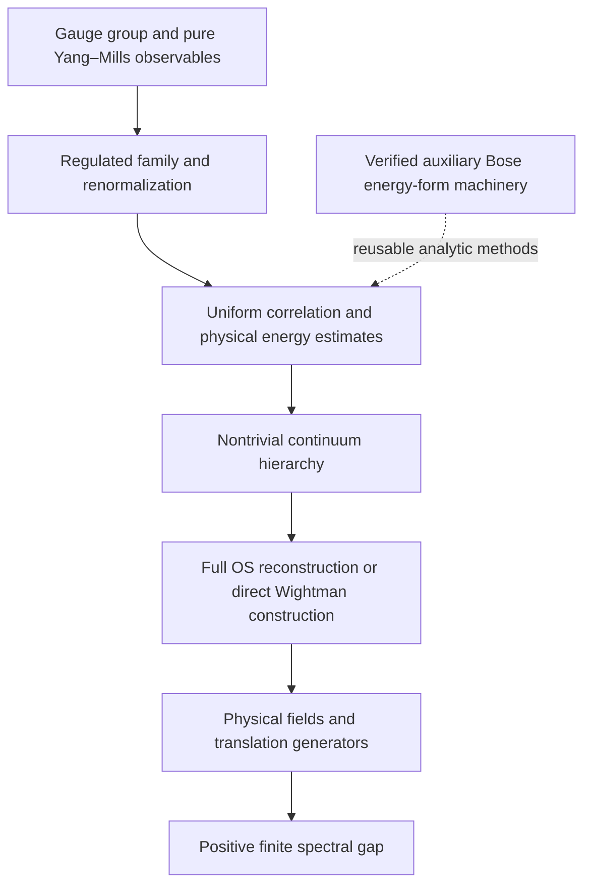

# Yang–Mills existence and mass-gap framework

This proof framework now constructs an actual bare scalar Wilson limit and
its full positive-time OS Hilbert space and maximal self-adjoint generator.
It also constructs a common renormalized full-test candidate from explicit
uniform estimates and a positive ultraviolet endpoint, while proving classical
constant-connection plaquette normalization. The analytic inputs needed for a nonzero branch remain open. The same
conditional renormalized candidate now has constructed OS time evolution and
its maximal self-adjoint generator; an explicit branch with proved all-order
bounds is instead proved to collapse.
**A nontrivial renormalized continuum Yang–Mills theory and the complete Clay
statement remain unproved.** The executable ledger keeps all twelve full-target
obligations open and distinguishes them from these verified partial results.

The target is a nontrivial four-dimensional quantum Yang–Mills theory for
every compact simple gauge group, with adequate quantum-field axioms and a
positive, finite mass gap. Local gauge observables and the required ultraviolet
behavior are part of the specification. See Jaffe–Witten, sections 3–5 of the
[official Clay description](https://www.claymath.org/wp-content/uploads/2022/06/yangmills.pdf).

## Full-target obligations

| ID | Required result | Current encoding |
|---|---|---|
| YM01 | Every compact simple gauge group | Generic finite regulator |
| YM02 | Nontrivial continuum theory on four-dimensional spacetime | Conditional nonzero rescaled candidate |
| YM03 | Renormalized gauge-invariant Yang–Mills observables | Classical plaquette normalization; quantum identification open |
| YM04 | Hilbert space, common invariant domain, adjoints | Full-test bare OS Hilbert space; physical fields open |
| YM05 | Full strongly continuous Poincaré covariance | Geometry and conditional interface |
| YM06 | Translation generators and forward-cone joint spectrum | Maximal bare OS time generator; physical joint spectrum open |
| YM07 | Unique invariant vacuum and full-space cyclicity | Partial interface |
| YM08 | Spacelike locality of physical observables | Partial interface |
| YM09 | Complete adequate quantum-field axiom system | Full positive-time scalar RP; physical reconstruction open |
| YM10 | Asymptotic freedom, stress tensor, required operator-product behavior | Explicit sufficient concentration rates; physical UV open |
| YM11 | Positive spectral gap of that physical Hamiltonian | Partial interface |
| YM12 | Finite nonzero excitation scale | Partial interface |

The detailed acceptance conditions and dependencies live in
[`yang_mills_requirements.json`](../../../data/yang_mills_requirements.json).
Confinement, an isolated particle mass shell, Standard Model numerical
identifications and a gravity theory are additional projects; they should not
be used to expand this target. The official description distinguishes its
stated problem from further extensions.

## Construction route

The chosen regulator route has four additional obligations, RG01–RG04, in the
ledger. These are work packages for our strategy, not extra conditions imposed
on every possible proof.



The proof must use one compatible candidate throughout. A gap for one operator,
locality for another field family and a continuum limit of a third model do not
assemble into a certificate without identification theorems. Those identifications
must include domains, observables, translation generators and the energy units.

## Implemented semantic interfaces

[`LocalFields.lean`](LocalFields.lean) fixes four-dimensional spacetime and
Schwartz tests. Fields act on a common dense invariant submodule; weak matrix
elements must be continuous in the test function. Locality uses spacelike
separation of actual test supports. Cyclicity refers to the closed span of
field words applied to the vacuum. Nontriviality requires a word state outside
the vacuum line. A proved check rejects zero field systems as nontrivial.
The extensions below add adjoint and covariance interfaces. Full hierarchy
regularity and reconstruction remain open; this is not a complete Wightman
specification.

[`FieldAdjoints.lean`](FieldAdjoints.lean) constructs Schwartz conjugation and
word adjoints. From adjoint compatibility on the common domain, it proves
that the correlation matrix of adjoint words followed by words is a Gram
matrix, hence positive. [`FieldCorrelations.lean`](FieldCorrelations.lean)
derives Hermiticity and adjacent spacelike exchange of vacuum correlations
from the corresponding adjoint and locality hypotheses. These implications
do not construct a field system satisfying those hypotheses.

[`PoincareKinematics.lean`](PoincareKinematics.lean) constructs the actual
affine Minkowski-isometry group and its determinant-one, future-cone-preserving
subgroup, including faithful translations. [`PoincareTestAction.lean`](PoincareTestAction.lean)
constructs continuous linear Schwartz pullbacks, their composition and inverse,
exact support transport, and preservation of spacelike separation.
[`PoincareTopology.lean`](PoincareTopology.lean) gives the coefficient topology,
continuous group operations and jointly continuous spacetime evaluation.
[`PoincareStrongTestContinuity.lean`](PoincareStrongTestContinuity.lean) now
proves continuity in the group parameter in the full Schwartz topology,
without a continuity premise. Weighted derivative estimates establish strong
translation continuity, joint translation/test continuity, and continuity of
linear pullbacks near the identity; the group law extends this to the full
Poincaré group. This closes the test-action continuity subproblem, while
construction of a physical unitary representation remains open.

[`PoincareCovariance.lean`](PoincareCovariance.lean) specifies a strongly
continuous unitary representation preserving the same field domain and vacuum.
Assuming this representation and scalar field covariance, it proves strongly
continuous commuting translation subgroups and invariant vacuum correlations.
It constructs no physical representation. Tensor multiplets, self-adjoint
translation generators and their joint forward-cone spectrum remain open.

[`SpectralGap.lean`](SpectralGap.lean) defines the real resolvent using a bounded
two-sided inverse of `H - lambda` on the actual unbounded operator domain. Its
gap condition covers an interval, and its finite-excitation condition requires
positive spectral support. It is stronger than checking a list of eigenvalues.
The module proves that a normalized stationary vacuum excludes zero from the
resolvent, and that a resolvent interval excludes eigenvectors there. Equivalence
to a general spectral-measure formulation has not yet been formalized here.

[`ContinuumControl.lean`](ContinuumControl.lean) provides full-order tempered
correlation interfaces, weak convergence, cutoff/volume scales and a convention
for physical gaps `gap_lattice / spacing`. It proves transfer of uniform scalar
norm bounds, exponential bounds and a nonzero witness under supplied convergence.
It also proves that positive cutoff gaps can converge to zero. These transfer
lemmas do not establish convergence, reconstruction, or a spectral gap by themselves.

[`HierarchyCompactness.lean`](HierarchyCompactness.lean) now constructs a common
subsequence converging on **every Schwartz test at every order**, provided a
regulator-uniform continuous seminorm bound at each order and countable dense
test families. The limiting functionals are proved complex-linear and continuous.
Supplied Gram positivity and normalization survive. A nonzero selected coordinate
may be the normalization coordinate; field nontriviality additionally needs a
uniform lower bound for an identified connected or centered correlation. The
renormalized hierarchy and its uniform seminorm bounds are not yet constructed
from the Wilson laws.

## Verified input from the current repository

The new auxiliary results are in the genuine dependency build:

- The full closed Bose energy form has an exact domain and represents the
  already constructed direct-sum Hamiltonian.
- Tensor creation maps and their Hilbert adjoints give an annihilation operator
  on that full form domain, with `||a(f)u||² <= (||f||²/delta) q(u)`.
- A linear field perturbation of this actual Bose energy operator is
  self-adjoint for every real coupling, with a full variational graph and a
  lower energy bound. Zero coupling recovers the original Bose sum exactly.

These results are instantiated for the repository's interacting one-particle
`H(t)`. The linear field perturbation has no proved interacting ground state or
gap, and is not the full S3 matter coupling or a local Yang–Mills model.

[`KFCausalBosonicClayGapInterface.lean`](../../Audit/KFCausalBosonicClayGapInterface.lean)
records the auxiliary form gap. Its previously missing spectral inputs are now
proved in [`KFCausalBosonicIntervalResolvent.lean`](../../Audit/KFCausalBosonicIntervalResolvent.lean)
and [`KFCausalBosonicFiniteExcitation.lean`](../../Audit/KFCausalBosonicFiniteExcitation.lean).
Coercive form inverses assemble into a bounded two-sided inverse of
`H_Bose - lambda` for every `0 < lambda < delta`, with norm at most
`max(1/lambda, 1/(delta-lambda))`. For a nontrivial one-particle space, the
positive inverse has a nonzero spectral point; a resolvent identity and
one-particle compression transfer a finite positive excitation to the full
Bose sum. This closes its auxiliary spectral bundle without assuming an
eigenbasis. It proves neither a gap for the linear field perturbation nor an
identification with Yang–Mills.

## Constructed finite gauge regulators

[`RegulatedGauge.lean`](RegulatedGauge.lean) defines general noncommutative
vertex gauge transformations, path holonomy and conjugation-invariant Wilson
observables. It proves trace-character invariance as a concrete example.
[`RegulatedGaugeMeasure.lean`](RegulatedGaugeMeasure.lean) constructs normalized
compact-group Haar links, proves gauge invariance of the product law and
constructs a positive finite partition function and normalized Wilson law.
[`RegulatedGaugeOrientation.lean`](RegulatedGaugeOrientation.lean) makes each
backward link the inverse of its independent forward link.

[`PeriodicLattice4.lean`](PeriodicLattice4.lean) instantiates this on
`(Z/nZ)^4`, with four forward directions and elementary length-four plaquettes.
For `n != 0`, a compact second-countable topological group with its Borel
structure, a continuous class function `chi`, and real `beta,c`, the resulting
Wilson law is a gauge-invariant probability measure. This supplies a genuine
finite regulator family. No reflection positivity is inferred for an arbitrary
class function. The physical representation/action choice, renormalization,
uniform scaling estimates and continuum construction remain to be proved.

## Bounds, finite fluctuations and subsequential limits

[`WilsonMomentBounds.lean`](WilsonMomentBounds.lean) proves one bound `B > 0`
for each fixed continuous character, such that every bare loop moment of
order `m` has norm at most `B^m`, independently of period, coupling and chosen
loops. [`UnitaryCharacterObservables.lean`](UnitaryCharacterObservables.lean)
makes the bound explicit as `dimension^m` for unitary characters, proves their
conjugation invariance, and proves that a unitary matrix has trace equal to
its dimension only when it is the identity.

[`GibbsFullSupport.lean`](GibbsFullSupport.lean) proves that the finite Gibbs law
has exactly the same null sets as the Haar reference measure. Every nonconstant
continuous observable therefore has strictly positive variance.
[`PeriodicPlaquetteNontriviality.lean`](PeriodicPlaquetteNontriviality.lean)
constructs a single-link configuration realizing any group element as plaquette
holonomy. For periods at least two and distinct plaquette directions, every
nonconstant continuous character has positive plaquette variance under the actual
Wilson law. A supplied nontrivial continuous unitary representation gives such
a character. The newer local comparison below strengthens this to a volume-independent
positive floor for bounded couplings. It does not provide a positive floor
along an unbounded-coupling continuum trajectory.

[`WilsonMomentCompactness.lean`](WilsonMomentCompactness.lean) uses the actual
moment bounds to extract one convergent subsequence for any countable collection
of bare loop products, allowing varying periods and couplings.
[`WilsonGramCompactness.lean`](WilsonGramCompactness.lean) also constructs a
positive normalized limiting Gram kernel, using an integral-of-squares identity
at finite cutoff. These are actual subsequence constructions, but the resulting
bare observable data are not a renormalized continuum Schwartz hierarchy.
The newer cell construction below does give an actual bare Schwartz hierarchy limit.
Ordinary Gram positivity is distinct from time-reflection positivity.

## Reflection-positivity construction

[`WilsonCrossingKernel.lean`](WilsonCrossingKernel.lean) proves genuine positive
definiteness of `exp(beta * Re trace(rho(x^-1*y)))` for `beta >= 0` and a
finite-dimensional unitary representation: every complex quadratic form is real
and nonnegative. The proof uses real matrix features, tensor powers and the
exponential series; pointwise positivity of a density alone would not suffice.
[`WilsonReflectionForm.lean`](WilsonReflectionForm.lean) proves the corresponding
compact-space integral positivity, finite products of crossing factors, and
absorption of continuous actions on the two halves. These crossing-kernel results alone do not
identify `PeriodicLattice4.wilsonLaw`. The newer site-reflection construction
below provides the actual reflected-edge decomposition, Haar factorization
and action equality, including the fixed reflection-boundary links.

[`WilsonSplitMeasure.lean`](WilsonSplitMeasure.lean) constructs an actual
normalized probability on two copies of a compact configuration space, with
density proportional to
`exp(-A(x)-A(y)+beta*<phi(x),phi(y)>)`. It proves a finite positive partition
function, invariance under exchanging the halves and reflection positivity for
every continuous half-observable when `beta >= 0`. Its unitary specialization
identifies the interaction with the Wilson crossing kernel. This two-half crossing construction is separate from the fixed-boundary
site-reflection construction below.

Older `LayerB` Wightman modules include finite-dimensional chamber constructions,
including a trivial Poincaré action. Their names do not discharge these full-target
conditions. No existing source was relabeled as a completed continuum theorem.

## Verification and next implementation steps

Run `python3 scripts/check_yang_mills_requirements.py` from the repository root
to check ledger consistency, dependency acyclicity and evidence references.
A successful run explicitly reports that no Clay certificate is present.
The first parallel attack added 230 explicit declaration checks to the preceding 936.
`scripts/CheckYangMillsSwarm.lean` and `scripts/yang_mills_swarm_audit.py` check
the new declarations, retain prior checks by source/log/certificate hashes,
and build the genuine dependencies. The report is
[`yang_mills_swarm_audit.json`](../../../data/yang_mills_swarm_audit.json).
The declaration count includes definitions, interfaces and intermediate lemmas;
it is not a count of solved target obligations.

The next construction batch adds **184 fresh declaration checks**, for
**1,350 cumulative**. `scripts/CheckYangMillsConstruction.lean` and
`scripts/yang_mills_construction_audit.py` check every new explicit public
declaration, retaining the previous 1,166 checks through the verified source,
log and predecessor-certificate chain. The report is
[`yang_mills_construction_audit.json`](../../../data/yang_mills_construction_audit.json).
The audit builds actual dependencies and checks root imports; it does not
claim a full-root build or use a temporary dependency overlay.

## Lattice-to-analysis bridges

[`PeriodicTimeReflection.lean`](PeriodicTimeReflection.lean),
[`PeriodicHalfGeometry.lean`](PeriodicHalfGeometry.lean),
[`PeriodicPlaquetteReflection.lean`](PeriodicPlaquetteReflection.lean),
[`PeriodicHalfSplit.lean`](PeriodicHalfSplit.lean) and
[`PeriodicHalfAction.lean`](PeriodicHalfAction.lean) construct site reflection
on period `2*n`, `n>0`. Spatial links on times `0,n` form the fixed boundary;
all remaining links are paired between the two halves. The configuration
bijection preserves product Haar measure and turns reflection into a half swap.
Every plaquette belongs to a closed half or a boundary plane, and the full
Wilson action splits exactly into its boundary and two half-actions.
[`BoundaryReflectionGluing.lean`](BoundaryReflectionGluing.lean) proves the
reflected integral is an integral of squared conditional amplitudes.
[`GibbsReflectionTransport.lean`](GibbsReflectionTransport.lean) and
[`PeriodicSiteReflection.lean`](PeriodicSiteReflection.lean) transport the
normalized law and prove **actual finite-lattice site-reflection positivity**
for every continuous closed-half observable. The character is continuous,
conjugation invariant and has inversion-invariant real part; continuous
unitary characters meet these conditions. This site-reflection result works
for every real coupling. It does not assert link-reflection positivity or
construct a one-step positive transfer operator.

[`WilsonLocalOscillation.lean`](WilsonLocalOscillation.lean) bounds the change
of the actual Wilson action when outgoing links at one vertex change by
`60*abs(beta)*B`, independently of the volume. Exact one-link Haar splitting
and local Gibbs comparison transfer a positive Haar fluctuation floor to the
actual Wilson measure. [`UnitaryUniformVariance.lean`](UnitaryUniformVariance.lean)
proves, for a continuous unitary representation with some `rho(g) != 1`,

```text
Var_Wilson(chi(plaquette)) >= exp(-120*betaMax*dim(rho)) * Var_Haar(Re chi) > 0
```

uniformly over periods greater than one and `abs(beta) <= betaMax`.
[`ConnectedGramLimit.lean`](ConnectedGramLimit.lean) proves the complex variance
identity and survival of this connected lower bound.
[`WilsonNontrivialHilbert.lean`](WilsonNontrivialHilbert.lean) constructs an
actual positive limiting kernel for the constant/plaquette labels whose
Hilbert completion has a canonical state outside the vacuum line. This is
**ordinary Gram nontriviality at bounded coupling**. It is neither a mass-gap
estimate nor nontriviality after an OS reflection-null quotient.

[`PositiveKernelForm.lean`](PositiveKernelForm.lean) and
[`KernelHilbertCompletion.lean`](KernelHilbertCompletion.lean) construct that
Hilbert space by quotienting the finitely supported kernel form's null vectors
and completing. Canonical vectors reproduce the kernel and have dense span.
[`WilsonKernelHilbert.lean`](WilsonKernelHilbert.lean) applies the construction
to countable Wilson-word limits. [`KernelSymmetryUnitary.lean`](KernelSymmetryUnitary.lean)
constructs unitaries for kernel-preserving label equivalences and proves their
group law. No physical Poincare action is supplied by this relabeling result.

[`PeriodicCellSampling.lean`](PeriodicCellSampling.lean) uses explicit measurable
cell sampling `floor(x/a) mod N`. [`WilsonCellHierarchy.lean`](WilsonCellHierarchy.lean)
forms actual Wilson plaquette-product kernels and integrates them against
Schwartz tests. The order-`m` distributions have the same continuous
`B^m * L1` seminorm bound for every period, spacing and coupling.
[`BoundedKernelDistribution.lean`](BoundedKernelDistribution.lean),
[`BoundedKernelL1.lean`](BoundedKernelL1.lean) and
[`L1HierarchyCompactness.lean`](L1HierarchyCompactness.lean) extend the kernels
to the separable L1 spaces and extract a common subsequence internally.
[`WilsonCellCompactness.lean`](WilsonCellCompactness.lean) proves convergence
at **every order and every Schwartz test**, with the bound and order-zero
normalization surviving. A supplied dense Schwartz family is no longer needed.
This is a bare distributional hierarchy, without renormalized observable
identification or a claim of nontrivial continuum dynamics.

The preceding bridge audit adds **320 fresh declaration checks** to the retained
1,350, for **1,670 cumulative**. See
[`yang_mills_lattice_bridge_audit.json`](../../../data/yang_mills_lattice_bridge_audit.json),
`scripts/CheckYangMillsLatticeBridge.lean` and
`scripts/yang_mills_lattice_bridge_audit.py`. The certificate retains every
previous proof-source, audit-script and log hash, checks standard axioms for
all new public declarations and builds the genuine target dependencies. Root
imports are checked; a full-root build is not claimed. Counts include definitions
and intermediate lemmas, not solved Clay requirements.

## Remaining mathematical connections

All twelve full-target requirements remain open. The following connections remain necessary for the **same physical candidate**:

1. Specify a compact simple Lie-group representation, physical scaling/coupling
   trajectory and renormalized curvature observables, including mixing and
   ultraviolet behavior. The bounded-coupling variance floor can degenerate
   when the coupling bound grows.
2. Prove uniform bounds and a nonzero connected **fixed Schwartz-smeared**
   correlation for those renormalized observables. An unsmeared plaquette
   fluctuation need not survive shrinking-cell averaging.
3. Extend the proved reflected tensor identities and finite-polynomial
   reflection positivity from the fixed-plane scalar real-character hierarchy
   to the required renormalized field multiplets. General Schwartz density and
   unrestricted positive-time positivity transfer for the scalar renormalized
   hierarchy are proved below. Its nonzero fixed-smeared state is conditional
   on compatible analytic bounds and a positive reflected floor; the boundary
   plaquette sector and the proved collapsing bounded branch do not supply
   that floor.
4. Prove the required Euclidean covariance and reconstruction regularity, then
   construct the local quantum fields, invariant cyclic vacuum, physical
   Poincare representation, translation generators and joint forward-cone
   spectrum. Kernel relabeling unitaries and test pullbacks do not supply them.
5. Identify the maximal OS generator of the conditional renormalized
   candidate with the intended physical theory, and prove its remaining
   analytic inputs and a finite positive mass gap in physical units. The separate auxiliary Bose gap does
   not establish this result.


## Reflected hierarchy and observable identities

[`FiniteCellSmearing.lean`](FiniteCellSmearing.lean) proves exact finite-cell
integral decomposition. [`WilsonSmearedObservable.lean`](WilsonSmearedObservable.lean)
uses it to construct continuous Wilson configuration observables from arbitrary
multi-point Schwartz tests. Their expectations **equal the existing bare
hierarchy**, and their configuration norms obey the same uniform L1 bound.
[`ClosedHalfSmearing.lean`](ClosedHalfSmearing.lean) proves that supported tests
give actual closed-half observables and hence real nonnegative reflected forms.
[`PositiveCellSupport.lean`](PositiveCellSupport.lean) derives the cell support
condition from actual nonnegative-time slab support. A fixed bounded time slab
eventually fits whenever the physical half-period tends to infinity.

[`ExplicitLatticeScales.lean`](ExplicitLatticeScales.lean) gives an explicit
geometric example: spacing `a_k=1/(k+1)`, half-period `n_k=(k+1)^2`, and physical
half-extent `n_k*a_k=k+1`. Both ultraviolet mesh refinement and infinite physical
volume are proved, including eventual support for every fixed bounded positive
time slab. This is not a renormalized Yang--Mills coupling prescription.

[`CellReflectionCovariance.lean`](CellReflectionCovariance.lean) proves the
actual floor sampler's reflection identity away from a volume-null grid set,
then the almost-everywhere identity for real Wilson words and the exact integral
formula for reflected smeared observables. Temporal plaquettes use `t -> -t`;
spatial plaquettes use `t -> a-t`. The latter shift tends pointwise to zero with
`a`. The Schwinger bridge below now supplies the full measure-preserving
change of variables, Schwartz pullback and convergence in Schwartz topology.

[`JointHierarchyCoordinates.lean`](JointHierarchyCoordinates.lean),
[`WilsonJointCompactness.lean`](WilsonJointCompactness.lean) and
[`WilsonJointNontrivial.lean`](WilsonJointNontrivial.lean) put the entire bare
hierarchy and countable Gram coordinates on **one strict subsequence**.
[`WilsonSmearedJointLimit.lean`](WilsonSmearedJointLimit.lean) proves exact
vacuum-to-test matrix elements for the ordinary kernel.
[`WilsonReflectedJointLimit.lean`](WilsonReflectedJointLimit.lean) supplies the
reflected counterpart: eventual half support suffices, the normalized positive
kernel is constructed, every actual selected smeared reflected-pair expectation
converges to its entry, and

```text
inner(vacuum, canonical(test_i)) = W.correlation(order_i)(test_i).
```

This closes the prior separate-subsequence and selected-observable identification
gaps. The Schwinger bridge below now identifies reflected products with
conjugate-reflected tensor entries of W in the scalar real-character sector.
An unconditional nonzero centered smeared state is still not proved to survive;
the later renormalized construction exposes the estimates that would ensure it.

[`ReflectedWilsonKernel.lean`](ReflectedWilsonKernel.lean) constructs the actual
reflected Wilson kernel and its Hilbert completion.
[`BoundaryPlaquetteOS.lean`](BoundaryPlaquetteOS.lean) represents a spatial
boundary plaquette exactly in half coordinates. Reflection fixes it, so its
proved fluctuation survives the **reflection null quotient**. There is an actual
non-vacuum reflected state at finite cutoff and a non-vacuum reflected boundary
kernel limit at bounded coupling. This boundary witness is not a fixed
Schwartz-smeared continuum witness.

[`BoundaryAmplitudeRealization.lean`](BoundaryAmplitudeRealization.lean),
[`KernelHilbertRealization.lean`](KernelHilbertRealization.lean) and
[`WilsonBoundaryHilbert.lean`](WilsonBoundaryHilbert.lean) realize the finite
reflected Wilson Hilbert completion isometrically in an explicit L2 boundary
space and characterize null vectors by zero boundary amplitude. The measure is
`Z^-1*w*dmu_boundary`; half-partition factors remain in the amplitudes. It is not
asserted to be the normalized boundary marginal, and no transfer dynamics is
assumed.

The reflected-hierarchy audit adds **157 new declaration checks**, retaining
all 1,670 previous checks, for **1,827 cumulative**. The report is
[`yang_mills_reflected_hierarchy_audit.json`](../../../data/yang_mills_reflected_hierarchy_audit.json),
with ledger `scripts/CheckYangMillsReflectedHierarchy.lean` and runner
`scripts/yang_mills_reflected_hierarchy_audit.py`. It checks every new public
declaration with standard axioms only, preserves the full predecessor
source/log/certificate chain, and builds genuine dependencies. Root imports
are checked; no full-root build or dependency overlay is claimed. All twelve
full Clay requirements remain open.


## Exact Schwinger-function bridge

[`SchwartzTranslations.lean`](SchwartzTranslations.lean) and
[`AffineCellReflection.lean`](AffineCellReflection.lean) construct the actual
continuous Schwartz pullbacks and volume-preserving affine reflection. The
spacing-dependent reflection converges in **Schwartz topology**, closing the
earlier pointwise-only gap. [`MovingTestLimit.lean`](MovingTestLimit.lean)
transfers weak convergence to moving tests using the proved uniform bounds.

[`SchwartzProductTensor.lean`](SchwartzProductTensor.lean),
[`SchwartzConfigurationTensor.lean`](SchwartzConfigurationTensor.lean) and
[`SchwartzConfigurationConjugation.lean`](SchwartzConfigurationConjugation.lean)
construct genuine configuration-space test tensors, conjugation and the
required volume factorization. [`WilsonTensorProduct.lean`](WilsonTensorProduct.lean)
identifies products of actual smeared observables with hierarchy tensor entries.
[`WilsonReflectedTensor.lean`](WilsonReflectedTensor.lean) proves the exact
mixed-order identity and its limit:

```text
E[conj(O_m(f)(reflection U)) * O_n(g)(U)]
  = W_cutoff(m+n)(conj(theta_a f) tensor g)
  -> W(m+n)(conj(theta_0 f) tensor g).
```

Here observables use one fixed plaquette plane and the scalar real character
`Re chi`. The tensor and reflection operations are proved constructions, not
identification hypotheses. [`WilsonHierarchyReflectionPositivity.lean`](WilsonHierarchyReflectionPositivity.lean)
then proves **full finite-polynomial reflection positivity**, including every
mixed-order cross term and arbitrary complex coefficients. Tests must be
eventually closed-half-supported. Every fixed bounded positive-time slab
satisfies this on the explicit expanding lattices. The constructed cutoff
argument below now extends this result to unrestricted positive-time Schwartz
support for the same bare hierarchy.

[`PeriodicTimeTranslation.lean`](PeriodicTimeTranslation.lean) proves exact
finite Wilson-law translation symmetry.
[`WilsonTranslationUnitary.lean`](WilsonTranslationUnitary.lean) constructs the
actual cyclic representation on ordinary Wilson L2, and
[`CellTranslationCovariance.lean`](CellTranslationCovariance.lean) identifies
its action on actual smeared states with translated tests.
[`ContinuumTimeTranslation.lean`](ContinuumTimeTranslation.lean) derives
invariance of every weak bare hierarchy limit under all real-valued Euclidean
time translations. Ordinary L2 unitaries differ from the OS semigroup
constructed in the direct requirements attack below. A physical Hamiltonian
and mass gap remain open.

[`BareSchwingerCandidate.lean`](BareSchwingerCandidate.lean) assembles these
properties for **one W and one strict subsequence**, using spacings `1/(k+1)`
and half-periods `(k+1)^2`: normalization, bare bounds, every Euclidean time
translation, and all finite mixed-order reflection-positive forms of fixed
bounded positive-time slab tests. Thus the symmetry and positivity results
apply to the same actual limiting hierarchy. This theorem allows a trivial
hierarchy and does not claim a renormalized continuum Yang--Mills theory.

[`ZeroCouplingOSCollapse.lean`](ZeroCouplingOSCollapse.lean) identifies a concrete
nontriviality obstruction. At zero coupling the actual Wilson law is Haar
product measure, and the reflected pairing on boundary-independent continuous
half-coordinate observables is rank one. Every centered observable in this
class is reflection-null, although its ordinary variance is strictly positive
if it is nonconstant. This does not say that the boundary-inclusive space
collapses, that the witness is gauge-invariant, or that the interacting physical
trajectory has the same behavior.

The Schwinger-bridge audit adds **143 new public declaration checks** to the
retained 1,827, for **1,970 cumulative**:
[`yang_mills_schwinger_bridge_audit.json`](../../../data/yang_mills_schwinger_bridge_audit.json),
`scripts/CheckYangMillsSchwingerBridge.lean` and
`scripts/yang_mills_schwinger_bridge_audit.py`. It verifies the full predecessor
source/log/certificate chain, builds genuine target dependencies and checks
all new public declarations using standard axioms only. Root imports are
checked; a full-root build is not claimed. Counts include definitions and
intermediate lemmas. **All twelve full Clay requirements remain open.**


## Direct attacks on the Clay requirements

The current results advance parts of YM03, YM05, YM06 and YM09 and expose
concrete failures of nontriviality for the stated **bare** regimes. They do
not discharge the twelve full physical requirements.

[`PeriodicSpacetimeTranslation.lean`](PeriodicSpacetimeTranslation.lean),
[`CellSpacetimeTranslation.lean`](CellSpacetimeTranslation.lean) and
[`ContinuumSpacetimeTranslation.lean`](ContinuumSpacetimeTranslation.lean)
prove exact translation symmetry in all four lattice directions, the actual
floor-sampling dictionary, and invariance of limiting correlations under every
Euclidean four-vector translation. [`EuclideanTranslationCandidate.lean`](EuclideanTranslationCandidate.lean)
puts these identities on the reflection-positive candidate. These are
translation identities; rotation covariance is still missing.

[`OSBoundedOrbitContraction.lean`](OSBoundedOrbitContraction.lean),
[`OSTestTranslation.lean`](OSTestTranslation.lean),
[`OSKernelShift.lean`](OSKernelShift.lean),
[`OSPositiveTimeKernel.lean`](OSPositiveTimeKernel.lean) and
[`OSStrongContinuity.lean`](OSStrongContinuity.lean) derive contraction and
null-space descent from the actual reflected kernel, then extend the shifts
through the quotient and completion. [`OSScalarDynamics.lean`](OSScalarDynamics.lean)
constructs a strongly continuous positive symmetric contraction semigroup on
the actual limiting scalar Hilbert space, with exact action on canonical test
vectors. [`OSInjectiveEvolution.lean`](OSInjectiveEvolution.lean) proves bounded
self-adjointness and finite-time injectivity by halving time and using strong
continuity. [`TranslationOSCandidate.lean`](TranslationOSCandidate.lean)
combines all four translation identities and this evolution on **one W and
one subsequence**. The subsequent construction below supplies the densely defined
nonnegative self-adjoint H on its maximal right-derivative domain and extends
the state space to all positive-time Schwartz tests by a proved unitary
equivalence. A separate functional-calculus formula T(t)=exp(-tH), spatial
momentum generators and a physical mass gap are not claimed. The observables
still use one fixed plaquette plane and a scalar real character.

[`InteriorCellSupport.lean`](InteriorCellSupport.lean),
[`ZeroCouplingFactorization.lean`](ZeroCouplingFactorization.lean) and
[`ZeroCouplingSchwingerCollapse.lean`](ZeroCouplingSchwingerCollapse.lean)
strengthen the earlier zero-action obstruction to actual fixed Schwartz
observables. At **beta=0**, the Wilson law is product Haar. Tests supported
in fixed slabs delta<=time<=R with delta>0 eventually depend only on interior
half-links; their limiting connected reflected correlations vanish. This is
zero Wilson-action coefficient, not a weak-gauge-coupling theorem, and does
not rule out a nonzero-action renormalized trajectory.

A separate direct attack proves collapse as the Wilson action coefficient
**beta tends to infinity**. [`UnitaryHolonomyDefect.lean`](UnitaryHolonomyDefect.lean)
identifies d-Re(trace rho(g)) with half a positive matrix-square trace and
constructs an identity neighborhood controlling every plaquette.
[`WilsonAverageDefect.lean`](WilsonAverageDefect.lean) bounds every plaquette
mean by six times the mean average defect, using actual translations.
[`WilsonIdentityNeighborhood.lean`](WilsonIdentityNeighborhood.lean) constructs
a low-energy product event of Haar mass q^(4V), with q independent of the period.
[`GibbsLowEnergyConcentration.lean`](GibbsLowEnergyConcentration.lean) proves
the normalized concentration estimate, and
[`WilsonWeakCouplingDefect.lean`](WilsonWeakCouplingDefect.lean) concludes
that the actual mean defect tends to zero for arbitrary changing periods.
This qualitative neighborhood argument supplies no spacing rate by itself.
The explicit grid estimates below now quantify the mass and give sufficient
spacing-dependent rates on specified trajectories.

[`BareDefectHierarchy.lean`](BareDefectHierarchy.lean) proves the quantitative
bound and its consequence for every fixed multi-point Schwartz test:

```text
|W_cutoff,m(f) - d^m * integral(f)|
  <= 6*m*d^(m-1) * E[average defect] * ||f||_L1,

beta -> infinity  implies  W_m(f) = d^m * integral(f).
```

Here W_cutoff is the actual hierarchy of **unscaled real unitary plaquette
traces**, and d is the representation dimension. The result allows arbitrary
changing nonzero periods and arbitrary spacings; it assumes no defect-decay
estimate. It identifies every actual weak limit in this regime with the
constant hierarchy. This is an obstruction to the current observable choice,
not a no-go theorem for centered and rescaled Yang--Mills fields. It does not
conflict with the earlier bounded-coupling boundary-plaquette fluctuation bound.

[`AffineWilsonSmearing.lean`](AffineWilsonSmearing.lean) and
[`ReflectedWilsonRenormalization.lean`](ReflectedWilsonRenormalization.lean)
prove exact identity-subtraction and rescaling formulas under the original
Wilson action law. For the **proposed** a^-4 curvature-squared normalization,
the bare connected reflected form equals a^8 times the rescaled form. Thus a
uniformly bounded rescaled fixed-test form requires bare O(a^8) decay. The
explicit sufficient trajectories below now prove that upper bound for actual
fixed-test forms, and a faster trajectory forces the rescaled form to zero.
A physically justified positive lower bound and all-order renormalized estimates
remain open. The later construction below proves that such estimates and an
actual reflected floor produce one nonzero renormalized candidate. It also
identifies the a^-4 trace defect on classical constant connections, without
identifying general quantum local fields, physical running, rotation covariance
or a finite positive physical gap.

[`OSFactorizedCollapse.lean`](OSFactorizedCollapse.lean) and
[`OSWeakCouplingCollapse.lean`](OSWeakCouplingCollapse.lean) carry the
beta-to-infinity result through the **actual completed OS space**. They
construct its normalized order-zero vacuum and an isometry into C, prove every
state is a scalar vacuum, and prove every constructed time evolution is the
identity. Thus this unscaled regime has no nonzero vacuum-orthogonal state.
It cannot furnish the required nontrivial Yang--Mills excitations. This result
does not address the Hilbert space of a centered and rescaled limit.

The direct-requirements audit adds **217 fresh public declaration checks**
across 25 modules, retaining 1,970 for **2,187 cumulative**:
[`yang_mills_direct_requirements_audit.json`](../../../data/yang_mills_direct_requirements_audit.json),
`scripts/CheckYangMillsDirectRequirements.lean` and
`scripts/yang_mills_direct_requirements_audit.py`. It verifies every old
proof-source/audit-script/log/certificate hash, rebuilds the genuine target
dependencies and checks each new declaration using standard axioms only.
Root imports are checked; no full-root build is claimed. Declaration counts
include definitions and intermediate lemmas, not solved Clay requirements.
All twelve full requirements remain open.


## Full positive-time state space and its maximal generator

[`PositiveTimeCutoff.lean`](PositiveTimeCutoff.lean) constructs smooth compact
cutoffs of every Schwartz test supported in nonnegative time in each argument.
The cutoff tests and their mixed reflected tensors converge in the L1 seminorm
controlling the actual bare hierarchy. [`FullPositiveTimeReflection.lean`](FullPositiveTimeReflection.lean)
therefore proves all finite complex mixed-order reflection-positive forms
without an upper time bound or spatial support restriction, for the same
actual Wilson weak limit.

[`FullPositiveTimeHilbert.lean`](FullPositiveTimeHilbert.lean) extends the
bounded-slab inclusion through the actual null quotients and completions.
Cutoff convergence in the reflected Hilbert norm proves that this isometry is
onto. [`FullPositiveTimeDynamics.lean`](FullPositiveTimeDynamics.lean) conjugates
the existing evolution through that unitary equivalence and proves its actual
translation action on every unrestricted positive-time test. The state-space
extension does not assume a density theorem or introduce an unrelated dynamics.

[`OSLaplaceResolvent.lean`](OSLaplaceResolvent.lean),
[`OSLaplaceGenerator.lean`](OSLaplaceGenerator.lean),
[`OSLaplaceHamiltonian.lean`](OSLaplaceHamiltonian.lean) and
[`OSGeneratorDomain.lean`](OSGeneratorDomain.lean) construct the actual
Laplace resolvent R = integral_0^infinity exp(-t) T(t) dt and H = R^-1 - I
on range(R). H is densely defined, nonnegative and self-adjoint. Its graph
is exactly the negative right derivative of the actual OS semigroup at zero,
including the full derivative domain. [`OSVacuumSector.lean`](OSVacuumSector.lean)
and [`OSHamiltonianVacuum.lean`](OSHamiltonianVacuum.lean) place the normalized
order-zero vacuum in this domain with energy zero; -1 is in the bounded
resolvent set. These facts supply neither a positive excitation nor a gap.
[`OSWeakCouplingHamiltonian.lean`](OSWeakCouplingHamiltonian.lean) further
proves that H is zero with full domain in the already proved unscaled
beta-to-infinity vacuum-line regime, which fails the finite-excitation target.

[`FullPositiveTimeHamiltonian.lean`](FullPositiveTimeHamiltonian.lean) transports
the resolvent, self-adjoint operator and exact maximal generator graph through
the proved full-test unitary equivalence.
[`FullOSHamiltonianCandidate.lean`](FullOSHamiltonianCandidate.lean) assembles
**one actual W and one strict subsequence** carrying normalization, the bare
bound, all four Euclidean translations, full positive-time reflection
positivity, canonical time shifts, and this maximal nonnegative self-adjoint
H. Neither the limiting W, positivity nor a generator is supplied as a premise.
The theorem constructs a bare scalar candidate, not renormalized local
Yang--Mills fields, rotation/Poincare covariance or a mass gap.

## Quantitative Haar mass and actual rescaled fixed-test bounds

[`FinitePartitionMass.lean`](FinitePartitionMass.lean),
[`UnitaryCoordinateGrid.lean`](UnitaryCoordinateGrid.lean) and
[`UnitaryEntryEstimates.lean`](UnitaryEntryEstimates.lean) supply the finite-grid
argument used in [`UnitaryHaarNeighborhood.lean`](UnitaryHaarNeighborhood.lean).
For a continuous unitary representation of nonzero dimension d and integer
K>0, the actual normalized Haar mass of the constructed identity neighborhood
is at least (2K+1)^(-2d^2). Four links in that neighborhood have plaquette
defect at most epsilon_K = 2d^4(1+3d)^2/K^2. No faithful representation or
assumed neighborhood-volume formula is required.

[`QuantitativeWilsonConcentration.lean`](QuantitativeWilsonConcentration.lean)
and [`WilsonGridCouplingRate.lean`](WilsonGridCouplingRate.lean) prove
volume-independent actual mean-defect bounds. The explicit sufficient choice

```text
beta >= betaThreshold(d,K)
     = (8d^2+2) log(2K+1) / (6 epsilon_K)
```

makes the concentration remainder at most (2K+1)^(-2), hence the mean defect
is O_d(K^-2). This threshold grows as K^2 log K; it is a sufficient
concentration prescription with no proved identification as physical running.

[`ReflectedDefectBound.lean`](ReflectedDefectBound.lean) identifies the actual
centered reflected form under the original unitary-character Wilson action
and proves, for arbitrary fixed Schwartz tests f,g,

```text
|C_bare(f,g)| <= 24 d E[average defect] ||f||_L1 ||g||_L1.
```

The spacing-dependent affine reflection and its tensor integral/L1 identities
are included. [`ReflectedGridRate.lean`](ReflectedGridRate.lean) consequently
bounds the proposed a^-4-rescaled centered form by
C_d ||f||_L1 ||g||_L1 / (a^8 K^2).
[`ExplicitRescaledTrajectories.lean`](ExplicitRescaledTrajectories.lean) gives
two actual refining, expanding families with a=1/(k+1): K=(k+1)^4=a^-4 and
beta=betaThreshold(d,K) yield a uniform upper bound, with threshold of order
a^-8 log(1/a). The faster K=(k+1)^5=a^-5 choice makes the same rescaled
connected form converge to zero. The balanced bound proves no positive lower
bound or convergence; neither choice is a physical renormalization condition.
All-order bounds for the renormalized hierarchy do not follow from the bare
B^m L1 bounds.

## Actual tuning and a common renormalized candidate

[`CompactGibbsContinuity.lean`](CompactGibbsContinuity.lean) proves continuous
parameter dependence of normalized compact Gibbs expectations from the
continuous numerator and strictly positive partition. Applied to the actual
Wilson law, [`WilsonReflectedTuning.lean`](WilsonReflectedTuning.lean) proves
continuity of the centered reflected form, including both beta-dependent
subtracted means. Independently prescribed continuous observable normalizations
are allowed; the normalization is not chosen by forcing the desired variance.

For the proposed a^-4 insertion with Z fixed while beta is tuned,
[`ProposedCouplingTail.lean`](ProposedCouplingTail.lean) proves that the actual
signal L^8 |Z|^2 Re C_proposed(f,f) tends to zero as beta tends to infinity at
each fixed regulator. Thus [`ProposedCouplingSelection.lean`](ProposedCouplingSelection.lean)
constructs the small endpoint and uses continuity to tune to any target u*>0
below a supplied positive starting value. If the starting coefficients diverge,
the selected coefficients diverge as well. **The positive ultraviolet endpoint
is still an unproved hypothesis.** No monotonicity or physical running law is
inferred, and the fixed-Z tail does not cover arbitrary beta-dependent Z.

[`UltrafilterHierarchyCompactness.lean`](UltrafilterHierarchyCompactness.lean)
constructs one hierarchy on **one common ultrafilter refining atTop**, for all
orders and all Schwartz tests, from regulator-uniform continuous seminorm
bounds. It requires no supplied dense test family and asserts no sequential
subsequence extraction. [`RenormalizedWilsonHierarchy.lean`](RenormalizedWilsonHierarchy.lean)
keeps the original Wilson action while allowing cutoff-dependent observable
insertions. [`RenormalizedWilsonLimit.lean`](RenormalizedWilsonLimit.lean),
[`RenormalizedOSWitness.lean`](RenormalizedOSWitness.lean) and
[`RenormalizedWilsonUltrafilter.lean`](RenormalizedWilsonUltrafilter.lean)
transfer the actual reflected identities and positivity to this common limit.
An actual positive centered reflected floor yields a nonzero state orthogonal
to the normalized vacuum in the OS quotient; ordinary variance is not substituted
for that reflected floor. Real affine identity subtraction and multiplicative
scaling are instantiated in the original action law.

[`SchwartzCutoffDensity.lean`](SchwartzCutoffDensity.lean) constructs compact
smooth cutoffs b(x/(R+1))f and proves an explicit inverse-radius bound for
every Schwartz derivative seminorm of the approximation error.
[`SchwartzTensorContinuity.lean`](SchwartzTensorContinuity.lean) proves joint
tensor convergence. Consequently [`FullSchwartzReflection.lean`](FullSchwartzReflection.lean)
extends bounded-slab reflection positivity to all positive-time Schwartz tests
of any continuous hierarchy. This extension needs no bare L1 bound.
[`RenormalizedSpacetimeTranslation.lean`](RenormalizedSpacetimeTranslation.lean)
proves all four Euclidean translation identities for the same renormalized
limit under the same uniform seminorm control.

[`RenormalizedFullOSLimit.lean`](RenormalizedFullOSLimit.lean) assembles one
actual original-action affine hierarchy limit with these translations, full
positive-time positivity, normalized vacuum and a nonzero vacuum-orthogonal
full-test state, **conditional on the renormalized all-order bounds and actual
positive reflected floor**. [`TunedRenormalizedLimit.lean`](TunedRenormalizedLimit.lean)
combines the one-positive-endpoint tuning with this same-W construction;
the ultraviolet positive endpoint and bounds remain explicit analytic inputs.
The tuned wrapper uses its stated L=Z=1 signal normalization, an expanding
regulator, the proposed a^-4 scale, and a prescribed center(k,beta) evaluated
at the selected coefficient. Its uniform all-order seminorm premise holds for
**every beta above the starting coefficient**, a strong estimate not proved by
the selection theorem. This is not a finite-volume step-scaling theorem.
Identity subtraction by d is not claimed sufficient for quantum renormalization.

[`WilsonMeanSubtraction.lean`](WilsonMeanSubtraction.lean) supplies a concrete
identity counterterm from the same Wilson law: translation invariance makes
the plaquette mean independent of its base point, and subtracting that mean
sets every one-point Schwartz-smeared expectation to zero exactly. The mean is
continuous in beta; for real-character insertions the counterterm is real.
This fixes order one without selecting a variance normalization. Higher-order uniform estimates compatible with a nonzero limit, a positive
reflected covariance and physical operator mixing remain separate requirements.
The rapidly concentrating construction below proves all-order estimates on a
branch whose positive-order centered correlations vanish.

The existing bare semigroup and maximal Hamiltonian remain proved for their
bare candidate. The subsequent tempered-dynamics construction below replaces
the special bare time-orbit estimate by polynomial Schwartz growth and
exponential damping. It supplies the same conditional renormalized candidate
with its own contraction semigroup and maximal Hamiltonian. A positive
physical excitation or mass gap still does not follow.

## Classical four-link normalization and its limits

[`UnitaryExponentialPlaquette.lean`](UnitaryExponentialPlaquette.lean)
constructs actual unitary links exp(aX), exp(aY) for skew-Hermitian matrices.
For their oriented four-link plaquette U(a), it proves

```text
(U(a)-I)/a^2 -> [X,Y],
(d-Re trace U(a))/a^4 -> (1/2) sum_ij |[X,Y]_ij|^2.
```

The remainder and a positive lower bound are derived when the commutator is
nonzero. [`ClassicalWilsonPlaquette.lean`](ClassicalWilsonPlaquette.lean)
attaches these links to the actual periodic lattice, proves its exact holonomy
and defect identities, and supplies an explicit U(2) reference with limiting
coefficient 4 and defect at least 2a^4 in the chosen 0–1 plane, at every
site and period for small a.
No SU(2) determinant theorem is claimed. For arbitrary constant directional
generators and fixed beta, the actual action divided by V a^4 converges to
beta times the sum of the six half Hilbert--Schmidt commutator squares, even
with changing nonzero period.

This is a deterministic classical constant-connection normalization. It does
not cover a general varying connection or prove a quantum reflected covariance
lower bound. A neighborhood product event of probability q^(4V) can lose its
usefulness as the lattice volume grows. Controlling a partition function or
a deterministic low-action configuration alone does not control the connected
source-insertion covariance after centering; a uniform estimate for that
reflected covariance is still needed.

## Tempered OS evolution for the same renormalized candidate

[`SchwartzTranslationGrowth.lean`](SchwartzTranslationGrowth.lean) proves
polynomial growth of every Schwartz seminorm along translation rays, and
convergence to zero after multiplication by exp(-epsilon*t) for any epsilon>0.
[`OSSubexponentialContraction.lean`](OSSubexponentialContraction.lean) and
[`OSDampedKernelShift.lean`](OSDampedKernelShift.lean) turn the reflected
Cauchy--Schwarz doubling inequality and this subexponential growth into a
contraction estimate, including descent through the reflection null space.
[`OSTemperedDynamics.lean`](OSTemperedDynamics.lean) therefore constructs a
strongly continuous positive symmetric contraction semigroup directly from a
continuous hierarchy, reflection positivity and time-translation stationarity.
A bare B^m L1 estimate or a separately assumed translated-orbit bound is not
required.

[`FullSchwartzHilbert.lean`](FullSchwartzHilbert.lean) uses the proved Schwartz
cutoff convergence to show that the bounded-slab/full-test OS inclusion is
onto for this general continuous hierarchy.
[`FullSchwartzDynamics.lean`](FullSchwartzDynamics.lean) transports the
semigroup through that actual unitary equivalence and proves its action on
all positive-time canonical states.
[`FullSchwartzHamiltonian.lean`](FullSchwartzHamiltonian.lean) transports the
Laplace resolvent and densely defined nonnegative self-adjoint H, with its
exact full right-derivative domain. [`FullSchwartzVacuum.lean`](FullSchwartzVacuum.lean)
places the order-zero vacuum at energy zero and supplies a bounded resolvent
witness at -1.

[`TunedRenormalizedDynamics.lean`](TunedRenormalizedDynamics.lean) attaches
these objects to **the same selected coefficients, original-action affine
hierarchy, common-ultrafilter W and nonzero full-test state** from the previous
tuning theorem. Its positive ultraviolet endpoint and uniform all-order
estimates remain explicit hypotheses. The semigroup and generator are derived,
not additional assumptions. A nonzero vacuum-orthogonal state does not by
itself have positive energy: vacuum uniqueness, a finite positive excitation,
a physical mass gap, field reconstruction and physical scale identification
are still unproved. A separate functional-calculus formula T(t)=exp(-tH) and
the full energy-momentum/Poincare construction remain distinct obligations.

## Actual all-order bounds on a collapsing centered branch

[`MeanCenteredWilsonMoments.lean`](MeanCenteredWilsonMoments.lean) proves an
all-order bound for the actual same-law mean-centered real unitary character.
For m+1 insertions, arbitrary real multiplicative scale s, and any fixed
Schwartz test f,

```text
|W_centered,m+1(f)|
  <= |s|^(m+1) (2d)^m 12 E[average defect] ||f||_L1.
```

Repeated, overlapping and coincident plaquette insertions are included. One
factor supplies the small defect expectation; the remaining factors use the
bounded unitary character. At beta>=betaThreshold(d,K), this gives an explicit
constant times |s|^(m+1)/K^2 times ||f||_L1, uniformly in lattice volume.

[`RapidMeanCenteredBranch.lean`](RapidMeanCenteredBranch.lean) instantiates
the exact existing proposed affine sequence with actual plaquette-mean
subtraction, a_k=1/(k+1), s_k=a_k^-4, and K_k=(k+1)^(2(k+1)). It **constructs**
continuous seminorm bounds at every order, uniformly for every
beta>=betaThreshold(d,K_k), without assuming the bound hypothesis. The period
may be any nonzero sequence, including the explicit expanding one.

The same theorem chain proves that every positive-order centered correlation
tends to zero for any coefficient sequence above these thresholds. Its actual
proposed reflected signal also tends to zero, and `no_positive_endpoint`
disproves the fixed positive starting-endpoint condition on this branch.
Thus the all-order bound requirement is realizable, but this constructed
branch cannot provide the nontrivial candidate. The remaining estimates must
hold together with a surviving positive reflected fluctuation on one physically
justified trajectory. This does not rule out other renormalized trajectories.

## The exact boundary-response target for a positive endpoint

[`NormalizedBoundaryResponse.lean`](NormalizedBoundaryResponse.lean) normalizes
the half-lattice amplitude by its actual half partition M(b). The resulting
response r_f(b) is a conditional mean. Its boundary probability marginal has
density Z^-1 w(b) M(b)^2, retaining the half partition factors.
[`WilsonBoundaryResponse.lean`](WilsonBoundaryResponse.lean) identifies this
marginal with the boundary-coordinate pushforward of the actual periodic
Wilson law. For an actual closed-half-supported Schwartz smear,

```text
C_bare^theta(f,f) = E_boundary |r_f - E_Wilson F_f|^2.
```

Strict positivity is equivalent to the response not being almost everywhere
equal to the actual mean. This is an exact identity for the original action,
not an assumption that the response is nonconstant. At zero interaction, an
interior-only half observable has constant response even if its ordinary
variance is positive.

The proved source-probe inequality gives a concrete route to a uniform floor:
for a continuous boundary probe h,

```text
|E_boundary [conj(h) (r_f - E_Wilson F_f)]|^2
  <= E_boundary |h|^2 * C_bare^theta(f,f).
```

A probe with uniformly bounded second moment and a lower bound on the
appropriately scaled overlap would therefore give the missing reflected
lower bound. **No such uniform nonzero overlap is proved.** Full support of
a finite law, partition stability and a deterministic classical energy value
do not substitute for this estimate. The physical target is to control this
normalized response while retaining the all-order bounds on the same branch.

## Concrete next targets

1. Fix the compact simple gauge group, representation, boundary conditions
   and physical finite volume L. Choose one fixed nonzero Schwartz test f_L
   supported strictly inside the positive-time half, and fix the observable
   normalization/mixing s(a,beta) by a specified renormalization prescription.
   For even N and a=L/N, define the concrete dimensionless finite-volume quantity

   ```text
   u_N(beta) = L^8 |s(L/N,beta)|^2 Re C_N^theta(f_L,f_L).
   ```

   The test and normalization must be fixed before proving the fluctuation
   estimate. For the proposed curvature-squared scaling, s includes a^-4 Z.
2. Prove the remaining uniform positive ultraviolet endpoint for the fixed
   test and independently prescribed normalization: u_N(beta_start(N))>u*>0
   with beta_start(N)->infinity. Actual finite-beta continuity is proved.
   For beta-independent Z at each cutoff in the proposed scaling, the proved
   tail supplies the opposite small endpoint and IVT supplies tuned beta_N.
   **The positive endpoint remains open**; a deterministic classical energy
   lower bound is insufficient. Develop uniform connected source-insertion
   estimates, for example a uniformly bounded boundary probe with a surviving
   scaled response overlap in the exact dictionary above, then consistent
   branch selection, step scaling, scale matching and controlled cutoff errors. No global monotonicity is assumed.
3. Prove uniform all-order renormalized seminorm bounds on the chosen
   nonzero trajectory and the required infinite-volume control. All-order
   bounds are now proved for an explicit collapsing branch, which fails the
   positive endpoint. Once compatible estimates and the endpoint hold, the
   common-ultrafilter hierarchy, full positivity, OS dynamics and maximal
   generator are constructed; sequential convergence, uniqueness and physical
   identification require their own arguments. In particular, for an identified fixed
   strict-positive-time Schwartz witness, prove

   ```text
   0 < c0 <= |Z(a,L)|^2 a^-8 Re C_bare(f,f) <= C0 < infinity
   ```

   along the physically specified trajectory, with a positive finite limit.
   Bare B^m L1 estimates do not supply these renormalized all-order bounds.
   The required field multiplets, rotation/Poincare covariance, locality and
   finite positive physical spectrum must then be constructed for that same
   candidate before a mass-gap claim.

An optional physical scale-setting proposal is the finite-volume
energy-density gradient-flow coupling g_R^2(L)=Ncal^-1 t^2 E[E(t)] at
sqrt(8t)=cL; see [Fritzsch--Ramos, section 3](https://arxiv.org/html/1301.4388v2#S3).
This is a scheme suggestion, not a proof for the repository's periodic
regulator. If flowed observables are used to construct local quantum fields,
a controlled zero-flow limit and local-field identification are separately
required. Scale calibration at positive flow time itself does not require
that zero-flow limit.

The cumulative ledgers cover **208 new public declarations in 23 modules**
and **2,395 declarations in total**. The generator/density audit runs genuine
target builds and standard-axiom checks, preserves the predecessor
proof/script/log/certificate hashes, and verifies the complete new inventory
and root imports. Its ledger is `scripts/CheckYangMillsGeneratorDensity.lean`
and its runner is `scripts/yang_mills_generator_density_audit.py`;
[`yang_mills_generator_density_audit.json`](../../../data/yang_mills_generator_density_audit.json)
records the results. No full-root build is claimed. Counts include definitions
and intermediate lemmas. **All twelve full Clay requirements remain open.**

The renormalized-tuning ledgers cover **163 new public declarations in 18
modules**, retaining 2,395 for **2,558 cumulative declarations**. The audit
checks genuine target builds, every new declaration's standard axioms, exact
source inventory and root imports, and the retained proof/script/log/certificate
hash chain. Its ledger is `scripts/CheckYangMillsRenormalizedTuning.lean` and
its runner is `scripts/yang_mills_renormalized_tuning_audit.py`;
[`yang_mills_renormalized_tuning_audit.json`](../../../data/yang_mills_renormalized_tuning_audit.json)
records the results. No full-root build is claimed. Counts include definitions
and intermediate lemmas; **all twelve full Clay requirements remain open**.

The tempered-dynamics ledgers cover **144 new public declarations in 13
modules**, retaining 2,558 for **2,702 cumulative declarations**. The audit
checks genuine target builds, every new public declaration's standard axioms,
exact source inventory and root imports, and the retained proof/script/log/
certificate hash chain. Its ledger is `scripts/CheckYangMillsTemperedDynamics.lean`
and its runner is `scripts/yang_mills_tempered_dynamics_audit.py`;
[`yang_mills_tempered_dynamics_audit.json`](../../../data/yang_mills_tempered_dynamics_audit.json)
records the results. No full-root build is claimed. Counts include definitions
and intermediate lemmas; **all twelve full Clay requirements remain open**.


## Polynomial ordinary fluctuations and the remaining reflected endpoint

[`SingleLinkWilsonOscillation.lean`](SingleLinkWilsonOscillation.lean) proves
that only six plaquettes depend on a chosen positive link.
[`SingleLinkWilsonLipschitz.lean`](SingleLinkWilsonLipschitz.lean) turns this into
an actual action difference bound `24*d^3*|beta|*r` when the changed
representation entries differ by at most r. There is no lattice-volume factor.

[`UnitaryTraceLocalOscillation.lean`](UnitaryTraceLocalOscillation.lean)
constructs, near every U in the full U(d), a unitary V with entry differences
at most `4*d*t` and real-trace difference at least `t^2/2`, for `0<t<=1`.
[`UnitaryHaarCaps.lean`](UnitaryHaarCaps.lean) supplies actual normalized-Haar
cap masses. [`LocalizedGibbsFluctuation.lean`](LocalizedGibbsFluctuation.lean)
compares two caps near a global action minimum with the exact partition
function. [`UnitaryGibbsTraceFluctuation.lean`](UnitaryGibbsTraceFluctuation.lean)
combines these constructions to give an explicit polynomial floor in the
entrywise Lipschitz constant, instead of a global exponential density ratio.

[`WilsonConditionalPolynomial.lean`](WilsonConditionalPolynomial.lean) binds
this to the original Wilson action and the actual selected plaquette, then
[`GibbsConditionalLower.lean`](GibbsConditionalLower.lean) averages the exact
fiber laws, retaining their partition factors. For the FULL interacting
periodic U(d) Wilson law, every center z, and integer
`k = ceil(24*d^4*|beta|)+1`, the real plaquette P satisfies

```text
E_Wilson |P-z|^2 >= exp(-(4*d+1)) /
  (64*k^4*(32*d^3*k^2+1)^(2*d^2)) > 0.
```

The bound is uniform in volume and all exterior links. The center may be the
actual Gibbs mean. For U(2) it is `exp(-9)/(64*k^4*(256*k^2+1)^8)`,
with `k=ceil(384*|beta|)+1`. Thus it decays polynomially, of degree 20,
instead of exponentially in the coupling. It is an **ordinary unsmeared
plaquette** bound. It does not control covariance cancellations in a fixed
Schwartz smear or the normalized half-lattice response. U(d) is also not the
required compact simple gauge group. The separate
[`SpecialUnitaryTwoOscillation.lean`](SpecialUnitaryTwoOscillation.lean)
constructs a determinant-one SU(2) perturbation with entry difference at most
`24*t` and real-trace change at least `t^2`; its SU(2) Haar/Gibbs attachment
remains to be constructed.

[`WilsonFeatureIntegral.lean`](WilsonFeatureIntegral.lean) expresses integrated
exponential feature-kernel coefficients as finite sums of squared Haar
moments. [`FourLinkWilsonTransfer.lean`](FourLinkWilsonTransfer.lean) applies
this to the concrete four-link U(2) kinetic kernel and the centered actual
plaquette. It proves `C4>0` for the explicit fourth coefficient, hence

```text
normalized primitive signal >= exp(-8*beta)*beta^4*C4/24 > 0  (beta>0).
```

The signal is zero at beta=0. This is the primitive kinetic factor with its
own partition and independent-Haar plaquette centering. Binding the full
periodic transfer operator, spatial potential, gauge projection and growing
time separation is still required. Iterating this crude estimate does not
supply the required `a^8` floor at fixed physical separation.

## Contact subtraction and zero-energy obstructions

[`DiagonalContactTerms.lean`](DiagonalContactTerms.lean) constructs the actual
continuous two-point diagonal delta functional and every finite distributional
derivative. All such jets vanish on reflected test pairs with a strict time
gap. For moving lattice reflection, this holds eventually as a tends to zero,
even when coefficients, directions and derivative orders depend on the cutoff.
Thus these two-point contact subtractions preserve that separated pairing.
This does not construct physical counterterm coefficients or prove all-order
bounds or reflection positivity for an entire subtracted hierarchy. Coincident
contact terms in composite-field renormalization are also discussed in the
perturbative literature, for example [Zoller and Chetyrkin](https://arxiv.org/pdf/1209.1516);
that discussion is background, not an imported nonperturbative theorem.

[`OSResolventWitnessState.lean`](OSResolventWitnessState.lean) maps a nonzero
vacuum-orthogonal state into the actual maximal Hamiltonian domain via its
resolvent, keeping it nonzero and orthogonal and bounding its nonnegative
energy. This does **not** force strictly positive energy.
[`StaticSchwartzHierarchy.lean`](StaticSchwartzHierarchy.lean) and
[`StaticOSCounterexample.lean`](StaticOSCounterexample.lean) prove why: an
explicit static random-sign hierarchy has normalized order zero, all-order
Schwartz bounds, full reflection positivity, spacetime translations and
connected reflected variance one, yet its reconstructed dynamics is identity
and its Hamiltonian is zero. It has a normalized non-vacuum zero mode and no
positive finite excitation. It is not asserted to be a Wilson limit.

The remaining physical work therefore includes BOTH a uniform nonzero
reflected endpoint on a compatible renormalized trajectory and an independent
temporal decay/zero-mode exclusion argument. A positive mass gap requires
additional uniform decay beyond mere clustering.

The local-fluctuation audit covers **191 fresh public declarations in 15
modules**, retaining 2,702 for **2,893 cumulative declarations**. The ledger
is `scripts/CheckYangMillsLocalFluctuation.lean`; the runner is
`scripts/yang_mills_local_fluctuation_audit.py`. The
[`certificate`](../../../data/yang_mills_local_fluctuation_audit.json) records
the genuine cumulative target build, standard-axiom checks, exact source
inventory, root imports and retained proof/script/log/certificate hashes.
Counts include definitions and intermediate lemmas. No full-root build or
Clay certificate is claimed; **all twelve full Clay requirements remain open**.


## The missing continuum estimate as a physical-energy window

The next results prove a quantitative criterion and its extraction steps.
**They do not construct the required spectral measure or prove the criterion
for the full Wilson trajectory.** A fixed centered, physically renormalized
observable must be used throughout; choosing a different state at each cutoff
to force an estimate would not establish the physical field identification.

For a normalized positive transfer operator with eigenvalue lambda in (0,1],
physical energy is `E=-log(lambda)/a`.
[`TransferSpectralScale.lean`](TransferSpectralScale.lean) constructs this map
and proves the exact measure dictionary

```text
nu_a([0,R]) = mu_a({lambda : exp(-a*R) <= lambda <= 1}),
Laplace(nu_a, a*n) = integral lambda^n mu_a(dlambda).
```

Here mu_a would be the spectral measure of the prescribed state. Its
identification with the full Wilson transfer operator is still missing.
The zero eigenvalue is explicitly excluded from the parameter space; Lean's
`Real.log 0 = 0` is never used as a physical energy assignment. Zero energy
corresponds exactly to lambda=1.

[`ContinuumSpectralWindow.lean`](ContinuumSpectralWindow.lean) proves, for
finite nonnegative energy measures and t>=0,

```text
nu([0,R])*exp(-t*R) <= Laplace(nu,t)
  <= nu([0,R]) + nu([0,infinity))*exp(-t*R).
```

Consequently a fixed positive amount of mass in one bounded physical-energy
window gives a positive scalar subsequential limit when total mass is uniformly
bounded. Convergence is constructed, not assumed, in
`exists_positive_subsequence`. Conversely, a positive fixed-time limit with
bounded total mass forces an eventual uniform positive window. If every bounded
window loses all mass, every positive-time signal collapses. The explicit
counterexample `nu_n=delta_(n+1)` has total mass one and strictly positive
correlations at every cutoff, yet its fixed positive-time signals tend to zero.
This is a separate obstruction from the earlier static zero-energy example.

Thus the concrete unresolved estimate is

```text
mu_a([exp(-a*R),1]) >= c > 0
```

for fixed R and c, with bounded total spectral mass, under the actual physical
Wilson trajectory. Ordinary plaquette variance does not locate that variance
in this shrinking band near eigenvalue one.

## A sufficient one-step energy estimate and exact propagation

[`TransferEnergySurvival.lean`](TransferEnergySurvival.lean) proves directly
from symmetry, without a supplied spectral decomposition,

```text
D_a(w) = ||w||^2 - Re <w,T_a w>,
Re <w,T_a^(2n) w> >= ||w||^2 - 2*n*D_a(w).
```

The proof derives convexity of `||T_a^n w||^2` from the nonnegative norm of a
difference. If `D_a(w_a)<=C*a*||w_a||^2` and `2*n*a<=tau`, this yields
`Re <w_a,T_a^(2n) w_a> >= (1-C*tau)*||w_a||^2`.
[`PhysicalTimeMesh.lean`](PhysicalTimeMesh.lean) constructs
`n_a=floor(tau/(2*a))`, proves `2*n_a*a -> tau` and `n_a -> infinity`, and
extracts a positive scalar subsequence when the contractions satisfy

```text
0 < c <= ||w_a||^2 <= M,     D_a(w_a) <= C*a*||w_a||^2,
0 < tau,                   C*tau <= 1/2.
```

The surviving limit is at least c/2. The physical transfer/state identity and
these norm/energy estimates remain unproved for the Wilson branch. The theorem
supplies a sufficient finite-cutoff route to the endpoint, not the endpoint
estimate itself. It constructs a single scalar subsequence, not a common
sequential limit of all fields and correlations.

[`WilsonSpectralWindowBridge.lean`](WilsonSpectralWindowBridge.lean) connects
the retained-window estimate to the existing actual affine Wilson hierarchy,
its full reflection-positive Hilbert space and maximal nonnegative self-adjoint
Hamiltonian. It explicitly requires the spectral identification of the fixed
reflected observable, a positive window, and all-order renormalized bounds on
the same supplied trajectory. It does not infer those inputs from the primitive
kinetic kernel or the ordinary local variance bound, and it does not select a
physical running coupling.

A retained window may contain zero energy. The separate `gapped_upper` theorem
gives exponential decay only under an additional support-gap hypothesis. A
mass gap for one probe is also not a mass gap for the entire physical sector.
The remaining global covariance, locality, field-identification and Clay
requirements are unchanged.

For external context, [Chatterjee's 2018 review](https://arxiv.org/pdf/1803.01950)
distinguishes ultraviolet stability from nontrivial continuum observables and
discusses diverging lattice correlation length as a scaling target. The
[OpenAI announcement of October 26, 2026](https://openai.com/index/building-scientific-understanding-with-academic-communities/)
claims an existence proof but states that the physics artifacts are being held
back while the external group prepares its write-up. Checked October 27: that
announcement provides no public physics proof to import here. No external
claim is used as a Lean axiom or as a discharged Wilson estimate.

The continuum-window audit adds **51 public declarations in 5 modules**,
retaining 2,893 for **2,944 cumulative declarations**. See
`scripts/CheckYangMillsContinuumWindow.lean`,
`scripts/yang_mills_continuum_window_audit.py`, and the
[`certificate`](../../../data/yang_mills_continuum_window_audit.json).
It checks the genuine cumulative target build, all new standard axioms,
inventory, imports and retained source/script/log/certificate hashes. No
full-root build or completed Clay requirement is claimed.


## Full Wilson time slabs and a coincident ultraviolet obstruction

**The nontrivial four-dimensional continuum theory is still not constructed.**
This checkpoint replaces the isolated primitive kinetic factor with an exact
finite-cutoff time-slab weight for the original interacting Wilson action.
It also proves a new obstruction to bounded coincident fluctuations on a
logarithmic coupling path. Neither result discharges the surviving separated
correlation or compatible distributional renormalization estimates.

[`WilsonTimeSlab.lean`](WilsonTimeSlab.lean) extracts the three-dimensional
spatial links `u_t` and temporal links `h_t` from an actual configuration on
the four-dimensional periodic lattice. It proves the spatial and temporal
plaquette identities, including the noncommutative order of every factor.
Writing

```text
V(u) = sum_spatial_plaquettes (c - Re chi(U_p)),
(h.v)_(x,i) = h_x v_(x,i) h_(x+i)^(-1),
w(u) = exp(-beta V(u)/2),
k(u,v) = exp(-beta sum_spatial_links (c - Re chi(u_e^(-1) v_e))),
```

the actual temporal plaquette is `(h.v)_e u_e^(-1)`. It is conjugate to
`u_e^(-1)(h.v)_e`, so class invariance gives the exact kinetic dictionary.
`action_eq_sum_slabs` and `boltzmann_eq_product_slabs` prove

```text
S_W(U) = sum_t beta [V(u_t)/2 + A_time(u_t,u_(t+1),h_t) + V(u_(t+1))/2],
exp(-S_W(U)) = product_t w(u_t) k(u_t,h_t.u_(t+1)) w(u_(t+1)).
```

The periodic seam is included; each spatial plaquette is counted once.
Integrating the temporal links against their product Haar law constructs

```text
K(u,v) = w(u) [integral_h k(u,h.v) dh] w(v).
```

The module proves this identity, joint continuity and strict **pointwise**
positivity. It does not yet prove the full product-Haar coordinate transport,
periodic correlation/trace dictionary, positive selfadjoint operator
realization, injectivity on the gauge-invariant subspace or spectral measure.
Pointwise positivity is not operator positive definiteness. The classical
finite-cutoff transfer construction is discussed in
[Luescher's original paper](https://bib-pubdb1.desy.de/record/396349/files/7611148.pdf?version=1);
that paper is background, not a theorem imported into the Lean audit.

[`GroundStateDirichlet.lean`](GroundStateDirichlet.lean) makes the future
one-step estimate concrete. For a separately supplied continuous symmetric
nonnegative kernel and normalized positive eigenpair `K psi = lambda psi`,
it constructs probability laws

```text
pi(du) = psi(u)^2 mu(du),
J(du,dv) = K(u,v) psi(u) psi(v)/lambda mu(du) mu(dv),
```

and proves the normalized transition and detailed-balance identities. Its
`dirichlet_expectation` proves exactly

```text
D(F) = (1/2) integral |F(u)-F(v)|^2 J(du,dv).
```

Thus for a centered prescribed observable, the desired energy control is a
stationary increment bound of order `a * Var_pi(F)`. The Wilson eigenpair,
its cutoff-dependent correlations and that bound are **not** proved here.
Scalar field multiplication rescales both the defect and variance by the
same square; it cannot itself improve their ratio.

There is also a finite-temperature issue in the intended spectral bridge.
Once an appropriate positive transfer operator and trace dictionary have
been established, the periodic expression is

```text
Tr(T^(N-r) A T^r A) / Tr(T^N),
```

whereas the vacuum expression is `<A psi_0,T^r A psi_0>`. Their identification
requires a separate limit. In a transfer eigenbasis the first expression
contains energy differences of either sign; a vacuum positive-energy spectral
measure cannot simply be assigned to it. This observation is a mathematical
audit of the intended argument, not a newly formalized trace theorem.
Uniform projection along changing cutoffs, growing spatial volume and
renormalized observables remains an obligation. Taking an infinite temporal
extent first at each fixed spatial cutoff is a possible route, but the current
four-equal-period regulator does not implement that separate limit.

[`WilsonCoincidentObstruction.lean`](WilsonCoincidentObstruction.lean) derives
from the actual full periodic U(2) Wilson law, for every supplied center,

```text
V_bare >= c_star / (1+abs(beta))^20,
c_star = exp(-9) / (64 * 257^8 * 386^20) > 0,
V_scaled >= c_star * norm(Z)^2 / [a^8 * (1+abs(beta))^20].
```

Consequently every coincident bound `V_scaled <= C` must satisfy
`c_star*norm(Z)^2 <= C*a^8*(1+abs(beta))^20`.
`actual_logarithmic_coincident_diverges` proves that `V_scaled` actually tends
to infinity for `a_k=exp(-k)`, `beta_k=k`, `Z=1`, for arbitrary changing periods
greater than one, sites, offsets and centers. This includes each law's own
mean as the center. This path is an explicit logarithmic example, not a
proved physical coupling trajectory; the variance theorem is for U(2), not
an asserted compact-simple-group continuum result.

**Coincident divergence does not rule out a distribution-valued continuum.**
It does not imply collapse or divergence of separated Schwartz correlations.
Derivative seminorms and contact renormalization remain possible. A formal
extension to exclusion of a uniform L1-distribution bound would additionally
need a cell-supported bump argument, which this audit does not claim.
The earlier contact-jet theorem protects strictly separated reflected pairings
but neither chooses physical counterterms nor proves all-order bounds.

The remaining analytic task is to prove, for one independently specified
physical trajectory and field normalization, compatible distributional bounds
and a nonzero fixed-positive-time reflected covariance. The full slab formula,
ordinary coincident floor, finite strict positivity and arbitrary scalar
rescaling do not establish this task. The rapidly concentrating branch with
proved all-order bounds still has a zero centered limit. Vacuum uniqueness,
full Euclidean/Poincare symmetry, the physical field identification and a
positive full-sector mass gap also remain open.

The new audit checks **68 public declarations in 3 modules**, retaining 2,944
for **3,012 cumulative declarations**. The ledger is
`scripts/CheckYangMillsFullSlab.lean`; the runner is
`scripts/yang_mills_full_slab_audit.py`; the report is
[`yang_mills_full_slab_audit.json`](../../../data/yang_mills_full_slab_audit.json).
It verifies a genuine cumulative target build, standard-axiom checks and the
retained source/script/log/certificate chain. Counts include definitions and
intermediate lemmas. No full-root build or Clay certificate is claimed;
**all twelve full Clay requirements remain open**.

### Actual Wilson source derivatives and the remaining transport estimate

[`CompactGibbsSource.lean`](CompactGibbsSource.lean) proves differentiation
under the compact Gibbs integral from an explicit local domination argument.
For the actual action `A-t*F`, it obtains

```text
d log Z(t)/dt = E_t F,
d E_t H/dt = Cov_t(H,F),
d^2 log Z(t)/dt^2 = Var_t(F) >= 0.
```

These identities assume continuous actions and observables, not their source
derivatives. [`WilsonSourceResponse.lean`](WilsonSourceResponse.lean) binds
them to the actual interacting periodic Wilson probability law. Its cell
observable has the explicit physical normalization `Z/a^4`; source curvature
is bounded above by `(|Z/a^4| * B * ||f||_1)^2`. This is independent of the
number of lattice sites but not uniform as the spacing tends to zero.

The same file proves that the derivative of the genuine Wilson half log
partition equals the normalized boundary response. A pointwise bound on a
marked insertion remainder bounds that response with **no inverse partition
factor**. A small conditional partition therefore does not itself cause a
loss in this first-derivative estimate. This is an exact time-half statement;
it does not identify an entire sourced multiscale history expansion.

[`BoundedSourceTube.lean`](BoundedSourceTube.lean) proves that the complex
source integral is nonzero when `abs(Im z)*B < pi/2`, if the observable lies
within `B` of a constant. The equal two-point generating function has a zero
at the boundary, showing why positivity and a range bound alone cannot
guarantee a larger region. For the actual physical Wilson smear, the proved
region retains the factor `abs(Z/a^4)`. This does not assert that Wilson
zeros occur there. A uniform zero-free logarithm is unnecessary for the
first-derivative normalization-cancellation identity just proved.

The remaining analytic theorem must transport the actual source through
ultraviolet integration: after a common history-independent vacuum
subtraction, identify a creation-scale insertion, bound its local amplitude,
and preserve creation-scale exponential decay through history merging and
re-filing. Neither bounded bare observables nor regularity of the coarse
field supplies this estimate. A positive separated continuum covariance,
compatible distributional hierarchy, physical coupling trajectory and mass
gap remain unproved.

The source-response audit checks **48 new public declarations in 3 modules**,
retaining 3,012 for **3,060 cumulative declarations**. Its ledger is
`scripts/CheckYangMillsSourceResponse.lean`, its runner is
`scripts/yang_mills_source_response_audit.py`, and its report is
[`yang_mills_source_response_audit.json`](../../../data/yang_mills_source_response_audit.json).
Counts include definitions and auxiliary lemmas; the audit checks a genuine
cumulative target build and the standard-axiom ledger. It does not claim a
full-root build or a Clay certificate. **All twelve full Clay requirements
remain open.**

### Local comparison, averaged response errors and conditional energy tails

[`WilsonSlabLocalComparison.lean`](WilsonSlabLocalComparison.lean) counts the
actual affected plaquettes when one spatial link changes. Four spatial
plaquettes and one temporal plaquette give

```text
abs(Delta potential) <= 8*B,
abs(Delta slabAction) <= 6*abs(beta)*B,
K(u,v) <= exp(6*abs(beta)*B)*K(u',v),
```

when `norm(chi(g)) <= B`. These estimates are independent of lattice volume,
the other slice and the additive action offset. A supplied nonnegative
continuous eigenfunction with positive eigenvalue inherits this comparison;
its product with the spatial weight has factor `exp(10*abs(beta)*B)`.
The eigenfunction is not constructed by this theorem.

[`WilsonSlabConditional.lean`](WilsonSlabConditional.lean) proves that a
pairwise weight ratio survives normalization with the same factor. Applied
to the actual selected-link slab row, it gives Haar expectation domination
by `exp(-6*abs(beta)*B)`, without a global partition estimate.

[`WilsonResponseL2.lean`](WilsonResponseL2.lean) proves the actual averaged
response estimate

```text
integral |response(F)(b)-g(b)|^2 d marginal(b)
  <= integral |F(U)-g(boundary(U))|^2 d Wilson(U).
```

The full Wilson law and its actual marginal appear on the two sides. Thus
an averaged insertion error can suffice for this conditional-response step;
an all-boundaries supremum is unnecessary. The required renormalized error
bound is not supplied by this contraction, and a full source Hessian must
also retain its within-history covariance and mixed exponent derivative.

[`WilsonConditionalEnergyTail.lean`](WilsonConditionalEnergyTail.lean) proves
a normalized tail estimate for the **actual one-link U(d) conditional Wilson
law**. For a minimizer `A` of its action `S`, put `E=S-S(A)` and
`K=ceil(48*d^5*abs(beta))+1`. Then

```text
Z_excess >= exp(-1)*(2*K+1)^(-2*d^2),
E_Wilson[exp(delta*E) 1_{E>=T}]
  <= exp(1-(1-delta)*T)*(2*K+1)^(2*d^2),   delta <= 1.
```

The prefactor is polynomial in the coupling, uniformly in exterior links
and volume. Bounded marks, including squared centered traces, have analogous
tail bounds. The cap and action estimates prove these tails; they are not
assumptions. The U(d) Haar result is not automatically an SU(2) Haar result.
These one-link events have not been identified with bad multiscale histories.

A separate mathematical argument now removes the spatial-volume penalty from
the earlier **local plaquette** covariance floor. It still decays at fixed
physical separation, and cannot be transferred to a fixed spatial smear by
discarding signed cross-correlations. Its positive-operator, trace and local
feature argument is recorded in the research notes, not in the certified
declaration count. Likewise, an explicit cancelling-staple exterior shows why
the selected-link excess energy alone cannot universally dominate a
nonconstant source with zero additive remainder: the source can fluctuate
while that excess energy is zero. A joint energy reserve or additional
source terms are needed; this does not refute the multiscale source lemma.

The local-source audit checks **46 new public declarations in 4 modules**,
retaining 3,060 for **3,106 cumulative declarations**. Its ledger is
`scripts/CheckYangMillsLocalSource.lean`, runner
`scripts/yang_mills_local_source_audit.py`, and report
[`yang_mills_local_source_audit.json`](../../../data/yang_mills_local_source_audit.json).
The cumulative target build and standard-axiom checks do not certify the
separate research derivations or a full-root build. A nonzero continuum
construction and all twelve full Clay requirements remain open.


## Exact independent blocks and source integration (2026-10-28)

[`WilsonIndependentBlocks.lean`](WilsonIndependentBlocks.lean) proves that
actual selected links with disjoint affected plaquettes have additive Wilson
action and weighted-plaquette source increments. A full parallel periodic
coordinate line supplies an explicit block of exactly `n` links; a transverse
separation criterion supplies further blocks. No action factorization is
assumed.

[`WilsonBlockIntegration.lean`](WilsonBlockIntegration.lean) integrates these
actual blocks against product Haar measure. The source partition factors
exactly into single-link source partitions with its reference prefactor. Its
first logarithmic derivative is the source mean; its second derivative and
actual fixed-exterior Gibbs covariance are the sum of one-link variances.
Compactness supplies the differentiation bounds. This works for continuous
characters on compact second-countable topological groups.

The next integration cannot reuse the original conditional product rule:
first-step factors generate interactions among retained links. The full
source covariance also contains covariance of retained conditional means.
These terms remain to be controlled across scales.

The separate [research record](../../../data/yang_mills_block_source_attack_2026_10_28.json)
gives SU(2) derivations of the sharp conditional quaternion covariance bound
`Cov(q) <= I/4`, actual small-staple rarity, an averaged local source variance
bound, and a concrete failure of worst-boundary Dobrushin smallness at weak
coupling. These are mathematical derivations, not Lean-certified declarations.
The record also distinguishes the new KITP committee statement about an
unreleased 1,147-page OpenAI construction from the earlier public draft we
audited. Gaps identified in that public draft cannot be attributed to the
committee-held manuscript. The statement supplies no importable theorem and
explicitly leaves confinement and the mass gap open.

The block-source audit checks **48 new declarations in 2 modules**, retaining
3,106 for **3,154 cumulative**. The ledger is
`scripts/CheckYangMillsBlockSource.lean`, runner
`scripts/yang_mills_block_source_audit.py`, and report
[`yang_mills_block_source_audit.json`](../../../data/yang_mills_block_source_audit.json).
A cumulative target build and standard-axiom checks are required; no full-root
build, continuum construction or Clay certificate is claimed.


## Correlated marginal towers and retained source errors (2026-10-28)

[`GibbsMarginalTower.lean`](GibbsMarginalTower.lean) constructs the actual
compact Gibbs marginal with action `-log(integral exp(-A))`. Sequential
normalized responses equal joint integration. The same vacuum constant and
an existing continuous-source error satisfy

```text
||R_Y(R_X F) - v - R_Y H||_L2(second marginal)^2
  <= ||R_X F - v - H||_L2(first marginal)^2
  <= ||F - v - H||_L2(original law)^2.
```

This requires neither conditional independence of retained variables nor
closure of the action in a Wilson family. Its exact total-variance identity
keeps both the eliminated fluctuation and the retained-mean covariance.

[`WilsonBlockMarginal.lean`](WilsonBlockMarginal.lean) supplies one and two
arbitrary finite-coordinate decompositions of the actual periodic lattice.
Product Haar and the interacting Wilson probability are transported exactly.
Both retained measures are proved to be actual Wilson pushforwards, and the
error and variance identities are bound to those measures.

These are unscaled contraction bounds with constant one. A physical source
rescaling multiplies the residual by that rescaling; it is not controlled by
the tower theorem. A retained observable can also keep its entire norm under
later averaging. Thus the result does not imply strict contraction, locality
of the evolved source, a surviving physical-energy window or a continuum
construction.

The separate [research record](../../../data/yang_mills_iterated_source_attack_2026_10_28.json)
constructs a continuous clipped coarse insertion with the earlier vacuum/error
bounds, full-star marked energy tails, normalized matched local source-tilt
estimates, and a first-block nonlinear effective-action comparison with
controlled free-energy and relative-entropy density. These SU(2) analytic
estimates are not part of the Lean-certified count. Arbitrary extensive source
backgrounds and new coarse-history identification remain open.

The source-tower audit checks **63 new declarations in 2 modules**, retaining
3,154 for **3,217 cumulative**. Its ledger is
`scripts/CheckYangMillsSourceTower.lean`, runner
`scripts/yang_mills_source_tower_audit.py`, and report
[`yang_mills_source_tower_audit.json`](../../../data/yang_mills_source_tower_audit.json).
It checks cumulative target builds and standard axioms, not a full-root build
or a Clay certificate. All twelve full-target requirements remain open.


## Separated-source covariance and the rescaled obstacle (2026-10-28)

[`GibbsCrossCovariance.lean`](GibbsCrossCovariance.lean) proves total covariance
and exact transport when the conditional mixed product factors.
[`WilsonSeparatedSources.lean`](WilsonSeparatedSources.lean) derives that
factorization from the actual Wilson geometry on the selected-edge Haar
coordinates. Selected links must have disjoint affected-plaquette sets, and
no selected link may touch both source supports. Disjoint source plaquettes
alone are insufficient.

[`WilsonCrossCovariance.lean`](WilsonCrossCovariance.lean) binds the result to
the original interacting Wilson probability and its correlated retained law:

```text
Cov_Wilson(O_f, O_g) = Cov_retained(E[O_f | R], E[O_g | R]).
E_Wilson[(O_f - E[O_f | R]) (O_g - E[O_g | R])] = 0.
```

The covariance identity survives arbitrary scalar rescaling exactly. The
formal statements use explicit affected-plaquette hypotheses. The separate
reflection-compatible positive-half interpretation of the removed noise as
OS-null still needs a formal geometric binding; ordinary disjoint support or
an arbitrary Schwartz function is not enough.

The [rescaled-source research record](../../../data/yang_mills_rescaled_source_attack_2026_10_28.json)
and [optimal-expansion derivation](../../../data/yang_mills_optimal_source_expansion_2026_10_28.json)
record independently reviewed natural mathematics outside the Lean count:
a finite factorial SU(2) expansion with exponential good-region error, and
an actual lower bound `Var(F_a) >= C_f a^-4 / beta^2` for a nonnegative smooth
witness with the repo's cell-integral weights and proposed `a^-4` scaling.
The latter diverges on logarithmic trajectories even after affine centering.
Full two-point convergence therefore requires additional renormalization;
it does not exclude separated or reflected limits. The first-block
approximation estimate does not establish a physical trajectory or control
the growing collection of retained nonlinear operators.

The remaining quantitative target is a vanishing reflected residual with a
bounded coarse reflected norm, together with an independent positive coarse
norm floor on the same trajectory. Exact transport supplies neither bound.

The separated-source audit checks **43 new declarations in 3 modules**,
retaining 3,217 for **3,260 cumulative**. Its ledger is
`scripts/CheckYangMillsSeparatedSources.lean`, runner
`scripts/yang_mills_separated_source_audit.py`, and report
[`yang_mills_separated_source_audit.json`](../../../data/yang_mills_separated_source_audit.json).
It checks cumulative target builds and standard axioms, not a full-root build
or a Clay certificate. All twelve full-target requirements remain open.


## Formal scalar source expansion and quaternion coordinates (2026-10-28)

The scalar approximation from the preceding research record is now a proved
Lean chain. Its statements concern actual integrals, with their domains
explicit; the desired remainder is not supplied as a hypothesis.

| Modules | Proved scope |
| --- | --- |
| `SqrtSourceRemainder` | Explicit generalized-binomial coefficients, the global square-root truncation bound, exact Euler Gamma moments, numerator/denominator expansions, and a positive denominator bound. |
| `SU2SourceCoefficients`, `SU2SourceQuotient` | The coefficient recurrence and factorial bound, with exact identification of those coefficients with the Gamma quotient. |
| `FiniteSourceConvolution`, `OptimalSourceTruncation`, `SU2QuotientRemainder` | Exact finite cancellation, an elementary factorial upper bound, and the actual quotient remainder and uniform optimal-truncation estimate. |
| `SU2ScalarTilt` | The exact substitution from the tilted semicircle integral to the Gamma quotient for positive tilt, plus the actual zero-tilt endpoint. |
| `SU2QuaternionCoordinates`, `SU2QuaternionEquivalence` | Explicit matrix coordinates, trace/determinant/inner-product identities, inverse coordinates, continuous group equivalence and normalized Haar transport. |
| `HybridSourceApproximation`, `WilsonHybridSource` | Hybrid error estimates and exact logarithmic rescaling, then actual retained Wilson mean-square and second-integration error bounds from an explicit good-region input. |
| `GibbsReflectionResponse`, `WilsonBlockReflection` | Reflection-equivariant conditional expectation and actual Wilson reflected transport; a nonempty temporal-line block has proved independence, reflection stability and time-support separation. |

For the actual shape-3/2 Gamma quotient `h` and the proved coefficients `b_j`,

```text
P_N(kappa) = sum_(j<N) b_j / kappa^j
|h(kappa) - P_N(kappa)|
  <= 6 (N + 9/2) (N+1)! / (2 kappa)^N,   kappa >= 3/2, N >= 1.
```

The choice `N = floor(2 kappa0)` has a proved uniform error bounded by an
explicit cubic polynomial in `kappa0` times `exp(-2 kappa0)` for every
`kappa >= kappa0 >= 3/2`. The factorial bound excludes index zero.
The one-dimensional semicircle excess mean equals this quotient only for
positive tilt. Its value at zero is proved to be zero; the raw Gamma formula
must not be substituted at that endpoint without the appropriate extension.

The remaining geometric theorem is the first-coordinate slicing formula for
unit-quaternion Haar measure. Haar equivalence with the matrix group does
not prove that density. The actual six-staple and weighted-source dictionary
also needs a nondegenerate lattice period; `NeZero n` alone includes the
degenerate one-site torus. These results are needed before the scalar estimate
can instantiate the actual Wilson hybrid's good-region hypothesis.

The reflection result supplies zero removed reflected pairings, with explicit
independence and source separation. The temporal-line construction does not
replace the full checkerboard and fixed-physical-support analysis. Neither
zero removed pairing nor small approximation error supplies a positive
retained OS norm. Multiscale control, contact renormalization, physical scale
identification, a nonzero continuum witness and the mass gap remain open.

See the [formalization record](../../../data/yang_mills_source_expansion_formalization_2026_10_28.json)
and the [source-expansion audit](../../../data/yang_mills_source_expansion_audit.json).
The audit retains the preceding certificate chain and checks all new public
declarations, a cumulative selected-target build and the requirements ledger.
No full-root build or completed Clay requirement is claimed.


This source-expansion phase checks **272 new declarations in 13 modules**,
retaining 3,260 for **3,532 cumulative**. The ledger is
`scripts/CheckYangMillsSourceExpansion.lean` and the runner is
`scripts/yang_mills_source_expansion_audit.py`. All twelve full-target
requirements remain open.


## Actual SU(2) Haar density and one-link source theorem (2026-10-28)

The geometric hypotheses left open in the preceding phase are now proved.
`SU2HaarSphere`, `SU2HaarSlice`, and `SU2SemicircleSlice` construct the actual
normalized quaternion Haar measure from sphere surface measure, reduce its
coordinate integrals through Euclidean volume and radial Fubini, and evaluate
the remaining polar integral. For every continuous real test `F`,

```text
integral_Haar F(Re q) = (2/pi) integral_[-1,1] F(t) sqrt(1-t^2) dt.
```

All integrability and normalization steps are proved. The intermediate
`SU2HaarScalarBridge.FirstCoordinateFormula` is discharged by
`SU2SemicircleSlice.firstCoordinateFormula`, without a density assumption.

`WilsonSingleLinkStaples` derives the six-staple action and full weighted
source directly from the actual plaquette definitions for every link direction
and lattice period `n >= 2`. The exterior vectors satisfy `norm(A) <= 6` and
`norm(B_f) <= sum_affected |f_p|`. `SU2HaarTilt` proves the exact rotational mean,
including zero staple. `SU2WilsonConditionalSource` proves equality of the
actual conditional Wilson law with this Haar tilt. `SU2WilsonMarginalTransport`
proves that the retained measure is exactly the exterior projection of the
original interacting Wilson probability.

The final [`SU2WilsonSourceTheorem.lean`](SU2WilsonSourceTheorem.lean) combines
these constructions with the previously proved factorial/Gamma expansion.
For `r0 > 0`, `r0 < r1`, and `beta*r0 >= 3/4`, its continuous hybrid satisfies

```text
|conditionalSource - hybridSource| <= epsilon
 epsilon = 1280 exp(2) r0^2 beta^2 exp(-4 beta r0) sum_affected |f_p|.
```

This theorem supplies its own good-region estimate. The approximation uses
`max(r0, norm(A))` in every denominator, making it globally continuous.
Below `r0` the entire conditional response is kept exact. A useful polynomial
sector chooses `r0 < r1 < 6`; the existing `5.5/5.75` example meets that condition.
Neither exactness below the cutoff nor the small residual bounds that sector.

The actual retained and original-law mean-square residuals are at most
`epsilon^2`. They concern the conditional response minus its hybrid, not the
raw source minus the hybrid. The removed fluctuation remains separate.

`CouplingTrajectoryRobustness` extends decay to arbitrary positive cutoffs
with `beta/log(1/a) -> b` and `b*r0 > 1`, including subleading logarithmic
corrections. The final theorem allows the lattice period, link, exterior and
weights to vary, provided the six affected weights have a uniform absolute
sum bound. It proves convergence of the `a^-4` approximation residual only;
it does not identify physical running or a nonzero limiting field.

Remaining work includes block aggregation with actual physical smearing and
reflection support, control of the exact retained low-staple source and new
interactions through repeated integration, compatible contact renormalization,
and positive reflected correlations on one physically identified trajectory.
The continuum construction and mass gap remain open.

The [Haar/source formalization record](../../../data/yang_mills_haar_source_formalization_2026_10_28.json)
and [audit](../../../data/yang_mills_haar_source_audit.json) record **237 new
declarations in 12 modules**, retaining 3,532 for **3,769 cumulative**.
Counts include definitions, intermediate lemmas and local instances. The audit
checks all new declaration axioms and cumulative selected targets, preserving
the earlier source/log certificate chain. It is not a full-root build or a
Clay certificate. All twelve full-target requirements remain open.


## Independent blocks, physical smearing and the OS zero sector (2026-10-28)

This attack reviews all twelve requirements against the
[official Clay statement](https://www.claymath.org/wp-content/uploads/2022/06/yangmills.pdf).
The [requirement-by-requirement record](../../../data/yang_mills_clay_requirements_attack_2026_10_28.json)
states what each still needs. All twelve full requirements remain open.

`WilsonBlockWeightBudget` proves that independent affected plaquette sets
count each weight at most once. `SU2WilsonBlockApproximation` integrates the
actual selected-link Haar fiber of the interacting Wilson action and derives
the exact sum of conditional-source increments. Replacing those increments
by the continuous one-link hybrids gives

```text
|block response - block hybrid| <= K(beta,r0) sum_p |w_p|
K(beta,r0) = 1280 exp(2) r0^2 beta^2 exp(-4 beta r0).
```

The hypotheses are affected-set independence, lattice period at least two,
`0 < r0 < r1`, and `beta*r0 >= 3/4`. There is no extra block-cardinality factor.
The actual retained measure is proved to be the outside projection of the
original Wilson law; both measures have the corresponding squared residual bound.

`FiniteCellWeightBudget` and `WilsonPhysicalCellWeights` supply actual weights:
`w_p` is the real part of the Schwartz test integral over the periodic sampling
fiber of plaquette `p`. They prove `sum_p |w_p| <= integral |f|`, the exact
spacetime-smearing identity, the exact total weight, and an L1 coefficient
budget for the existing hierarchy at every order.
`SU2WilsonPhysicalBlock` then proves convergence of the `a^-4` block residual
and its correctly `a^-8`-rescaled retained mean square for varying periods and
blocks, assuming `a -> 0+`, `beta/log(1/a) -> b`, and `b*r0 > 1`.

This is one block elimination. It does not bound the retained physical source
or establish limiting correlations: cross terms additionally involve its
rescaled norms. The low-staple response remains exact, with no smallness claim.
Reflection-compatible physical supports after periodic sampling, expanding
boxes, repeated generated interactions, contact renormalization and a positive
reflected continuum norm remain open.

`SU2InducedAction` evaluates the actual one-link source-dependent effective
action as `beta*C_1 - t*C_f - log Z_Haar(beta*A - t*B_f)`.
Its second source derivative is minus four times the actual tilted variance.
For the unsourced potential `V_beta(A) = -log Z_Haar(beta*A)`, directional
curvature lies between `-4 beta^2 norm(B)^2` and zero. The actual Haar second
moment gives the exact zero-staple value `-beta^2 norm(B)^2`. Consequently no
coupling-independent global curvature bound holds over all quaternion source
vectors. This leaves good-region and probabilistic estimates available; it
is not a no-go result for the continuum construction.

`OSFixedSector` proves that the constructed maximal Hamiltonian zero sector
is exactly the fixed sector of its actual OS semigroup, including full
Schwartz transport. An exact centered-state norm identity and canonical-state
density show that diagonal connected-kernel clustering implies vacuum
uniqueness. The physical clustering estimate remains an explicit premise;
no positive excitation gap is proved.

The [Clay-attack audit](../../../data/yang_mills_clay_attack_audit.json) checks
**102 new declarations in seven modules**, retaining 3,769 for **3,871 cumulative**.
The ledger is `scripts/CheckYangMillsClayAttack.lean`, with runner
`scripts/yang_mills_clay_attack_audit.py`. Counts include five local instances.
Verification covers real cumulative selected targets, every new declaration's
axioms, the requirements ledger and the retained source/log certificate chain.
No full-root build, physical continuum construction or Clay certificate is claimed.


## Sharp interaction estimates and conditional spectral resolvents (2026-10-28)

The [interaction/gap record](../../../data/yang_mills_interaction_gap_formalization_2026_10_28.json)
attacks the low-staple, generated-interaction, physical-support and spectral
obligations identified above. All twelve full Clay requirements remain open.

`SU2HaarCovariance` proves exact antitone Gamma-cutoff moment comparisons and
transports them to the actual tilted quaternion Haar measure. For positive
`kappa`, the first excess moment is at most `3/2` and its squared excess moment
is at most `15/4`. Consequently

```text
Cov_beta,A(B,B) <= 3 norm(B)^2 / (2 beta norm(A))    (beta>0, A!=0)
Cov_beta,A(A,A) <= 15 / (16 beta^2)                (beta>0, all A).
```

These are proved concentration estimates, with no supplied concentration
hypothesis. They improve the good-region arbitrary-direction and radial
curvature bounds for the actual one-link induced action.

`SU2WilsonBlockEffectiveAction` derives the source-dependent effective action
of the entire actual independent selected-link block, including all reference
action/source corrections. It is a sum of nonlinear Haar potentials at
`beta*A_e - t*B_f,e`. Its exact Hessian is minus four times the sum of the
corresponding tilted variances. Independence bounds the squared-staple budget
by `(sum_p |f_p|)^2`, without an added volume factor.

`SU2WilsonBlockGoodRegion` binds the concentration theorem to that full block.
If every shifted staple norm is at least `R>0`, then

```text
-6/R * (sum_p |f_p|)^2 <= H_block''(t) <= 0.
```

For actual physical Schwartz cell weights, `norm(A_e)>=r0>0` and
`|t| L1(f)<=beta*r0/2` imply the volume-independent bound
`|H_block''(t)|<=12 L1(f)^2/(beta*r0)`.
The sufficient source window after `a^-4` normalization has radius
`a^4 beta r0/(2 L1(f))` for nonzero test norm. This tends to zero on a supplied
logarithmic coupling trajectory, as proved in the same module. A fixed
physical-source neighborhood and retained-source correlation estimates remain
open. The bounds apply to conditional fibers; covariance of retained means
and probabilities of low staples are not discarded.

`WilsonPhysicalReflectionSupport` derives discrete support from an actual
Schwartz test supported in `delta<=x0<=L/2-delta`, with `L=2n*a`, `a>0` and
`delta>0`. It proves no temporal floor/ZMod wrapping, the shifted temporal
plaquette reflection separation, positive-half identification of the original
source, and nonnegative reflected pairing. The concrete independent time-line
block preserves the reflected product and has zero removed reflected integral.
This is not a strictly positive continuum norm. The removed fluctuation's own
positive-half measurability and general continuum-test reflection commutation
are not claimed.

`OSClusteringGap` constructs the exact finite connected reflected-kernel
quadratic form, including cross terms. The explicit hypothesis
`C_t(c)<=exp(-2*m*t)*C_0(c)` for every finite coefficient family and every
nonnegative time, with prefactor one, gives the actual maximal-Hamiltonian
energy bound by canonical density and the proved right derivative.
`OSFormGapResolvent` closes the further form-gap-to-spectral-gap bridge: a
centered Laplace-resolvent bound gives a Neumann inverse, and the actual
bounded two-sided graph resolvent is constructed for every `0<lambda<m`.
This proves the repository's `IntervalGap`, including full Schwartz transport,
conditional on the stated physical kernel estimate. It does not establish that
estimate or `FiniteExcitation`.

The [interaction/gap audit](../../../data/yang_mills_interaction_gap_audit.json)
checks **120 new declarations in six modules**, retaining 3,871 for
**3,991 cumulative**. Counts include seven local instances. The runner is
`scripts/yang_mills_interaction_gap_audit.py`; the complete new axiom ledger is
`scripts/CheckYangMillsInteractionGap.lean`. Verification preserves earlier
proof/audit sources and the certificate/log chain, uses real cumulative
selected targets, and does not claim a full-root build or Clay certificate.


## Actual small-staple probability and conditional finite excitation (2026-10-28)

The [probability/spectrum record](../../../data/yang_mills_probability_spectrum_formalization_2026_10_28.json)
closes a finite-lattice probability estimate and the remaining conditional
finite-excitation bridge. All twelve full Clay requirements remain open.

`GibbsFreeEnergyBound` derives `E[S] <= -log Z` from Jensen and exact
Boltzmann-factor cancellation under the actual normalized compact Gibbs law.
Combining this with the already proved Haar neighborhood mass,
`WilsonEnergyDensity` obtains, for any continuous compact-group unitary
representation of dimension `d`, positive coupling and positive integer grid:

```text
E_Wilson[averageDefect] <= 2 d^4 (1+3d)^2/K^2
                         + 4 d^2 log(2K+1)/(3 beta).
```

All volume factors cancel. For the actual quaternion SU(2) representation,
choosing `K=ceil_nat(beta)+1` gives the explicit envelope

```text
E(beta) = 1568/beta^2 + 16 log(2 beta+5)/(3 beta).
```

`SU2StarEnergy` identifies the sum of the six affected plaquette defects as
`12-2 inner(q,A)`, hence at least `2(6-norm(A))`.
`WilsonBadStapleProbability` combines that cost with the actual mean-energy
bound and Markov's inequality:

```text
P_Wilson(norm(A)<=r0) <= 18 E(beta)/(6-r0),
                         n>1, beta>0, r0<6.
```

This is a proved estimate for the original interacting Wilson law, with no
assumed concentration of an exterior law. It tends to zero as `beta` tends
to infinity, even with arbitrary varying lattice periods, positions and
directions. It controls a selected link, not a simultaneous event over all
links. Its `O(log(beta)/beta)` rate does not provide the required physical
rescaling on a logarithmic coupling trajectory.

`SU2WeightedRadial` splits the actual weighted staple as `B_f=c*A+B_(f-c)`.
For `S=sum_affected |f_p-c|`, the conditional variance is at most
`15c^2/(2 beta^2)+12S^2/(beta r0)` on `norm(A)>=r0>0`.
`SU2AnnealedVariance` proves the all-staple bound
`15c^2/(2 beta^2)+8S^2` and integrates the good/bad split under the original
Wilson law. For `0<r0<6` it gives

```text
E_Wilson[Var(source | exterior)]
  <= 15c^2/(2 beta^2)
     + [12/(beta r0) + 144 E(beta)/(6-r0)] S^2.
```

The radial part retains its inverse-square rate even in the bad region; only
coefficient variation pays the bad-event probability. Covariance of retained
conditional means and repeated generated interactions still need estimates.
Binding coefficient variation to physical Schwartz derivatives is a concrete
next step, together with compatible contact renormalization.

`OSFiniteExcitation` proves that the actual centered Laplace resolvent
`J=R(I-P_vacuum)` is positive and self-adjoint. A nonzero vacuum-orthogonal
state makes `rho=norm(J)>0`, and a positive form gap gives `rho<1`.
The bounded C*-algebra spectrum contains `rho`; a hypothetical graph inverse
at `lambda=1/rho-1` would contradict this membership. Thus `lambda` is a
finite positive spectral excitation, including the possibility of continuous
spectrum. No compactness or eigenvector is assumed.

The full Schwartz Hamiltonian now satisfies the repository
`SpectralRequirements` bundle from normalization, the explicit finite-family
connected-kernel quadratic decay estimate, and an actual nonzero orthogonal
state. The decay estimate must include all cross terms with prefactor one.
Proving these inputs for a physically identified nonzero continuum theory
remains open; the result is conditional.

The [probability/spectrum audit](../../../data/yang_mills_probability_spectrum_audit.json)
checks **99 new declarations in seven modules**, retaining 3,991 for
**4,090 cumulative**. Counts include definitions, intermediate lemmas and three
named local instances. The runner is
`scripts/yang_mills_probability_spectrum_audit.py`; the complete fresh axiom
ledger is `scripts/CheckYangMillsProbabilitySpectrum.lean`. Verification uses
real cumulative selected-target builds and preserves the earlier proof,
audit-script and certificate/log chain. No full-root build or Clay
certificate is claimed.


## Swarm attack on all physical obligations (2026-10-28)

The [physical-obligations attack record](../../../data/yang_mills_physical_obligations_attack_2026_10_28.json)
maps all twelve requirements to their remaining physical inputs. Three workers
and the root agent produced five new formal modules. All twelve full
requirements remain open.

`WilsonCellTranslation` identifies translation of the actual periodic cell
coefficients across seams and supplies an explicit finite Schwartz derivative
budget `D(f)`. For `0<|a|<=1`, the summed neighboring-weight difference is at
most `|a|D(f)`. `WilsonSourceVariation` identifies all six affected coefficients
with actual plane-dependent physical cell weights. Its bound retains plane
mismatch; an isotropic source has `sum_x S_x<=3|a|D(f)` and the corresponding
square budget. A one-plane source instead has `S_x>=4|c|` from the four other
plaquettes, so spatial smoothness cannot erase directional anisotropy.

For the isotropic source, the modules prove the literal original-law bound

```text
sum_x E_Wilson[Var(F | exterior_x)]
 <= 15 L1(f)^2/(2 beta^2)
    + [12/(beta r0)+144 E(beta)/(6-r0)] (3|a|D(f))^2,
```

with positive beta and `0<r0<6`, where `E(beta)` is the previously proved
energy envelope. This sum is not yet a global-variance or sequential
renormalization bound.

`SU2RetainedCovariance` compares the actual original Wilson connected
covariance with the covariance of conditional sources under their true
retained law. The difference is exactly the Gram matrix of the discarded
sources. For any finite real source combination `f_z=sum_i z_i f_i`,

```text
0 <= sum_ij z_i z_j (C_original-C_retained)(f_i,f_j)
  <= 15c^2/(2 beta^2)
     + [12/(beta r0)+144 E(beta)/(6-r0)]
       (sum_affected |f_z,p-c|)^2.
```

All cross terms and coefficient cancellations are retained. The next
elimination acts on a changed source under a changed law. It needs evolved
local estimates and conditional mixing or approximate tensorization; the
first-step bound and tower nonexpansion do not establish these. The record
includes an elementary two-spin illustration of this distinction, explicitly
marked as non-Wilson analysis outside the Lean certificate.

`OSPhysicalDecay` substantially reduces the explicit decay hypothesis in the
spectral bridge. It suffices that every canonical connected diagonal kernel
eventually decays at the same positive exponential rate. Each label may have
its own prefactor and starting time. The actual contraction controls short
times, linearity bounds finite sums, and self-adjoint semigroup doubling
removes the prefactors. This derives the sharp quadratic inequality with all
cross terms at the same rate. The existing full Schwartz spectral bundle then
follows from normalization, this decay input and a nonzero orthogonal state.
The common physical decay rate and surviving continuum state remain unproved.

`LocalCountertermReflection` constructs the local quadratic source subtraction

```text
q(f)=integral f(x)^2 dx,       Z_c(f)=exp(-c q(f)) Z(f).
```

For real `c` of either sign and reflection-separated positive-time Schwartz
sources, `q(theta f+g)=conj(q(f))+q(g)`. Consequently every finite reflection
Gram form of `Z_c` is an exact diagonal congruence of the original form.
Reflection Gram positivity is equivalent before and after this operation,
source-zero normalization is preserved, and coefficient `-c` inverts `c`.
This is generating-functional counterterm compatibility. It does not select
physical coefficients or prove uniform derivatives/all-order hierarchy bounds.

The full-slab review also identifies a concrete formalization route: construct
the actual L2 operator with spatial weights, character-exponential convolution
and gauge projection, then its positive top eigenpair and trace dictionary.
The present regulator has equal time and space periods, so a rectangular-time
extension or comparison is needed for a separate vacuum limit. Fixed-cutoff
operator construction would still leave the cutoff-uniform Dirichlet,
spectral-survival and source-overlap estimates to prove.

The [physical-obligations audit](../../../data/yang_mills_physical_obligations_audit.json)
checks **89 new declarations in five modules**, retaining 4,090 for
**4,179 cumulative**. Counts include one named local instance. The runner is
`scripts/yang_mills_physical_obligations_audit.py`; the complete fresh axiom
ledger is `scripts/CheckYangMillsPhysicalObligations.lean`. Earlier proof and
audit sources remain fixed. Verification uses real cumulative selected
targets and the retained certificate/log chain; no full-root build or Clay
certificate is claimed.


## Constructed full transfer operator and actual counterterm jets (2026-10-28)

The [transfer-construction record](../../../data/yang_mills_transfer_construction_2026_10_28.json)
closes the missing finite-cutoff operator construction and adds estimates for
actual evolved laws and source counterterms. All twelve full Clay requirements
remain open.

`CompactKernelOperator` constructs a genuine bounded operator on complex L2
from a continuous real kernel: continuous kernel rows are embedded into L2,
paired with the input, and re-embedded as a continuous output representative.
Its exact integral action, norm bound, compactness by Arzela--Ascoli and
self-adjointness for symmetric kernels are proved.

`WilsonSlabGauge` constructs normalized compact Haar gauge averaging, proves
measure preservation, idempotence and symmetric quadratic pairing, and derives
symmetry and gauge invariance of the original full Wilson slab kernel.
`WilsonSlabPositivity` constructs whole-slice matrix features for the kinetic
factor, integrates the resulting Hilbert vectors over actual temporal Haar,
and includes the spatial plaquette weights. The resulting continuous feature
satisfies `inner(Phi(u),Phi(v))=K_Wilson(u,v)` for the original full kernel.
`CompactKernelOperatorPositivity` transfers this identity through Bochner
integration and L2 density to genuine operator positivity.

`WilsonSlabOperator` and `WilsonSlabPositiveOperator` bind these constructions
to the actual quaternion SU(2) spatial product-Haar space. The resulting full
interacting operator is compact, self-adjoint, positive for `beta>=0`, and
nonzero; every output has a continuous gauge-invariant representative. Spatial
interactions and temporal-link integration are retained.

`PositiveKernelGroundState` supplies a direct compact spectral-attainment
proof. A nonzero real spectral value has unit approximate eigenvectors;
compactness extracts an exact eigenvector. The actual Wilson operator therefore
has an attained positive top eigenvalue `lambda0=norm(T)` and a normalized,
continuous, gauge-invariant complex eigenfunction satisfying the full integral
eigen-equation pointwise. No eigenpair or norm-attainment hypothesis is supplied.
Strict positivity as a real function and simplicity remain unproved here.

`WilsonSlabBounds` makes the normalization dependence explicit. For
`V=card(SpatialVertex n)` and `beta>=0`,

```text
exp(-24 beta V) <= K_Wilson(u,v) <= 1,
exp(-24 beta V) <= norm(T) <= 1.
```

These are finite-cutoff normalization estimates. A physical gap requires a
uniform estimate on the excited-to-top spectral ratio after physical scale
matching, plus surviving source overlap and the periodic-to-vacuum dictionary.
The trace-class/periodic Wilson trace identity, a separate time-volume limit,
and a strictly positive simple vacuum still need construction. A positive
transfer eigenvalue is not a positive excitation energy.

`WilsonRetainedLawComparison` integrates an arbitrary finite edge set without
an independence assumption. The exact evolved action keeps the single-link
oscillation `12|beta|B`, where `norm(character)<=B`. The actual surviving-link
conditional density lies between `exp(-12|beta|B)` and `exp(12|beta|B)` times
Haar. The original-law pushforward and exact disintegration are proved. For
the actual SU(2) character the constants are `exp(+-24|beta|)`, independent of
volume and eliminated-set size. Their weak-coupling growth still prevents
using them as a scale-uniform mixing or cumulative-loss estimate.

`CompactQuadraticJets` constructs every real derivative of
`exp(-q t^2) integral exp(tF) dmu`, for either sign of `q`, using the recurrence
`P_0=1`, `P_(m+1)=X P_m-2q P_m'`. Compactness proves derivative domination.
`WilsonQuadraticJets` binds this to the actual centered smeared defect under
the original interacting Wilson law and identifies the earlier reflection-
compatible local source factor along real Schwartz rays. At zero source,

```text
second jet = connected Wilson covariance - 2 kappa Re(contact(f tensor f)),
fourth jet = E[F^4] - 12q E[F^2] + 12q^2.
```

All orders are actual polynomial insertions. Physical counterterm coefficients,
cutoff-uniform mixed-source Schwartz bounds and the nonzero continuum hierarchy
remain open.

The [transfer-construction audit](../../../data/yang_mills_transfer_construction_audit.json)
checks **184 new declarations in eleven modules**, retaining 4,179 for
**4,363 cumulative**. Counts include six named local instances. The runner is
`scripts/yang_mills_transfer_construction_audit.py`; the complete fresh axiom
ledger is `scripts/CheckYangMillsTransferConstruction.lean`. Real cumulative
selected-target builds and the full retained certificate/log chain are checked.
Earlier proof and audit sources remain fixed. No full-root build or Clay
certificate is claimed.

## Actual excited/top ratio and full vacuum-complement decay (2026-10-28)

The actual full interacting SU(2) transfer now has a constructed strictly positive real continuous normalized gauge-invariant ground state and a one-dimensional top eigenspace in complex L2. For every real off-top spectral point,

\[ |\rho/\lambda_0|\le q=1-e^{-24\beta V}<1,\qquad \lambda_0=\|T\|. \]

Compactness and positivity on the invariant vacuum complement upgrade this to a full norm estimate. For the constructed unit vacuum Omega, A=T/lambda0 satisfies ||A^k v||<=q^k||v|| whenever v is orthogonal to Omega, and every corresponding matrix element has the same rate. The proof uses actual Doob minorization, oscillation, spectral attainment and the restricted operator; it assumes neither ground-state positivity nor the excited-sector norm bound.

For positive off-top spectral values and temporal spacing a>0, the physical energy is at least -log(1-exp(-24 beta V))/a, hence exp(-24 beta V)/a. This explicit bound tends to zero with spatial volume at fixed positive beta and fixed a; the true gap is not shown to close. TransferPhysicalRatio formalizes the stronger sufficient target: uniform contraction q_star<1 over N(a) steps with N(a)*a<=tau gives a physical lower bound -log(q_star)/tau. That improved Wilson estimate is still open.

Local control improves independently: across b changed spatial links, the actual kernel and constructed ground compare by exp(12 beta b), and the actual normalized transition by exp(24 beta b). A fully proved rank-two PSD product-kernel counterexample nevertheless has local ratio 4/3 and excited/top ratio (1-(24/25)^N)/(1+(24/25)^N) tending to one. Thus collective mixing must be established for the actual ground law. The research record derives a natural-math two-edge comparison E_QB<=(1+exp(12 beta |B|))^2 E_P, retaining coverage, volume and clock factors; a formal heat-bath/coupling construction and the required uniform mixing remain open.

New modules: CompactGroundContraction, LocalRatioSpectralCounterexample, PositiveKernelRatio, TransferPhysicalRatio, WilsonGroundLocalComparison, WilsonPositiveGroundState, WilsonSlabContinuousRatio, WilsonSlabContraction, WilsonSlabSpectralRatio, WilsonSlabTransitionComparison. The incremental audit scripts/yang_mills_spectral_ratio_audit.py checks all 130 new declarations and retains 4,363 previous checks, for 4,493 cumulative. It performs real dependency builds, full new axiom checks, frozen-source and verification-chain checks, and the requirements-ledger check. No full-root build, nonzero continuum construction or Clay certificate is claimed; all 12 full requirements remain open.

Records: data/yang_mills_spectral_ratio_2026_10_28.json; data/yang_mills_spectral_ratio_audit.json; data/yang_mills_local_ratio_block_gap_research_2026_10_28.json.

## Actual block dynamics and the physical collective-estimate bottleneck (2026-10-28)

The physical mass gap remains unproved. This tranche constructs the actual conditional block dynamics under pi=psi^2 spatialHaar, including normalized conditional laws, the true outside marginal and disintegration, a reversible edge law with both stationary marginals, and exact heat-bath energy identities as conditional variance and conditional-averaging residual. The update is an explicit probability family; a separate Mathlib Kernel structure is not claimed.

The two-edge comparison is now Lean-proved from the actual conditional density: E_QB(f)<=(1+exp(12 beta |B|))^2 E_P(f) for continuous real f. Exact temporal-gauge projection removal on invariant tests improves this to

\[ \mathcal E_{Q_B}(f)\le(1+e^{4\beta |B|})^2\mathcal E_P(f) \]

for continuous real gauge-invariant f. The RHS is the ORIGINAL full Wilson ground-state Dirichlet form and its original transfer clock. Spatial plaquette factors remain. No comparison of singular heat-bath edge densities with the full transfer edge measure is assumed.

The constructed unaveraged row law has an exact input tilt supported on the changed output links, bounds exp(+-4 beta |B|), a normalized row comparison exp(8 beta |B|), and an exact covariance response formula. It agrees with the full transfer only on the stated invariant sector. The scalar partition ratio and retained spatial correlations do not disappear.

A separate actual SU(2) Haar-response calculation gives an original-Wilson annealed lower proxy whose lower envelope tends to three at weak coupling, even with changing volumes. It identifies failure of the usual absolute single-link influence strategy after rare-staple averaging; it does not disprove the physical gap or apply automatically to pi. The full 18-neighbor Wasserstein interpretation and strong-coupling criterion are separately reviewed natural mathematics in the influence research record.

The missing estimate is collective variance/correlation control for these actual laws. With positive gamma and C, gamma Var_pi<=C sum alpha_B E_QB, and A=sum alpha_B(1+exp(4 beta |B|))^2, the resulting linear physical floor is only gamma/(a C A). No volume/coverage/clock factor may be omitted. Neither a suitable uniform factorization nor fixed-physical-time contraction is proved. Continuum nontriviality, coupling identification, source overlap and full field reconstruction remain open.

All 162 fresh declarations in 8 new modules receive scripts/yang_mills_physical_mixing_audit.py, retaining 4,493 prior checks for 4,655 cumulative. The audit uses real dependency builds, all-new axiom checks, immutable proof-source and verification-chain checks, and the requirements ledger. No full-root build or Clay certificate; all 12 full requirements remain open. Records: data/yang_mills_physical_mixing_2026_10_28.json, data/yang_mills_physical_mixing_audit.json, and data/yang_mills_conditional_influence_research_2026_10_28.json.


## Parallel conditional laws and the actual open-slab vacuum limit (2026-10-28)

The physical mass gap remains unproved. On even periodic lattices, direction and vertex parity give eight independent-link colors. Each link is covered with probability 1/8, independent of volume. The actual original four-dimensional Wilson conditional probability law for each color is proved equal to the product of normalized one-link laws, on all measurable events. This supplies simultaneous updates with the exterior fixed; it does not give product conditionals for the squared-ground spatial law or identify update time with physical time.

Actual compact Gibbs differentiation now gives the sharp covariance bound range(F)range(G)/4 and the SU(2) conditional estimate |nu_B(G)-nu_A(G)|<=beta range(G)||B-A||. If only one affected unit staple changes, the bound is 2 beta range(G). Separately, a nonnegative finite influence matrix with row bound alpha<1 has a constructed Green series D satisfying (I-C)D=I and D_ij<=alpha^distance/(1-alpha). The full lattice neighbor dictionary and Gibbs comparison connecting these pieces remain separate. The reviewed 18-neighbor criterion beta<1/36 is a small-beta regime, not a weak-coupling continuum estimate.

The original full transfer kernel now defines an actual finite open-chain law, with b_k=T^k1 and midpoint density b_k^2/integral b_k^2. Its midpoint converges to the already constructed ground law pi=psi^2 Haar. For continuous real F the explicit proved error is

\[
 |E_{\mathrm{mid},k}F-E_\pi F|
 \le 4\|F\|_\infty e^{24\beta V}(1-e^{-24\beta V})^k.
\]

This closes the fixed-cutoff free-boundary midpoint-to-vacuum bridge. The constants still degenerate with volume and coupling. A periodic trace dictionary, uniform physical-time contraction, nonzero renormalized continuum correlations and all full field-theory requirements remain open. The next essential estimate is a cutoff-uniform q_star<1 over N(a) original transfer steps with N(a)a<=tau, together with survival of physically normalized states.

The [collective-slab audit](../../../data/yang_mills_collective_slab_audit.json) checks **125 fresh declarations in 10 modules**, retaining 4,655 for **4,780 cumulative**. It verifies real cumulative selected-target builds, every new axiom dependency, frozen source hashes and the full certificate/log chain. No full-root build or Clay certificate is claimed; all twelve full requirements remain open. See the [research record](../../../data/yang_mills_collective_slab_2026_10_28.json) for exact formal scope, primary sources and remaining connections.


## Actual collective Wilson Poincare bound at strong coupling (2026-10-28)

For the ORIGINAL four-dimensional SU(2) Wilson law rho on every even periodic lattice n>1, real continuous F now satisfies

\[
 \operatorname{Var}_{\rho}(F)
 \le \frac{1}{1-36\beta}\sum_{c=1}^{8}\|F-Q_cF\|_{L^2(\rho)}^2,
 \qquad 0\le\beta<1/36.
\]

Each Q_c is the actual conditional-expectation projection for one of the eight independent link colors. The constant has no volume factor. For one uniformly selected color update P=(1/8)sum_c Q_c, the actual auxiliary Dirichlet gap is at least (1-36 beta)/8. Exact Haar/Gibbs coordinate transport identifies the measure with the original Wilson law, and the final theorem explicitly states its left-hand variance under that original law.

The previously separate pieces are now connected: shared-plaquette multiplicity counting gives row bound36 beta even with repeated period-two neighbors; actual one-coordinate conditional influence holds for every measurable event; actual conditional resampling equals the conditional/Dirac product update; product-law telescoping derives collective oscillation and all-step moment decay. Reversibility and weighted convexity remove the observable-dependent moment prefactor from the gap. No global mixing, spectral-norm or variance bound is assumed.

This is an auxiliary heat-bath Poincare theorem for continuous real observables of the original Euclidean law. A separate completed L2 update representation is not claimed. The three-dimensional squared-ground law, the ORIGINAL physical transfer clock and the beta(a)->infinity trajectory remain separate. The physical mass gap and all twelve full Clay requirements remain open.

The next constructive route is actual support propagation and disjoint-support cross-energy cancellation, followed by an open rectangular time-cylinder/two-time transfer dictionary at fixed spatial period. That could turn uniform Euclidean clustering into strong-coupling transfer control without a trace-class premise. These additional steps are not yet proved, and even their completion would not supply the weak-coupling continuum.

The [parallel-gap audit](../../../data/yang_mills_parallel_gap_audit.json) checks **199 fresh declarations in 14 modules**, retaining 4,780 for **4,979 cumulative**. Every new definition, theorem and named instance is included. The audit uses real cumulative selected-target builds, standard-axiom checks and the full immutable source/certificate/log chain; no full-root build or Clay certificate is claimed. The [research record](../../../data/yang_mills_parallel_gap_2026_10_28.json) gives the exact theorem, normalization, independent review and next physical-transfer obligations.


## Actual local clustering and open-cylinder construction (2026-10-28)

The original periodic four-dimensional SU(2) Wilson law now satisfies

\[
 |\operatorname{Cov}_{\rho}(F,G)|
 \le q^d\sqrt{\operatorname{Var}_{\rho}(F)\operatorname{Var}_{\rho}(G)},
 \qquad q=1-\frac{1-36\beta}{8},\qquad 0\le\beta<1/36.
\]

Here n is even and greater than one. The supports obey actual shared-plaquette neighborhood separation: neighborhood(A,j) is disjoint from B for every j<d. There is no volume prefactor. The proof derives support propagation and disjoint cross-Dirichlet cancellation from the actual Wilson conditionals, telescopes the covariance exactly, and applies the actual L2 iterate norm bound. The original-law theorem transports the means, covariance and variances through the proved configuration equivalence. Genuine sparse plaquette sources are explicitly included. The geometric d respects temporal wraparound on the periodic lattice.

An open time cylinder is also constructed with independent temporal length L and fixed spatial period n. Its actual flat-link geometry, slice/temporal-link coordinates, full action and normalized probability are identified. Independent temporal Haar integration gives b(U0) productK b(UL), where b=exp(-beta V/2) for full spatial endpoint potentials. The explicitly half-endpoint action instead gives constant boundary1. Actual boundary messages and endpoint insertions are connected to original-transfer matrix elements. The positive full-endpoint boundary has nonzero vacuum overlap and a fixed-cutoff two-insertion matrix limit. Exact three-segment integration identifies raw-cylinder interior observables with these propagated-boundary quotients, so actual interior correlations and connected covariances now have the original-transfer vacuum limit. Open-cylinder square neighborhoods change time by at most one; eight actual independent colors work for every temporal length.

The remaining physical bridge is actual uniform cylinder conditional influence and product-update control, followed by a uniform spectral estimate using the now-proved interior-correlation/vacuum dictionary. The proved geometry and raw-cylinder vacuum limit do not supply that uniform estimate. The beta(a)->infinity trajectory and a nonzero renormalized continuum remain open, as do all twelve full Clay requirements.

The [locality-cylinder audit](../../../data/yang_mills_locality_cylinder_audit.json) checks **251 fresh declarations in 18 modules**, retaining 4,979 for **5,230 cumulative**. It verifies all named symbols, real selected-target builds and the immutable predecessor source/certificate/log chain. See the [research record](../../../data/yang_mills_locality_cylinder_2026_10_28.json) for exact scope and remaining obligations. No full-root build or Clay certificate is claimed.


## Original-transfer strong-coupling spectral ratio (2026-10-28)

The actual original SU(2) Wilson transfer T now satisfies, on the full complex Hilbert space orthogonal to its constructed unit vacuum psi,

\[
 \|(T/\lambda_0)v\|\le q(\beta)\|v\|,
 \qquad q(\beta)=1-\frac{1-36\beta}{8}=\frac78+\frac92\beta,
 \qquad\lambda_0=\|T\|>0.
\]

For every real spectral value rho away from lambda0, |rho/lambda0|<=q(beta). The bound holds uniformly in every even spatial period n>1 and is strictly contracting for0<=beta<1/36. All original lattice-transfer powers have the same rate q^k. Positive excited spectral values therefore have dimensionless lattice energy at least-log q>0 in that range.

The final actual-model theorem has no supplied cylinder mixing or spectral-ratio premise. Actual full/local conditional action cancellation yields the2 beta shared-face influence coefficient. Actual independent-block action decomposition gives the exact normalized product conditional/Dirac update. Its stationarity, reversibility, local influence and support propagation give genuine uniform open-cylinder covariance decay. The previously proved interior gluing and raw-cylinder vacuum limit carry that decay to the ORIGINAL transfer. Reversible moments remove finite observable-dependent constants; compact eigensmoothing, real/imaginary decomposition and positivity cover the full complex vacuum-orthogonal Hilbert space, including zero modes.

This closes the strong-coupling original-transfer bridge. It does not supply beta(a)->infinity control, a nonzero rescaled excitation, an infinite-volume/ultraviolet construction or a nontrivial continuum Yang-Mills theory. The bound loses strict contraction at beta=1/36. At fixed beta, a positive dimensionless energy floor divided by a grows like1/a; that is not a proof of a surviving finite physical mass. All twelve full Clay requirements remain open.

The [cylinder-transfer-gap audit](../../../data/yang_mills_cylinder_transfer_gap_audit.json) checks **121 fresh declarations in 9 modules**, retaining 5,230 for **5,351 cumulative**. All new named symbols, real selected-target builds and the immutable predecessor source/certificate/log chain are checked. The [research record](../../../data/yang_mills_cylinder_transfer_gap_2026_10_28.json) states the exact operator, normalization, scope and independent review. No full-root build or Clay certificate is claimed.


## Actual weak-coupling local moments and ground-slab energy (2026-10-28)

For the actual SU(2) Wilson measure, let X_i=2 beta(||A_i||-<U_i,A_i>), where A_i is the six-staple exterior sum. The new proofs establish E[X_i]->3/2, E[X_i^2]->15/4 and Var(X_i)->3/2 along every beta->infinity, even with changing lattice periods. Exact tilted-Haar/Gamma formulas, actual Gibbs disintegration and the already proved original-law bad-staple estimate supply every analytic input. These are local moment limits; full distributional convergence is not asserted.

The true average plaquette defect now also has an inverse-coupling lower bound: every c<1/24 eventually satisfies c<=beta E[d]. In particular, eventually 1/(48 beta)<=E[d]<=1568/beta^2+(16/(3 beta))log(2 beta+5). The constants are conservative, and no sharp asymptotic density constant is claimed.

The actual ground-state slab law psi(u)psi(v)exp(-beta A)/lambda0 is constructed, with endpoint marginal equal to the original transfer ground-edge law. Jensen and a genuine 7V-link Haar cap give the volume-independent estimate E[A]/(6V)<=1568/beta^2+(28/(3 beta))log(2 beta+5). This is weak-coupling energy control under the physical transfer's own ground law.

Physical weak-coupling scaling and a nonzero continuum field remain unproved. The local excess subtracts an exterior-dependent conditional minimum; it is not the a^-4 plaquette trace with a deterministic identity counterterm. Nonzero local moments do not supply a fixed-smear reflected correlation, bounded physical-energy overlap or uniform all-order renormalized distributions. The energy-density estimate does not supply weak-coupling spectral contraction. All twelve full Clay requirements remain open.

The [research record](../../../data/yang_mills_weak_local_scaling_2026_10_28.json) states the precise estimates and outstanding hypotheses. The [audit](../../../data/yang_mills_weak_local_scaling_audit.json) checks 84 fresh declarations in 4 modules, retaining 5351 for 5435 cumulative; prior proof sources and the full predecessor certificate/log chain are retained unchanged. No full-root build or Clay certificate is claimed.


## Physical transfer source bridge and conditional-noise diagnosis (2026-10-28)

For an actual spatial plaquette trace F, the state w=(F-E_psi²F)psi is now explicitly bound to the original normalized transfer A=T/||T||. It is vacuum-orthogonal, its norm squared is the true ground-law variance, and

D(w)=||w||²-Re<w,Aw>=(1/2) E_groundSlab[(F(u)-F(v))²] <=192 e(beta),

where e(beta)=1568/beta²+(28/(3 beta))log(2 beta+5). The estimate is independent of spatial volume. Actual Haar relabeling and positive-ground uniqueness prove spatial vacuum/slab translation invariance, making each temporal defect mean at most6e. Temporal gauge alignment and the four-link trace estimate then give the factor192. Absolute D tends to zero at weak coupling. The Rayleigh quotient retains the actual variance denominator; nonzero real scalar normalization leaves that quotient unchanged.

The microscopic equipartition signal is also now diagnosed exactly. Under actual one-link conditional integration, X=m(exterior)+eta, with eta orthogonal to every continuous exterior function. Retained variance tends to0 and removed noise energy tends to3/2. This concerns this observable at its current normalization; further rescaling, other sources and continuum fields are not excluded.

The new conditional LogBracketRenormalizedLimit selects the unchanged actual Wilson hierarchy inside logarithmic brackets and derives the selected slope by squeezing. Common all-order seminorm bounds are required only at tuned signal-level points, instead of all beta above a starting value. The actual endpoint signs, common bounds and physical slope remain unproved inputs.

The decisive missing estimate is relative physical energy D(w_a)/||w_a||²<=C a for a suitable collective renormalized local source with nonzero controlled norm, together with common hierarchy bounds on the same physically identified trajectory. The new absolute energy estimate does not establish this. All twelve full Clay requirements remain open.

See the [research record](../../../data/yang_mills_physical_source_bridge_2026_10_28.json) and [audit](../../../data/yang_mills_physical_source_bridge_audit.json): 106 new declarations in 4 modules, 5541 cumulative, with the immutable predecessor proof/certificate/log chain retained. No full-root build or Clay certificate is claimed.


## Fixed smooth-test obstruction to the identity-only hierarchy (2026-10-28)

The actual fundamental SU(2) Wilson measure now gives a lower bound for one fixed nonnegative smooth compact test f with integral 1:

E[(a^-4 S_f-c)^2] >= a^-4/(768*9^4 beta^2),

for every real identity counterterm c, every even period n>1, sufficiently large beta, and 0<a<=1. This is an ordinary smeared second moment, not a coincident-point or cutoff-dependent-test estimate. Exact eight-color conditional-noise aggregation and an actual compact-cell count make the bound independent of the ambient lattice volume. Along every positive shrinking mesh with beta->infinity and beta<=b log(1/a) eventually, the second moment diverges. Exact tensor-moment identities bind it to the current affine plaquette hierarchy. Its proposed common full Schwartz bounds therefore fail already at order 2 on these trajectories.

This result does not establish either separated reflected bracket sign. A revised observable or a hierarchy with additional contact renormalization needs its own actual coefficients, all-order compatibility, uniform estimates and continuum transport; it cannot be substituted silently for the existing proposedSequence. The current result does not rule out such theories or prove a physical mass gap. All twelve full Clay requirements remain open.

See the [research record](../../../data/yang_mills_smooth_noise_obstruction_2026_10_28.json) and [audit](../../../data/yang_mills_smooth_noise_obstruction_audit.json): 120 new declarations in 11 modules, 5661 cumulative, retaining the immutable predecessor proof/certificate/log chain. No full-root build is claimed.


## Actual one-block contact subtraction (2026-10-28)

A deterministic counterterm matrix is now constructed from the actual Wilson fluctuation removed by an independent link block. Its subtraction leaves the true retained covariance exactly. Coefficients are bounded by 16 and occupy a finite stencil. Literal physical sampling makes that stencil lie within distance 4a on every fixed compact region once the physical period is large.

The actual rescaled kernel has near-diagonal tube mass at most M_R/a^4, where M_R=2048*pi^2*volume(closedBall(0,R)). Integrating its relative-coordinate Taylor polynomial through degree 4 constructs an explicit diagonal contact term. On compact two-point tests, the remainder is bounded by (M_R*4^5/24)*seminorm(0,5)(F)*a. Exact finite-cell Fubini connects this physical kernel to the original smeared source covariance. Consequently, on compact real tensor smears,

a^-8 Cov_full - contact4 = a^-8 Cov_retained + O(a).

Every ordered mixed derivative of the finite-source generating function with the actual quadratic matrix is also constructed. Corrected second derivatives equal retained covariance. Higher corrected derivatives are not identified with retained moments; deterministic quadratic factors leave every connected derivative above order 2 unchanged. Separately, every fixed natural moment of the actual microscopic excess converges to its Gamma(3/2) value, with third/fourth cumulants tending to 3 and 9. Those are local noise statements, not uniform physical field bounds.

The remaining work is retained interacting correlation control, iteration under successive induced laws, higher contact terms where required, full Schwartz periodic-image tails, reflection covariance and a common continuum hierarchy. One cannot sum the original-law noise matrices and treat them as successive integrations. The earlier identity-only obstruction remains valid. All twelve full Clay requirements remain open.

See the [research record](../../../data/yang_mills_contact_subtraction_2026_10_28.json) and [audit](../../../data/yang_mills_contact_subtraction_audit.json): 190 new declarations in 13 modules, 5851 cumulative, retaining the immutable predecessor proof/certificate/log chain. No full-root build is claimed.


## Full-Schwartz subtraction and true successive integration (2026-10-28)

The actual one-block contact repair now covers every two-point Schwartz test, including all periodic copies. Its proved error is C0*a*R^4*p05(F)+16*weightedMoment_m(F)/(a^8*R^m). The explicit path a=(k+1)^-8,n=4*(k+1)^9,R=k+1,m=72 makes the two errors decay as (k+1)^-4 and (k+1)^-8. The radius is fixed independently of the test and all coupling sequences are allowed; logarithmic couplings are compatible without identifying a physical slope.

The kernel, contact and remainder are actual continuous linear Schwartz functionals. One common continuous seminorm bounds the removed remainder by p(F)/(k+1)^4. Exact physical tensor pairing therefore gives a^-8 Cov_full-contact4=a^-8 Cov_retained+o(1) on all real Schwartz tensors. Separated covariances agree asymptotically, and an established separated limit transfers to the actual retained law.

Two successive Wilson integrations now have exact covariance accounting under their genuine induced laws, with orthogonal removed fluctuations and nonnegative cumulative variance. Final-coordinate observables retain covariance exactly, so a blanket strict contraction cannot follow from elimination alone. Exact third/fourth cumulance identities also include all mixed retained/noise covariance terms.

Still needed: locality and summable bounds for later induced interactions, control of the final retained covariance, mixed higher cumulants, reflection-compatible hierarchy construction, actual physical bracket signs and a nonzero continuum theory. The common seminorm above controls only the removed-noise remainder. All twelve full Clay requirements remain open.

See the [research record](../../../data/yang_mills_schwartz_successive_2026_10_28.json) and [audit](../../../data/yang_mills_schwartz_successive_audit.json): 142 new declarations in 9 modules, 5993 cumulative, retaining the immutable proof/certificate/log chain. No full-root build is claimed.


## Actual induced locality and two-stage physical repair (2026-10-28)

The first Wilson elimination now produces explicit local generated potentials under its true marginal law. Each generated factor and normalized plaquette response uses at most 18 retained coordinates. A second block with disjoint link stars has a proved conditional product law. An actual maximal packing guarantees a block of size at least 1/577 of the surviving coordinates.

The second removed covariance C2 is computed under the first induced law, satisfies |C2|<=4, and vanishes beyond 10a inside the no-wrap pair ball2R+5a<n*a. Its literal physical kernel and finite-cell tensor pairing are proved. Degree-four contact subtraction has full-Schwartz error C*p05(F)*a*R^4+4*weightedMoment_m(F)/(a^8*R^m), retaining every periodic image. On the explicit a=(k+1)^-8,n=4(k+1)^9,R=k+1,m=72 path, errors decay as R^-4 and R^-8 for arbitrary couplings.

Combining both actual stages gives a^-8 Cov_full-contact_first-contact_second=a^-8 Cov_twice_retained+o(1) on all real Schwartz tensors. Separated covariances agree asymptotically. Variance-weighted local all-order moments and a local log-MGF bound also pass through genuine elimination, but their source-width dependence prevents claiming uniform physical all-order correlation bounds.

Still open: controlled iteration through increasingly many scales, final retained covariance and mixed higher cumulants, compatible field symmetries and positivity, actual bracket signs, the physical coupling trajectory and a nonzero continuum theory. These finite-step results do not establish a physical mass gap. All twelve full Clay requirements remain open.

See the [research record](../../../data/yang_mills_induced_locality_2026_10_28.json) and [audit](../../../data/yang_mills_induced_locality_audit.json): 241 new declarations in 17 modules, 6234 cumulative. Earlier certified proofs and verification records remain immutable; no full-root build is claimed.


## Growing actual Wilson elimination towers (2026-10-28)

Actual independent-coordinate elimination is now repeatable for arbitrary finite local factors. Every stage potential, support and normalized source response is computed from its predecessor. The resulting action equals the true Gibbs integration tower, and covariance telescopes under the true successive laws. Removed coordinates appear only as independent reference variables in a fixed-space representation with a proved retained-marginal dictionary.

For the original Wilson plaquette seed, source radii and factor diameters are bounded by 2^j, and every actual removed coefficient satisfies |C_j|<=4. Its physical kernel vanishes beyond (4*2^j+2)a under explicit no-wrap geometry. The accumulated degree-four contact error is bounded by C*p05(F)*a*R^4*sum(c_j^9)+4*weightedMoment_m(F)*J/(a^8*R^m).

The path J=k,a=2^(-16k),R=2^k,n=16*2^(17k),m=144,c_j=3*2^j makes both accumulated errors vanish. Exact physical pairing proves a^-8 Cov_full-sum(contact_j)=a^-8 Cov_k+o(1) on all real Schwartz tensors. A constructed schedule removes k distinct links; its first two share an original plaquette and are not jointly initially independent. Generic maximal current-factor packing separately gives nonempty blocks, strict progress and incidence-dependent density bounds.

This remains ultraviolet control: the largest physical neighborhood is bounded by 12*2^(-15k), which shrinks to zero. The explicit global witness is sparse. Fixed-physical-scale blocking, final retained covariance bounds, a nonzero signal, actual bracket signs, all-order continuum correlations and the physical mass gap remain unproved. All twelve full Clay requirements remain open.

See the [research record](../../../data/yang_mills_growing_tower_2026_10_28.json) and [audit](../../../data/yang_mills_growing_tower_audit.json): 275 new declarations in 18 modules, 6509 cumulative. Prior certified proof sources and verification chains remain unchanged; no full-root build is claimed.


## Fixed-scale estimates and retained coarse covariance (2026-10-28)

The actual SU(2) one-link Haar covariance now has a global all-direction floor: exp(-100)*norm(B)^2/4 <= (1+2*beta*norm(A))^2*Cov(B,B), for beta>=0. The actual Wilson conditional source satisfies exp(-100)*norm(weightedStaple)^2 <= (1+12*beta)^2*conditionalVariance. This is local noise; the weighted staple can vanish and no retained continuum signal is inferred.

True compact Gibbs integration also satisfies a generated-interaction rectangle bound: original mixed-action error plus one quarter of the product of the two source oscillations. It binds directly to the computed negative-log factors. It does not imply weak-coupling contraction.

The old positive contact majorant provably cannot vanish if an included subtraction radius stays physically positive: a*R^4*c^9=R^4*(a*c)^9/a^8. This rules out that estimator, not convergence of the actual Yang-Mills remainder. A sharper weighted-displacement sufficient criterion is proved, with its actual interacting moment estimates still open.

All larger-scale kernels can instead remain explicit. The sum of their full physical pairings plus the final true covariance equals the earlier retained covariance, for any finite additional depth at each cutoff. The established UV repair error still tends to zero against this package. A finite diagonal repaired limit, if it exists, is nonnegative; its existence, strict positivity, reflection positivity, physical bracket signs and mass gap remain unproved. All twelve full Clay requirements remain open.

For one literal aligned six-staple Haar integral, a quantitative Gaussian approximation is now proved: after vacuum subtraction and t=x/sqrt(beta), s=y/sqrt(beta), the potential differs from (5*x^2+5*y^2-2*x*y)/6 by at most (R^4/2+3*R^2/10)/beta when beta>=max(1,R^2) and |x|,|y|<=R. This controls a true one-fiber nonlinear remainder. Full-lattice realization, large-field control and propagation through the genuine induced tower remain open.

See the [research record](../../../data/yang_mills_coarse_control_2026_10_28.json) and [audit](../../../data/yang_mills_coarse_control_audit.json): 68 new declarations in 5 modules, 6577 cumulative. Prior certified proof sources and verification chains remain unchanged; no full-root build is claimed.


## Iterated maximal packing, covariance exhaustion, and full-lattice aligned realization (2026-10-28)

Generic current-factor maximal packing is now iterated across arbitrary finite depths via `packedSchedule`, which selects a factor-star-disjoint block at each stage from the true evolved support family `supports`. As long as the active coordinate set is nonempty, the chosen block is nonempty and active cardinality strictly decreases. Consequently `active` reaches the empty finset by depth `B.card`, and any observable with initial support in `B` becomes literally constant at exhaustion, with zero remaining covariance (`observable_const_of_exhausted`, `covarianceAt_eq_zero_of_exhausted`, `packedSchedule_covariance_eq_sum`).

Binding `packedSchedule` to the 4D periodic Wilson lattice (`wilsonSchedule n`) gives an admissible, pairwise-disjoint full-lattice elimination schedule whose first stage satisfies the extensive cardinality bound `edgeCount n <= 25 * (wilsonSchedule n 0).card`, removing at least 1/25 of all lattice links in a single independent block. At depth `edgeCount n`, the unintegrated final covariance vanishes identically (`retainedCovariance_eq_zero_of_exhausted`). Thus both `retainedCovariance n beta a (wilsonSchedule n) J` and `coarseCovariance n beta a (wilsonSchedule n) J (edgeCount n - J)` equal the pure finite sum `exhaustedCoarseSum` of stage noise kernels from `J` to `edgeCount n - 1`, with no unintegrated remainder.

The two-staple aligned Gaussian approximation is now realized on the actual 4D periodic Wilson lattice (`n > 1`) via `alignedConfig` and `alignedExterior`. Setting `selectedLink n x 1` to `rotorUnit t`, `selectedLink n x 2` to `rotorUnit s`, and all other links to `1` yields exact staple sum `alignedSum t s` at `(x, 0)`. In the 4-point mixed interaction rectangle of the literal generated one-link factor `nextFactor`, the single-variable reference action terms cancel identically (`generatedMixedInteraction_eq_starMixed`). Under fluctuation scaling `(x / sqrt(beta), y / sqrt(beta))`, the actual generated mixed interaction on the 4D periodic lattice converges to `-x * y / 3` with explicit error `(3 * R^4 / 2 + 9 * R^2 / 10) / beta`.

Finally, `MacroscopicContactObstruction` constructs an explicit measurable, symmetric, positive-semidefinite, uniformly bounded (`<= a^-8`), finite-range (`<= 2R`) continuum kernel `boxKernel a R` whose degree-4 contact-repaired pairing diverges as `a -> 0+` on every test function with nonzero box average (`boxKernel_repaired_not_tendsto_nhds`). This formally proves that measurability, symmetry, PSD structure, `a^-8` scaling, and macroscopic finite range alone cannot yield continuum convergence of `exhaustedCoarseSum` without quantitative cancellation or decay across coarse stages.

Still open: uniform physical-scale bounds for `exhaustedCoarseSum`, non-aligned and large-field multi-step interaction bounds, a nonzero separated reflected limit, physical bracket signs, all-order continuum hierarchy bounds, and the physical mass gap. All twelve full Clay requirements remain open.

See the [research record](../../../data/yang_mills_exhausted_packing_2026_10_28.json) and [audit](../../../data/yang_mills_exhausted_packing_audit.json): 114 new declarations in 5 modules, 6691 cumulative. Prior certified proof sources and verification chains remain unchanged; no full-root build is claimed.


## All-direction star approximation under the actual Wilson law (2026-10-29)

The one-link Gaussian approximation now covers all six unit quaternion staples with arbitrary orientations. Write A for their sum, r=norm(A), delta=6-r, and V_beta(A) for the actual negative logarithm of the Haar partition. The quadratic disagreement energy is exactly

Q_beta(A) = beta*(36-r^2)/6 = (beta/12)*sum_i sum_j norm(u_i-u_j)^2.

For beta>0 and 0<r<=6, the vacuum-subtracted remainder E_beta=V_beta(A)-V_beta(6*1)-Q_beta(A) satisfies

abs(E_beta) <= beta*delta^2/6 + 3*delta/(2*r).

In particular, beta*delta<=K<=beta gives the uniform bound (K^2/6+K/2)/beta. The actual original one-link induced action equals its exterior reference action plus V_beta(6*1), Q_beta and this remainder exactly.

The approximation also holds in probability under the original interacting Wilson law. At beta=t^4, t>=1,

P(abs(E_beta(stapleField)) >= t^-2) <= 18*t^3*energyEnvelope(t^4)
  = 28224/t^5 + 96*log(2*t^4+5)/t -> 0.

This uses the actual six-plaquette energy estimate: delta<=t^-3 gives error at most 2/(3*t^2), and its complement is a low-staple event. Taking t=sqrt(sqrt(beta)) proves convergence for every diverging coupling, uniformly over arbitrary varying lattice periods and selected links. No aligned-plane restriction or supplied exterior-probability hypothesis remains.

For m selected links the simultaneous bad probability is at most m times the one-link envelope; off this event the sum of absolute errors is at most m/t^2. The cardinality cost is explicit and no independence is assumed.

This does not prove uniform integrability or exponential error estimates for the Gibbs density, propagation through subsequent induced laws, extensive physical-scale block control, convergence of exhaustedCoarseSum, or a nonzero separated reflected correlation. Those remain substantive missing steps toward the full hierarchy and physical mass gap. All twelve full Clay requirements remain open.

See the [research record](../../../data/yang_mills_star_approximation_2026_10_29.json), [audit](../../../data/yang_mills_star_approximation_audit.json), and `scripts/yang_mills_star_approximation_audit.py`: 28 fresh declarations in 2 modules, 6719 cumulative. Verification is recorded in the audit; no full-root build is claimed.


## Global remainder stability and exact integration transport (2026-10-29)

The actual star remainder now has a global two-sided estimate, including zero staple:

-27/(32*beta) <= E_beta(A) <= beta*(6-norm(A))^2/6,

for beta>=3/2 and norm(A)<=6. For norm(A)>=2 the lower bound is a square completion in the earlier radial estimate. For norm(A)<=2, monotonicity of the exact radial free energy gives E_beta>=2*beta-3>=0. The upper bound follows from the sign of the entropic correction to the radial classical cost.

This gives a controlled stabilized potential

V_stable(A) = V_beta(6*1) + Q_beta(A) + max(E_beta(A),0).

Its difference from the exact potential is max(-E_beta(A),0), uniformly between zero and 27/(32*beta). The positive remainder is retained, so the comparison never removes a potentially large suppression of rare configurations. The corrected singleton full Wilson action is tied to its literal one-link Haar integral, including the unchanged exterior reference term.

For m initial link corrections, let d=27*m/(32*beta). Every subsequent exact coordinate integration preserves the action difference interval [0,d], at arbitrary depth. All normalized stage-density ratios lie in [exp(-d),exp(d)], and any continuous observable bounded by M changes in expectation by at most M*d/2. These bounds hold at every configuration and use no exceptional-event probability. When m/beta tends to zero, bounded-observable expectation differences vanish for arbitrary varying lattice periods, schedules, depths and uniformly bounded tests.

The theorem propagates one initial perturbation; it does not justify adding fresh approximations at every scale. The retained positive remainder, later generated interactions, extensive physical-volume blocks, cutoff-diverging source insertions, exhaustedCoarseSum convergence, nonzero reflected continuum signal and physical mass gap remain uncontrolled. All twelve full Clay requirements remain open.

## Extensive remainder density and the integrability obstruction (2026-10-29)

`WilsonRemainderDensity` now controls an extensive spatial average under the
**original interacting Wilson law**. Write `R_e=max(E_beta(A_e),0)` for the
actual positive star remainder and
`q(beta)=18*sqrt(beta)*energyEnvelope(beta)`. The proved energy estimate and
the deterministic bound `sqrt(R_e)<=sqrt(beta)*(6-|A_e|)` give

```text
E_Wilson[sqrt(R_e)] <= q(beta) -> 0,
E_Wilson[(sum_{e in S} sqrt(R_e))/|S|] <= q(beta),
P_Wilson(fraction of e in S with R_e >= epsilon is >= eta)
    <= q(beta)/(sqrt(epsilon)*eta).
```

These estimates hold for every selected set `S`, including the full lattice,
without a cardinality factor or independence assumption. The empty average
is defined as zero. The limits permit arbitrary varying lattice periods and
selected sets along any `beta -> infinity` trajectory. At `beta=t^2`, `t>=1`,
the envelope is at most
`28224/t^3 + 96*(log(7)+2*log(t))/t`. Every fixed truncation also satisfies
`E_Wilson[min(L,R_e)] <= sqrt(L)*q(beta)` for `L>=0`.

This closes fractional-moment and empirical-density control; it does not
control the untruncated action or its exponential weight. The distinction is
necessary. `StarRemainderIntegrabilityObstruction` constructs a probability
law on quaternion staples assigning masses `1/beta` and `1-1/beta` to
`A=5*1` and `A=6*1`. It uses the **same exact Haar remainder**, with
`beta/6-3/10 <= R_beta(5*1) <= beta/6` and `R_beta(6*1)=0`. Under this law:

```text
E[6-|A|] = 1/beta,
E[sqrt(R_beta)] -> 0,
E[R_beta] -> 1/6,
E[R_beta * indicator(R_beta > L)] -> 1/6 for every fixed L,
E[exp(R_beta)] -> infinity.
```

Reweighting by `exp(R_beta)`, as removing a positive remainder requires,
changes the rare-atom probability from a limit of zero to a limit of one.
This is an artificial staple law, not a Wilson configuration law or a
counterexample to continuum Yang-Mills. It proves that deficit concentration
and vanishing fractional moments alone cannot justify the proposed removal.

The next analytic step must use further structure of the interacting Wilson
law to control exponential tails and correlated bad regions, together with
the new interactions generated at successive scales. Convergence of
`exhaustedCoarseSum`, a nonzero reflected continuum signal, the physical
coupling trajectory, the all-order hierarchy and the physical mass gap remain
open. All twelve full Clay requirements remain open.

The [remainder-density audit](../../../data/yang_mills_remainder_density_audit.json)
checks 46 fresh declarations in two modules and retains 6,757 earlier checks,
for 6,803 cumulative declarations. It verifies the selected-module build,
axiom dependencies, source hashes and predecessor certificate/log chain;
it does not assert a full-root build or a Clay certificate. The
[research record](../../../data/yang_mills_remainder_density_2026_10_29.json)
states the exact scope and remaining obligations.

See the [research record](../../../data/yang_mills_stabilized_integration_2026_10_29.json), [audit](../../../data/yang_mills_stabilized_integration_audit.json), and `scripts/yang_mills_stabilized_integration_audit.py`: 38 fresh declarations in 3 modules, 6757 cumulative. Verification is recorded in the audit; no full-root build is claimed.

## Normalized joint tails and the continuum convergence gap (2026-10-29)

`WilsonJointBadStarTail` proves a normalized simultaneous-event estimate
under the original SU(2) Wilson law. If `S` has disjoint affected plaquettes,
`m=|S|`, and `V` is the number of vertices, then

```text
P(6-|A_e| >= delta for every e in S)
  <= exp(6*beta*V*energyEnvelope(beta) - 2*beta*delta*m).
```

The normalization is controlled by a proved Haar-grid partition lower
bound, not an assumed exterior distribution. The entropy cost per vertex is
`9408*beta/K^2 + 32*log(2*K+1)`. The exact disjoint-star geometry gives the
additive energy cost `2*beta*delta*m`.

The module constructs a concrete selected block from the existing maximal
packing, proves its independence, and binds its cardinality to `m>=4*V/25`.
Once `(75/2)*energyEnvelope(beta)<=delta`, its joint probability is at most
`exp(-beta*delta*m)`. For the actual positive star remainder `R_e`, the bound
becomes

```text
P(R_e >= epsilon for every e in the packed block)
  <= exp(-sqrt(beta)*sqrt(epsilon)*m)
```

whenever `(25/12)*q(beta)<=sqrt(epsilon)`, where the previously proved
`q(beta)=18*sqrt(beta)*energyEnvelope(beta)` tends to zero. Thus every fixed
positive threshold eventually satisfies the displayed test, independently
of the changing volume. This completes the additive-energy and normalization
input for these joint events. It does not prove a repeated-reflection
dissemination inequality, control arbitrary bad clusters, or bound the
typical configurations on the complement.

The requested **nontrivial continuum limit remains unproved**. The existing
`RenormalizedWilsonLimit.exists_hierarchy_limit` is a conditional compactness
theorem: its `hb` hypothesis requires one continuous Schwartz seminorm at
each order that bounds all cutoff correlations on the chosen trajectory.
The joint-event result above does not discharge this hypothesis. At second
order, `WilsonExtensiveSchedule.repaired_limit_iff_exhaustedCoarseSum_limit`
is an exact reduction to the actual coarse-noise sum. It does not prove that
sum converges, nor that a separated reflected correlation has a positive
limit. These inputs, compatible higher-order limits and the physical gap
remain open; no full Clay obligation is marked closed.

The [joint-tail audit](../../../data/yang_mills_joint_bad_star_tail_audit.json)
checks 23 fresh declarations, retains 6,803 prior checks, and verifies the
source/certificate/log chain, for 6,826 cumulative declarations. The
[research record](../../../data/yang_mills_joint_bad_star_tail_2026_10_29.json)
records the continuum attempt and its exact missing inputs. No full-root
build or continuum certificate is claimed.

## Shrinking-density sector removal in the continuum (2026-10-29)

`WilsonRemainderDensityTail` improves the preceding simultaneous-block
estimate to a full-lattice density estimate under the original SU(2) Wilson
law. Let `V=N^4`, let `R_e` be the actual positive star remainder, and put
`D=(1/(4*V))*sum_e sqrt(R_e)`. Exact incidence counting gives
`sum_e starEnergy_e=24*V*energyDensity`, hence
`D<=3*sqrt(beta)*energyDensity`. The proved Haar partition lower bound then
gives

```text
P(D >= t) <= exp(-sqrt(beta)*t*V)   if q(beta) <= 3*t,
q(beta) = 18*sqrt(beta)*energyEnvelope(beta) -> 0.
```

This requires no independence of the selected bad links. In particular,
the event that at least a fraction `eta` of all link remainders exceed
`epsilon` is contained in `D>=sqrt(epsilon)*eta`.

The explicit choice

```text
t_beta = q(beta)/3 + 1/sqrt(beta) -> 0
P(D >= t_beta) <= exp(-V)
```

allows the density threshold itself to shrink. `WilsonBadDensityContinuum`
proves that this exceptional sector contributes zero to any insertion
bounded by a fixed power of `a^-1`, along positive spacings `a->0`,
couplings `beta->infinity`, and eventually noncollapsing physical boxes
`N*a>=1`. Indeed `V>=1/a`, and `a^(-p)*exp(-1/a)->0` for each fixed `p`.
Actual mean-centered products of physical cell sources satisfy the required
deterministic bounds; this is not an assumed interacting correlation bound.

`WilsonBadDensityHierarchy` extends the result to **every full Schwartz
test at every fixed order**, including colliding coordinates. It identifies
the observable exactly with the existing `MeanCenteredWilsonMoments`
hierarchy at field scale `a^-4`. The exceptional contribution satisfies

```text
|badSector_m(f)| <= 4^m * a^(-4*m) * exp(-1/a) * ||f||_L1.
```

For positive-coupling sequences with noncollapsing boxes, the module derives
a fixed continuous Schwartz seminorm at each order bounding the exceptional
sector at every cutoff. It also proves that the full hierarchy minus its
**unnormalized restriction** to `D<t_beta` tends to zero on each full test.
The retained restriction is not asserted to be a new Wilson law.

This closes the exceptional-sector contribution in this continuum
reduction. It does **not** prove the requested nontrivial continuum limit.
Small global density permits sparse bad clusters and correlations among
typical configurations. The retained sector still needs compatible contact
subtractions and cutoff-uniform correlation bounds on a physical trajectory,
as well as a positive separated reflected limit. The raw mean-centered
`a^-4` hierarchy can still have the previously proved contact divergences;
sector removal does not repair them. No full Clay obligation is closed.

The [sector-removal audit](../../../data/yang_mills_bad_density_continuum_audit.json)
checks all 42 new declarations and retains 6,826 prior checks, for 6,868
cumulative declarations, with the previous source/certificate/log chain
verified. The [research record](../../../data/yang_mills_bad_density_continuum_2026_10_29.json)
states the precise retained-sector obligations. The selected dependency
build is checked; no full-root build or continuum certificate is claimed.

## Regional remainder tails and correlated joint events (2026-10-29)

The energy estimate now localizes to any finite set `B` of actual lattice
edges. `WilsonRegionEnergy` constructs its touched, interior and boundary
plaquettes from their four actual edge supports. Here a boundary plaquette
has an edge in `B` and an edge outside `B`. Summing regional star energies
counts each touched plaquette at most four times. The module also proves
that the genuine conditional Wilson law given all exterior links equals
the Gibbs law of the touched-plaquette action: the untouched action cancels
exactly from its normalization.

`WilsonRegionPartition` constructs an actual product Haar cap for the inside
edges. Interior plaquette defects are bounded by the proved cap tolerance
`epsilon_K`, while each crossing plaquette retains its maximal defect four.
Writing `m=|B|` and `b=|boundary B|`, the conditional partition is at least
`exp(-C_B)` for every exterior configuration, where

```text
C_B = (6*beta*epsilon_K - log(massLower_K))*m + 4*beta*b.
C_B <= 6*beta*energyEnvelope(beta)*m + 4*beta*b  at K=grid(beta).
```

There is no cost proportional to the full lattice volume. The boundary cost
is essential: arbitrary exterior data need not permit small boundary energy.

`WilsonRegionDensityTail` proves, both conditionally on every exterior and
under the original interacting Wilson law,

```text
E exp((sqrt(beta)/2) * sum_(e in B) sqrt(R_e)) <= exp(C_B).
```

Let `D_B=(1/m)*sum_(e in B) sqrt(R_e)`, with the actual positive star
remainders `R_e`, and use the previously proved `q(beta)->0`. For nonempty
regions the resulting estimate is

```text
t_B = (2/3)*q(beta) + 8*sqrt(beta)*b/m + 2/sqrt(beta),
P(D_B >= t_B) <= exp(-m).
```

`WilsonRegionClusters` proves a joint bound for any specified finite family
of nonempty regions with disjoint edge sets:

```text
P(D_(B_i) >= t_(B_i) for every i) <= exp(-sum_i |B_i|).
```

This uses exact additivity of the regional remainder sums and subadditivity
of the boundary count, not independence of the events. In particular, if
each region satisfies the explicit finite geometric condition
`beta*|boundary B_i|<=|B_i|`, one common threshold works:

```text
u(beta) = (2/3)*q(beta) + 10/sqrt(beta) -> 0,
P(D_(B_i) >= u(beta) for every i) <= exp(-sum_i |B_i|).
```

This supplies a local energy and normalization estimate that was absent
from the whole-lattice density reduction. It does not yet sum over every
possible bad-region contour, construct a mesoscopic tiling with the stated
surface condition, or control interactions after repeated integration.
For microscopic regions the boundary term can be large; the theorem must
not be read as a uniform small-threshold bound on every microscopic defect.
Physical-scale retained correlations, compatible contact subtractions,
all-order continuum compactness, a nonzero reflected signal and the physical
mass gap remain open. All twelve full Clay obligations remain open.

The [regional audit](../../../data/yang_mills_region_clusters_audit.json)
checks 57 fresh declarations and preserves 6,868 prior checks, for 6,925
cumulative declarations. The [research record](../../../data/yang_mills_region_clusters_2026_10_29.json)
states the precise geometric and analytic work still needed. Previous
audited sources are preserved; no full-root build or continuum certificate
is claimed.

## Bałaban dependency review and concrete boxes (2026-10-29)

The [detailed research record](../../../data/yang_mills_balaban_deep_dive_2026_10_29.json)
maps four original papers to the current proof obligations. Bałaban's work
provides a relevant strategy for controlling interactions after integration.
It does not presently discharge this repository's continuum-limit premises.

The [small-field paper](https://doi.org/10.1007/BF01215223), especially
pp. 255-262, uses gauge-covariant averaging, constrained minimizing
backgrounds, and Ward identities to separate the running coupling from
localized corrections. Its analytic variable `J` represents particular
background derivatives. It is not a source for arbitrary smeared observables.
The [cluster-expansion paper](https://doi.org/10.1007/BF01239022), pp. 17-21,
pays the combinatorial cost of connected domains and reblocking while
preserving decay estimates. Our exact support propagation does not yet
provide that quantitative induction.

The [complete-density representation](https://doi.org/10.1007/BF01217741),
Section 2, keeps regular, large-field and boundary contributions together
with their scale histories. Its abstract's completed convergent construction
is explicitly for superrenormalizable models. The four-dimensional
[Large Field II theorem](https://doi.org/10.1007/BF01238433), pp. 355-356,
assumes small effective couplings and leaves observable expectations for
further analysis. Pages 358-359 cancel common background action terms before
estimating the remaining ratio. Equation (1.100), p. 390, controls specified
interior remainder activities; boundary terms are treated separately.

For our implementation, there are three immediate consequences:

* `FiniteFactorIteration.stageAction_eq_tower` proves genuine coordinate
  integration. Identifying that map with gauge-covariant coarse averaging,
  or proving a quantitative comparison, remains necessary before importing
  estimates from the papers.
* `WilsonRegionClusters.joint_common_probability_bound` controls prescribed
  bad-density events under the original Wilson law. The surviving generated
  interactions still need uniform bounds. Small regional averages do not
  imply pointwise small fields: for nonnegative contributions, an average
  bound `D_B <= u` only yields an individual bound `|B|*u`.
* `WilsonNoiseSourceJets.all_order` supplies finite-cutoff derivatives, but
  does not bound them uniformly. Source-free normalization cannot do this
  alone: for a symmetric random sign `X` and `Phi_a=a^-4*X`, the generating
  function has value one at zero while its second derivative is `a^-8`.
  This elementary example concerns the logical implication, not Yang-Mills.

The next analytic target is a source-preserving one-step estimate for the
actual Wilson integral. Insert the observables before integration; retain
the full large-field history; cancel common background terms in normalized
local ratios; and prove a local expansion whose weighted bounds survive the
next integration, initially with two source derivatives. The running
coupling and complex domains must be controlled on the same trajectory.
Background analyticity alone does not establish this target.

A useful sufficient intermediate estimate is uniform holomorphy of a
corrected generating function on a source polydisc, with radii inversely
proportional to a continuous test-function seminorm. Iterated Cauchy bounds
would then control mixed derivatives on factorized tests. Extending these
bounds to full `CorrelationTest m`, proving compatible contact subtraction
and reflection positivity, and obtaining a nonzero separated reflected
signal are additional steps. Upper derivative bounds permit a zero limit.
For the exact coarse-noise sum, a uniform summable tail also needs convergence
at each fixed physical scale, or another actual compactness/Cauchy argument.

The geometric part has been made explicit in `WilsonMesoscopicBoxes` and
`WilsonBoxPacking`. A no-wrap cube of side `L>=1`, with all four forward
edges at each vertex, satisfies

```text
|B| = 4*L^4,
|boundary B| <= 6*((L+1)^4-(L-1)^4) <= 96*L^3.
```

Thus `L>=24*beta` proves `beta*|boundary B|<=|B|`. On a torus with
`n>=L*M+1`, the constructed `M^4` boxes have disjoint edge sets. For
`beta>0`, at the previously defined threshold `u(beta)->0`,

```text
P(all boxes in a specified family s are bad) <= exp(-4*L^4*|s|),
P(any box in the packing is bad) <= M^4*exp(-4*L^4).
```

The second estimate includes the finite packing count. It is a packing with
uncovered boundary slices, and does not assert a full tiling, pointwise
regularity, or control of a multiscale polymer expansion. The
[box audit](../../../data/yang_mills_box_packing_audit.json) records the
kernel checks and preserved predecessor certificates. No external result
has been added as a Lean axiom. All twelve full Clay obligations remain open.

## Generated-interaction mixing attack (2026-10-29)

The fixed-physical-slab strategy now has a quantitative mixing criterion for
arbitrary finite local factors. `FiniteFactorInfluence` starts from the actual
Gibbs action `sum p, Phi p`. If factor `p` has support `D p` and global
oscillation at most `w p >= 0`, its proved conditional influence coefficients
satisfy

```text
c(i,j) = (1/2) * sum_{p: i,j in D p} w(p)  for i != j,
c(i,i) = 0,
sum_j c(i,j) = (1/2) * sum_{p: i in D p} |D(p) erase i| * w(p).
```

The last expression is `rowBudget`. Exterior action terms cancel before the
estimate; additive constants in a factor do not contribute to its oscillation.
`FiniteFactorParallelKernel` proves the product-kernel identity for the actual
conditional block operator. A block must be independent for the current full
support family. The original Wilson colors cannot simply be reused after
integration enlarges supports.

`FiniteFactorContraction.centered_norm_contraction` proves contraction of
centered continuous observables in the actual Gibbs L2 norm at rate
`1-(1-alpha)/C`, where all row budgets are at most `alpha >= 0` and a valid
coloring uses `C` colors. The rate is strictly below one for `alpha<1`.
Its volume independence requires uniform control of both `alpha` and `C`.
Stationarity and reversibility are derived from actual conditional expectations;
the theorem does not assume that an abstract product update preserves the law.
The sharper `centered_norm_contraction_of_mixed` only requires bounds
`r(i,j)` on mixed action rectangles with `sum_j r(i,j)<=4*alpha`.
`localInfluence_of_mixed` proves the corresponding influence `r(i,j)/4`;
factorwise rectangle bounds add to the bound on the full action. This avoids
a small whole-factor amplitude premise, and connects the existing generated
free-energy rectangle estimates to the mixing criterion. Those mixed bounds
still need to be controlled uniformly on the physical Wilson trajectory.

This is auxiliary sampling dynamics. Physical-time clustering and the original
transfer-operator slab estimate still require a separate bridge.

`FiniteFactorOscillationTower` also supplies proved, computed weights for the
literal factors produced by integration. Retained factors keep their weights;
a new factor for eliminated site `i` receives the conservative weight
`2*sum_{p: i in D p} w(p)`. The estimate uses cancellation outside the site
and the one-Lipschitz free-energy bound, and iterates through every finite
stage. It proves finite control, not smallness or a uniform RG estimate.

`WilsonGeneratedMixing` applies these results to the actual SU(2) Wilson
factor tower. Plaquette weights are `4*beta`; the initial row budget is at
most `36*beta`; each first-step generated factor has computed weight at most
`48*beta`. The stage law equals the genuine Wilson elimination law for an
admissible schedule. Strict contraction is obtained if the stage row budget
is below one and its supports admit the stated coloring. These premises
have not been established along a physical trajectory with `beta -> infinity`.
The growing upper bounds do not show that the actual model fails to mix.

The next estimate must control the coarse mixed interactions after cancelling
background action, while retaining large-field, boundary and source terms.
The existing `GibbsMixedInteraction.rectangle_bound` separates a pre-existing
mixed term from the covariance term generated by integration, but controlling
these terms uniformly over the physical trajectory remains open. Entry into
this mixing class, physical-time decay, nontrivial continuum correlations and
a finite-energy excitation are all still required.

The [generated-mixing audit](../../../data/yang_mills_generated_mixing_audit.json)
checks 56 fresh declarations across five modules and retains 6,961 predecessor
checks, for 7,017 cumulative declarations. The
[research record](../../../data/yang_mills_generated_mixing_2026_10_29.json)
records the estimates and their limits. All twelve full Clay obligations
remain open; neither a continuum limit nor a physical mass gap is claimed.

## Mixed-budget stability under exact elimination (2026-10-29)

The generated-action smallness condition can now be propagated from an
initial mixed-interaction estimate. `GibbsMixedElimination.singleAction_mixed`
proves a one-site recurrence for the existing genuine coordinate-elimination
operator. Normalize `c(i,j)` so that every mixed action rectangle is bounded
by `4*c(i,j)`. Eliminating coordinate `e` produces the bound

```text
c_new(i,j) = c(i,j) + c(i,e)*c(e,j)   (i,j distinct and retained),
c_new(i,i) = c_new(e,i) = c_new(i,e) = 0.
```

The new term comes from the actual logarithmic partition integral. The
pre-existing mixed rectangle costs `4*c(i,j)`; the two boundary changes have
oscillations at most `4*c(e,i)` and `4*c(e,j)` in the integrated variable.
The proved free-energy rectangle estimate bounds the generated term by their
product divided by four. Symmetry yields the stated normalized recurrence.
No estimate on the output action is supplied as a premise.

`MixedInfluenceBudget.row_step_le` proves the compensation in the row sum:

```text
sum_j c_new(i,j)
  <= sum_j c(i,j) - c(i,e) + c(i,e)*sum_j c(e,j)
  <= alpha - (1-alpha)*c(i,e)
  <= alpha                         when 0<=alpha<=1.
```

The removed column pays for the new couplings. Individual retained bounds
can increase; the theorem preserves the row budget. `MixedEliminationTower`
proves that nonnegativity, symmetry, zero diagonal and the same row bound
persist through every finite stage of the actual `GibbsCoordinateTower` for
arbitrary singleton schedules, including repeated selections. Its conditional
influence theorem concerns the actual stage action and normalized law.

`WilsonMixedBudgetTower` verifies the input from actual SU(2) plaquette
oscillations. For `0<=beta<=1/36`, every finite singleton-elimination stage has
mixed influence row budget at most `36*beta`, independent of elimination
depth and lattice volume. `factors_mixed` transfers that bound to the exact
computed Wilson factor sum. It retains cancellations that the earlier
separate global factor-amplitude bounds lose.

For `beta<1/36`, `stage_contraction` now derives the generated-action smallness
needed by the auxiliary L2 contraction theorem from the initial Wilson
condition alone. A coloring independent for the current supports is still
required, and its number of colors remains in the rate. Uniform row control
does not by itself prove a uniform color count or physical-time propagation.

This closes stability of an already established small-influence regime under
exact one-site integration. It does not establish entry into that regime from
`beta(a)->infinity`, identify coordinate elimination with Bałaban's block map,
or prove scale-uniform source and large-field estimates. A nontrivial
continuum limit, physical transfer gap and finite-energy excitation remain
open. All twelve full Clay obligations retain their open status.

The [mixed-stability audit](../../../data/yang_mills_mixed_stability_audit.json)
checks 41 fresh declarations and preserves 7,017 predecessor checks, for 7,058
cumulative declarations. The
[research record](../../../data/yang_mills_mixed_stability_2026_10_29.json)
states the recurrence, its hypotheses and the remaining physical-scale work.


## Weighted clustering through exact elimination (2026-10-29)

The growing-color obstacle is removed for spatial covariance estimates inside
an initially small weighted mixed-interaction regime. This does not establish
the weak-coupling entry estimate or the Yang–Mills continuum limit.

`WeightedMixedInfluence` proves that submultiplicative weights satisfy
`w(i,j)*step(c)(i,j) <= step(w*c)(i,j)`. The removed-column accounting from the
previous audit therefore preserves every initial weighted row bound
`sum_j w(i,j)*c(i,j) <= alpha <= 1` through arbitrary finite singleton
elimination schedules. Exponential distance weights are an instance. Generated
interactions may extend over long distances; their weighted total stays bounded.

`GibbsSiteCovariance` proves the actual conditional covariance estimate and the
random-site cross-defect bound
`|integral (F-PF)*G| <= sum_i delta_i(F)*delta_i(G)/(4*N)`.
`WeightedOscillation` propagates the coordinate sensitivities at rate
`q_N = 1-(1-alpha)/N`. In `GibbsWeightedCovariance`, stationarity supplies a
vanishing remainder and geometric telescoping cancels `N`. The resulting bound
is

```text
|Cov(F,G)| <= b * sum_i u(i)*delta_i(F) / (4*(1-alpha)),
```

when `sum_j C(i,j)*u(j) <= alpha*u(i)`, `delta_i(G) <= b*u(i)`, and the ordinary
influence rows are also at most `alpha < 1`. The ordinary bound follows from
the exponential weighted bound. No generated-interaction coloring is required.

`GibbsWeightedClustering` takes `u(i)=exp(-m*r(i))`, where `r` is a
distance-to-support potential. For `F,G` supported on `S,T` separated by `R`,
it obtains

```text
|Cov(F,G)| <= |S| * norm(F) * norm(G) * exp(-m*R) / (1-alpha).
```

`PeriodicSupportDistance` constructs the least radius in the repository's
periodic coordinate relation, proves its triangle inequality and actual
plaquette diameter at most one, and constructs distance to a nonempty support.
Thus periodic wrapping is included in the distance. Distinct link directions
at a common base may have distance zero, which is harmless for these estimates.

`WilsonWeightedClustering` derives the seed bound
`alpha = 36*beta*exp(m)` from actual SU(2) plaquette incidence. For
`beta,m >= 0` and `alpha < 1`, its `stage_covariance_decay` proves the displayed
clustering estimate for every finite induced Wilson stage law, uniformly in
volume and elimination depth. `m > 0` gives exponential decay. The extended stage
law leaves integrated coordinates inactive; observables on retained coordinates
see the genuine retained marginal.

The theorem does not bound eliminated-source response supports uniformly or
identify a fixed physical-scale coarse representation. It also does not show
that a trajectory with `beta(a) -> infinity` enters the weighted regime. The
remaining physical attack is to prove that entry with large-field, boundary and
source control, then establish the original fixed-physical-slab transfer bound
and a compatible nonzero finite-energy continuum witness. All twelve full Clay
obligations remain open.

The incremental audit is `scripts/yang_mills_weighted_clustering_audit.py`, with
`CheckYangMillsWeightedClustering.lean`, the research record
`data/yang_mills_weighted_clustering_2026_10_29.json`, and certificate
`data/yang_mills_weighted_clustering_audit.json`. It checks all 43 declarations in
the seven new modules and retains the 7058 prior audited declarations and their
frozen sources. The selected dependency build, axiom checks and requirement
ledger are checked; this is not a full root-module build.

## Actual microscopic margin and its gauge direction (2026-10-29)

Improving the current `36*beta` microscopic upper bound cannot yield a fixed
global influence margin along `beta -> infinity`. `WilsonMicroscopicMargin`
proves this for every matrix satisfying `ParallelOscillation.LocalInfluence`
for the actual periodic SU(2) Wilson coordinate laws, not just the existing
plaquette-oscillation majorant.

`WilsonAlignedConditional` proves that assigning the same quaternion `q` to
every positive link gives zero plaquette energy and the exact exterior staple
`6*q`. The genuine one-link conditional expectation of the continuous probe
`Re(q)` is therefore `axisMean(12*beta)*Re(q)`. Its oscillation is at most two.
Telescoping the conditional mean between the all-`+1` and all-`-1` configurations
using any globally valid influence matrix `C` gives

```text
axisMean(12*beta) <= sum_j C(i,j),
1 - 1/(8*beta)   <= sum_j C(i,j)       (beta > 0).
```

The second line follows from the proved actual Haar concentration estimate.
Consequently a row upper bound `alpha` must satisfy
`(1-alpha)*beta <= 1/8`. Any fixed `alpha<1` forces
`beta <= 1/(8*(1-alpha))`. The trajectory theorem allows changing lattice
periods: along any `beta_k -> infinity`, each chosen row eventually exceeds
every fixed `alpha<1`. Weights at least one cannot improve a nonnegative
majorant. This does not prove that rows are at least one at finite coupling;
cutoff-dependent margins tending to zero are still possible.

The witness has a precise gauge interpretation. `WilsonFlatGaugeOrbit`
constructs the alternating central gauge transformation from the actual
periodic parity and proves that, on even periods, it maps the all-`+1` links
to all-`-1`. Every gauge-invariant observable agrees at these endpoints. The
probe detecting the conditional response is a raw link orientation, not a
physical gauge-invariant observable. Moreover, the coordinate telescoping
path need not stay inside a proposed good-field domain. The theorem neither
rules out a restricted comparison there nor obstructs a physical mass gap.

The next physical-scale estimate should therefore use the gauge-invariant
observable algebra or an explicitly constructed gauge-fixed collective block
representation, with its Wilson law and source dictionary proved. At a fixed
physical scale it still needs uniform control of weighted propagation,
correlated bad blocks, boundary terms and observable responses. Binding that
estimate to the original transfer powers over a fixed physical slab, and
constructing a surviving nonzero finite-energy continuum source, remain open.
Removing the gauge direction alone proves none of these inputs.

The [microscopic-margin audit](../../../data/yang_mills_microscopic_margin_audit.json)
checks all 23 new declarations in three modules and retains 7,101 predecessor
checks, for 7,124 cumulative declarations. The
[research record](../../../data/yang_mills_microscopic_margin_2026_10_29.json)
distinguishes the proved obstruction from the remaining physical estimates.
The selected cumulative dependency build, axiom checks and requirement ledger
are checked; no full root build is claimed. All twelve Clay obligations remain
open, and neither a continuum limit nor a mass gap is proved.

## Two actual neighbors exclude microscopic contraction (2026-10-29)

The previous fixed-margin obstruction is strengthened: at sufficiently large
coupling, every global one-link influence matrix for the actual SU(2) Wilson
laws has a row strictly greater than one. Even a shrinking strict margin in
this global raw-link comparison norm is then impossible. This is not a claim
that the Wilson measure fails to mix or that the physical mass gap is absent.

`SU2HaarSeparation` constructs the continuous test

```text
f(q) = |q-b|^2 / (|q-a|^2 + |q-b|^2),    a != b.
```

It lies in `[0,1]` and has oscillation at most one. The triangle inequality
bounds its denominator below by `|a-b|^2/2`. For the actual tilt with nonzero
field `A`, the existing exact orientation identity gives
`E|q-orientation(A)|^2 <= 3/(2*beta*|A|)`. Applying these bounds to two fields
`A,B` proves

```text
E_A f - E_B f >= 1 - (3/|A| + 3/|B|)/(beta*|a-b|^2),
a = orientation(A), b = orientation(B).
```

This uses the actual Haar laws and improves the earlier unaudited
inverse-square-root error to an inverse-beta error.

`WilsonTwoNeighborFields` binds this test to the existing full-lattice rotor
construction. At target `(x,0)`, the all-zero rotor angles produce the actual
field `A=6*1`. Changing just coordinate `(x,1)` to angle `pi/2` gives
`B=5*1+imaginaryUnit`; changing just the distinct coordinate `(x,2)` gives the
same field. Agreement away from the changed coordinate and the exact
`coordinateLaw` identities are proved. The fields have distinct orientations.

`WilsonTwoNeighborObstruction` defines the positive, volume-independent
constant `K=(3/|A|+3/|B|)/|orientation(A)-orientation(B)|^2`. Each of the two
actual coefficients is at least `1-K/beta`. The influence predicate itself
forces every other coefficient nonnegative, so

```text
sum_j C((x,0),j) >= 2 - 2*K/beta > 1       when beta > 2*K.
```

The theorem allows changing periods along any diverging coupling trajectory.
Weights at least one cannot repair the row bound. The exact threshold is
`2*K`; no decimal approximation is used in the formal proof.

These are global conditional comparisons. No probability estimate for the
rotated exterior is asserted, and no good-field restricted estimate is
excluded. The next physical-scale attack still needs an actual collective
gauge-invariant or gauge-fixed representation, its source dictionary,
correlated large-field control and a bridge to original physical transfer
powers. Nonzero finite-energy source survival and compatible continuum bounds
remain independent requirements.

The existing `WilsonTemporalInfluence.response_covariance` already expresses
the actual temporal-gauge ground-row response as covariance with an explicit
local tilt. Its `invariant_increment` identifies physical observable squared
increments with the original full transition. These identities can be reused;
the missing input is the collective covariance or factorization estimate.
The ground-row law includes the ground-density factor, whose control does not
follow from the small-mixed-budget theorem.

The [two-neighbor audit](../../../data/yang_mills_two_neighbor_audit.json) checks
44 new declarations in three modules, retaining 7,124 for 7,168 cumulative.
The [research record](../../../data/yang_mills_two_neighbor_2026_10_29.json)
records the exact constant, proof and scope. The selected cumulative build,
axiom dependencies and obligation ledger are checked; no full root build is
claimed. All twelve Clay obligations remain open.

## Actual gauge-invariant collective response (2026-10-29)

`WilsonPhysicalResponse` identifies the actual temporal-gauge ground-row
expectation of every continuous gauge-invariant observable with the original
full normalized physical transfer. Gauge transformations of its input leave
that expectation unchanged. Combining this with the exact local tilt identity
proves that a pure gauge tilt has exactly zero covariance with every such
observable, even when the raw tilt is large.

`WilsonRowGeometry` uses the literal row action

```text
A_u(v) = beta*K(u,v) - log(spatialWeight(v)) - log(ground(v)).
```

Its Gibbs law is proved equal to the constructed row law. The output spatial
weight and positive ground amplitude cancel from input action differences;
no bound on their ratios is assumed. The SU(2) character identity gives
`|A_u'(v)-A_u(v)| <= 2*beta*sum_e |u_e-u'_e|`. The existing Gibbs oscillation
inequality then proves a response bound linear in beta and link displacement.

`WilsonGaugeOrbitResponse` constructs the attained cost

```text
d(u,u') = min_h sum_e |u_e - gauge(h)u'_e|.
```

The proofs establish nonnegativity, symmetry, the triangle inequality, gauge
invariance in both arguments, and zero precisely for gauge-equivalent pairs.
For a continuous gauge-invariant `f` with `lo <= f <= hi`, the actual bound is

```text
|P f(u) - P f(u')| <= beta*(hi-lo)*d(u,u'),
|Cov_row(u')(tilt,f)| / E_row(u')(tilt) <= beta*(hi-lo)*d(u,u').
```

Here `P` is the original full normalized transfer on physical observables,
not an auxiliary heat-bath update. The covariance formula requires agreement
off its stated tilt support, and its actual denominator is proved positive.
A chosen alignment with agreement off a finite set charges only the residual
link displacements in that set.

This is a positive collective response estimate after exact gauge
cancellation. Its coefficient still grows with beta; it gives neither a
strict contraction nor spatial decay. Compact choice of the optimizing gauge
does not provide locality, continuity, a controlled coarse representation or
large-field estimates. Uniform contraction of original transfer powers over
a fixed physical slab, a surviving nonzero finite-energy source and compatible
all-order continuum bounds remain open.

The [gauge-response audit](../../../data/yang_mills_gauge_response_audit.json)
checks all 47 new declarations in three modules and retains 7,168 predecessor
checks, for 7,215 cumulative declarations. The
[research record](../../../data/yang_mills_gauge_response_2026_10_29.json)
records the exact laws and assumptions. The selected cumulative dependency
build, fresh axiom checks and requirement ledger are checked; no full root
build is claimed. All twelve Clay obligations remain open.

The subsequent [direct closure review](../../../data/yang_mills_uniform_closure_attempt_2026_10_29.json)
did not establish a uniform distant-ground sum or slab coercivity. Applying
Cauchy–Schwarz to every distant entry yields only a bound proportional to
spatial volume; substituting the ground equation reproduces the exact mixed
response without controlling its decay. Reusing the existing finite-cutoff
transfer deficit retains its degenerating constants. These are failures of
the attempted estimates, not proofs that the desired uniform bounds are
false. The review is an analytical record, not an additional Lean certificate.


## Stationary entropy improves the response power of beta (2026-10-29)

The new estimate bounds actual stationary mean-square sensitivity under a
single physical input-link rotation. Let `R_q u` replace the chosen link
`u_e` by `q*u_e`, let `pi(du)=ground(u)^2*Haar(du)` be the constructed ground
law, and let `P` denote the original full normalized physical transfer. For
continuous gauge-invariant `lo<=f<=hi`,

```text
E_pi |P f(u)-P f(R_q u)|^2 <= 66*beta*(hi-lo)^2*|q-1|^2.
```

The constant is independent of spatial volume and valid for every positive
period, every `beta>=0` and every unit quaternion `q`. The same bound holds
for the stationary mean square of the literal localized tilt covariance
divided by its actual positive tilt mean. The earlier pointwise bound still
stands. Squaring and averaging its single-link consequence gives a coefficient
`beta^2`; the new averaged coefficient is `66*beta`, which is smaller for
`beta>66`. This does not give a pointwise square-root-beta bound.

`CompactDensityEntropy` proves a bounded-observable response inequality from
relative entropy through Hellinger distance and the actual L2 Cauchy-Schwarz
inequality. `QuaternionSymmetricChange` proves quadratic symmetric differences
of unit-quaternion products, including repeated factors and inverses.
`WilsonSymmetricLinkChange` applies this to the literal Wilson action. Its
four affected spatial plaquettes have total symmetric difference at most
`128*|q-1|^2`; the kinetic contribution is at most `2*|q-1|^2`. The half spatial
weight therefore gives total input-action difference at most
`66*beta*|q-1|^2` after pairing `q` and `q^-1`.

The main cancellation in `WilsonStationaryEntropy` uses the actual ground
amplitude, without a supplied derivative, ratio or concentration bound:

```text
E_pi log(ground(R_q u)/ground(u))
  = -D(ground^2 || (ground composed with R_q)^2)/2 <= 0.
```

`R_q` preserves spatial Haar, so both densities on the right integrate to one.
It need not preserve `pi`. The exact row entropy is

```text
D(nu_u || nu_w)
  = E_nu_u[inputAction(w,v)-inputAction(u,v)]
      + log(ground(w)/ground(u)),
inputAction(u,v) = (beta/2)*potential(u) + beta*kineticAction(u,v).
```

Pairing the rotations and averaging proves
`E_pi[D(nu_u||nu_R_q_u)+D(nu_u||nu_R_q_inverse_u)] <= 66*beta*|q-1|^2`.
Nonnegativity then bounds each term separately. `WilsonAveragedResponse`
converts this into the physical-transfer and normalized-covariance estimates.
The spatial interaction, temporal kinetic term and constructed ground law
are retained throughout.

This is a sensitivity estimate with an observable range on the right. It
does not control response relative to actual source variance, supply temporal
contraction, or lower-bound the physical Dirichlet form. Collective
physical-scale factorization, iterated response, correlated large-field and
boundary control, a surviving nonzero finite-energy continuum source, and
compatible all-order bounds remain open.

The [stationary-response audit](../../../data/yang_mills_stationary_response_audit.json)
checks all 54 new declarations in five modules and retains 7,215 predecessor
checks, for 7,269 cumulative. The
[research record](../../../data/yang_mills_stationary_response_2026_10_29.json)
records the exact constants, laws and limitations. The selected cumulative
build, fresh axiom dependencies and requirement ledger are checked; no full
root build is claimed. All twelve Clay obligations remain open.

## Actual variance dissipation and physical transfer iteration (2026-10-29)

The response bound now uses actual source variance, with no observable-range
factor. Write `pi=g^2 Haar` for the constructed ground law, `P` for the
original ground-state-transformed transfer on physical observables, and
`E_q(F)=E_pi|F(R_q u)-F(u)|^2` for rotation of one specified input link. With
`B(beta,q)=(exp(4*beta*norm(q-1))-1)^2`, the new proofs give

```text
E_pi Var_nu_u(f) = Var_pi(f) - Var_pi(P f)
E_q(P f) <= B(beta,q) * (Var_pi(f) - Var_pi(P f))
sum_{j<k} E_q(P^(j+1) f)
  <= B(beta,q) * (Var_pi(f) - Var_pi(P^k f))
  <= B(beta,q) * Var_pi(f).
```

The actual row likelihood ratio supplies the conditional-variance estimate;
actual detailed balance supplies stationarity. The time sum telescopes,
so its bound has no extra factor `k`. The infinite response sum is finite,
the response tends to zero, and its time average is at most
`B*Var_pi(f)/k` for `k>0`. These statements hold for the raw row process on
all continuous real observables. On gauge-invariant observables, gauge
invariance is preserved and `flow_embedding` identifies every iterate with
the original normalized complex Hilbert-space transfer power under the
ground-state embedding. There is no auxiliary update clock in that identity.

The coefficient is independent of spatial volume. It is at most
`(exp(4)-1)^2` for rotations satisfying `beta*norm(q-1)<=1`, but grows
exponentially at fixed nonzero displacement as beta increases. The earlier
`66*beta` estimate still uses observable range; it is not a variance-loss
coefficient.

The precise next target is a collective lower bound over a physical slab:

```text
Var_pi(P^k f) <= sum_i w_i * sum_{j<k} E_i(P^(j+1) f),   w_i >= 0.
```

`block_contraction_of_coercivity` proves that this premise implies
`Var_pi(P^k f) <= C/(1+C)*Var_pi(f)`, where
`C=sum_i w_i*B(beta,q_i)`, without another factor `k`. The premise is not
proved. It must hold for the required physical observables with `C` bounded
uniformly in cutoff and volume over a fixed physical slab. Time summability
of response alone gives neither a uniform rate of variance decay nor a
mass gap. Physical scaling, large-field control, a surviving nonzero
finite-energy continuum source, and compatible all-order bounds remain open.

The [variance-dissipation audit](../../../data/yang_mills_variance_dissipation_audit.json)
checks 53 new declarations in four modules and retains 7,269 predecessor
checks, for 7,322 cumulative. The
[research record](../../../data/yang_mills_variance_dissipation_2026_10_29.json)
records the exact laws, coefficient and conditional lower-bound target.
The selected cumulative build, fresh axiom dependencies and requirement
ledger are checked; no full-root build is claimed. All twelve Clay
obligations remain open.

## Collective likelihood Gram matrix and mixed ground response (2026-10-29)

The new collective estimate retains correlations between link responses.
For input rotation `R_i` at link `e_i`, the actual centered likelihood score
and its Gram matrix are

```text
s_i(u,v) = p_(R_i u)(v)/p_u(v) - 1
G_ij(u) = E_nu_u[s_i(u,v)*s_j(u,v)].
```

Each score has zero mean under the actual row law and depends on output `v`
only through `v_(e_i)`. This locality does not imply independence. The matrix
is symmetric positive semidefinite, and its diagonal obeys the previously
proved bound `G_ii<=B(beta,q_i)`.

For distinct input links, the new exact identity is

```text
G_ij(u)+1 = Z(u)*Z(R_i R_j u)/(Z(R_i u)*Z(R_j u)),
```

where `Z` is the actual row partition function. If the two links have
disjoint affected spatial plaquette sets, the bare spatial mixed difference
vanishes. Substitution of the proved ground equation
`Z(u)=lambda*g(u)/spatialWeight(u)` then gives

```text
G_ij(u) = exp(Delta_i Delta_j log g(u))-1,
Delta_i Delta_j log g(u)
  = log g(R_i R_j u)+log g(u)-log g(R_i u)-log g(R_j u).
```

This is an identity for the constructed interacting ground amplitude.
Spatial decay of these mixed responses has not been proved.

For real amplitudes `a_i`, let `M_ij=a_i*a_j*G_ij`. A proved compact-law
Schur/Bessel estimate gives the following implication: if the actual matrix
satisfies `sum_j |M_ij(u)|<=kappa` for every baseline input `u` and index `i`,
with `kappa>=0`, then

```text
sum_i a_i^2 E_i(P f) <= kappa*(Var_pi(f)-Var_pi(P f))
sum_{j<k} sum_i a_i^2 E_i(P^(j+1) f)
  <= kappa*(Var_pi(f)-Var_pi(P^k f)).
```

The same coefficient controls the entire family and time interval; no
additional direction-count or time-count factor is introduced. For physical
observables these iterates are already bound to the original normalized
Hilbert-space transfer powers. If the accumulated response is at least the
final variance, the resulting contraction factor is `kappa/(1+kappa)`.

Both analytic estimates remain open: a uniformly controlled Gram bound and
the collective lower bound. The matrix coefficient can still grow with
volume, and an average bound on the matrix alone cannot replace the stated
pointwise bound because conditional source variance depends on the same
input. A good-region/bad-region argument would need the corresponding
weighted source control. The next target is summable spatial control of the
mixed ground response, nearby-pair estimates, and collective coercivity on
a justified physical trajectory, together with continuum source survival.

The [collective-Gram audit](../../../data/yang_mills_collective_gram_audit.json)
checks 39 new declarations in four modules, retaining 7,322 predecessor
checks for 7,361 cumulative. The
[research record](../../../data/yang_mills_collective_gram_2026_10_29.json)
states the exact laws and remaining assumptions. The selected cumulative
build, fresh axiom dependencies and ledger are checked; no full-root build
is claimed. All twelve Clay obligations remain open.

## Proved nearby Gram budget and exact distant remainder (2026-10-29)

The nearby part of the collective matrix estimate is now controlled. Define
`near(e)` as the union of link supports of the spatial plaquettes affected by
link `e`. The new lattice proof gives `card(near(e))<=16`, includes `e` in
this set, and proves that every link outside it has a disjoint affected
plaquette set. The argument covers every positive periodic spatial period,
including repeated plaquette occurrences.

Choose a rotation `q_d` for each spatial link. If the proved individual
coefficients satisfy `B(beta,q_d)<=D`, actual-row Cauchy–Schwarz gives
`|G_ed|<=D`. Therefore the entire nearby sum is at most `16*D`. The full
row decomposes exactly as

```text
sum_d |G_ed(u)|
  = sum_(d in near(e)) |G_ed(u)| + farCost(u,e)
  <= 16*D + farCost(u,e),
farCost(u,e)
  = sum_(d outside near(e)) |exp(Delta_e Delta_d log g(u))-1|.
```

For `beta*norm(q_d-1)<=1`, the nearby contribution is at most
`16*(exp(4)-1)^2`, uniformly in input, coupling and spatial volume.
No correlation-decay premise is needed for this nearby estimate.

A uniform bound `farCost<=R` would now give the collective dissipation and
time-sum coefficient `16*D+R`. This distant estimate remains unproved.
One selected rotation per link also does not establish sufficient variation
coverage or the separate whole-slab lower coercivity bound. Those inputs,
physical scaling and a surviving continuum source remain open.

The [nearby/distant Gram audit](../../../data/yang_mills_near_far_gram_audit.json)
checks 20 new declarations in two modules, retaining 7,361 predecessor checks
for 7,381 cumulative. See the
[research record](../../../data/yang_mills_near_far_gram_2026_10_29.json)
for the exact remainder and limitations. The selected cumulative build,
new axiom dependencies and requirement ledger are checked; no full-root
build is claimed. All twelve Clay obligations remain open.


## Gauge-score projection and signed physical response (2026-10-29)

The upper-bound proof can now preserve cancellations instead of requiring an
absolute distant row sum. At each actual baseline input `u`, choose one pure
gauge transformation `h` and form its normalized row likelihood score

```text
t(v) = p_(gaugeSlice(h,u))(v)/p_u(v)-1.
```

Its mean is zero. More importantly, its centered response against every
continuous gauge-invariant source is exactly zero under the actual row law.
For the amplitude-weighted local scores `s_i`, the new construction sets

```text
v = E_nu_u[t^2],       c_i = E_nu_u[s_i*t],
r_i = s_i-(c_i/v)*t,
M_red = M-c*c^T/v.
```

The zero-variance case is proved: if `v=0`, every `c_i` is zero, and the
construction is still defined. The residual scores have zero mean and are
orthogonal to `t`. Every original physical response is unchanged exactly.
Their actual Gram matrix satisfies `0<=M_red<=M` in quadratic-form order.
The removed term is positive semidefinite; no entrywise sign assumption is
used. Only the selected one-dimensional nuisance direction is removed.
No complete removal of all gauge directions or regular gauge fixing is
claimed, and absolute row sums need not decrease.

A proved compact-law Bessel estimate now takes the signed bound

```text
sum_i sum_j b_i*b_j*M_red,ij(u) <= kappa*sum_i b_i^2
```

for every real vector `b` and actual input `u`. This suffices for the original
physical response bound by actual variance loss, with the same coefficient
through the entire transfer-time sum. The gauge transformation may depend on
`u`; only its pointwise quadratic bound is used, so no regularity of that
choice is needed in this implication. Every previously sufficient raw
absolute-row bound also gives this reduced quadratic bound.

The separate lower bound remains explicit:

```text
Var_pi(P^k f) <= C * sum_(j<k) E(P^(j+1) f)
  implies
Var_pi(P^k f) <= C*kappa/(1+C*kappa) * Var_pi(f).
```

The projection does not prove the lower inequality: physical response
energies are unchanged. The remaining target is uniformly bounded
`C*kappa` over a fixed physical slab, with adequate physical variations,
exceptional-input control and surviving continuum sources. Neither the
reduced signed upper bound nor that lower estimate is established in the
required weak-coupling regime. The original distant absolute sum also
remains open; this is an alternative sufficient criterion.

The [gauge-residual audit](../../../data/yang_mills_gauge_residual_audit.json)
checks 39 new declarations in three modules, retaining 7,381 predecessor
checks for 7,420 cumulative. The
[research record](../../../data/yang_mills_gauge_residual_2026_10_29.json)
records the exact construction and assumptions. The selected cumulative
build, new axiom dependencies and ledger are checked; no full-root build is
claimed. All twelve Clay obligations remain open.

## Haar-response lower comparison (2026-10-29)

The local part of the response lower bound is now proved at every
nonnegative coupling, with coefficient one. At a fixed true exterior `r`,
draw `a` from the actual conditional ground law and independently draw `b`
from block Haar. The exact squared-difference identity is

```text
E_(a~conditional,b~Haar) (f(a)-f(b))^2
  = Var_conditional(f) + E_Haar (E_conditional f-f(b))^2.
```

Integrating against the actual retained marginal proves
`heatBathEnergy(B,f) <= refreshEnergy(B,f)`, with no exponential-in-beta
comparison cost, small-coupling condition, or mixing premise. The proof
does not assert that Haar refresh preserves the ground law. Its reference
draw occurs only inside the selected block, with the actual exterior held
fixed. Right invariance of Haar identifies this refresh with an average
over genuine block rotations. For a singleton block, it is exactly
`integral_Q responseEnergy(e,q,f) dHaar(q)` from the original physical
transfer construction.

Let `E_Haar` sum those averaged responses over all spatial links. The new
whole-slab lower theorem has one specific remaining premise:

```text
Var_pi(F) <= A * sum_e heatBathEnergy({e},F)
```

for every continuous gauge-invariant `F`, under the actual slice ground law
`pi=g^2 Haar`. Transfer variance is monotone and gauge invariance is
preserved, so that premise now implies

```text
k * Var_pi(P^k f) <= A * sum_(j<k) E_Haar(P^(j+1) f).
```

If the same Haar energy satisfies `E_Haar(PF)<=kappa*loss(F)`, telescoping
gives contraction `A*kappa/(k+A*kappa)` for `k>0`. The time length is retained:
the physical target is bounded `A*kappa/k`, rather than a bound on each
static constant separately. A crude upper coefficient is proved without
any mixing assumption:
`kappa=N_links*(exp(8*beta)-1)^2`. Its volume and weak-coupling growth remain
explicit. A second contraction theorem uses this coefficient and therefore
assumes only the displayed static factorization as additional analytic
input; that factorization has not been established in the required regime.

This uses a Haar-indexed family of rotations of all sizes. Neither the
earlier small-rotation coefficient nor the finite-family reduced Gram bound
is automatically a uniform upper bound for this family. The separate
strong-coupling variance theorem for the four-dimensional Wilson Gibbs law
does not supply factorization for the three-dimensional slice ground law.
Uniform collective upper control, ground-law factorization, the original
distant mixed-ground sum, and continuum survival remain open.

The [Haar-response audit](../../../data/yang_mills_haar_response_audit.json)
checks 38 new declarations in three modules, retaining 7,420 predecessor
checks for 7,458 cumulative. The
[research record](../../../data/yang_mills_haar_response_2026_10_29.json)
records the actual laws, constants and remaining premises. Verification
covers the selected cumulative build, new axiom dependencies and ledger;
no full-root build is claimed. All twelve Clay obligations remain open.

## Canonical physical Gram projection (2026-10-29)

The upper-bound construction now removes the entire component of each raw
score that is orthogonal to continuous physical tests. It uses the original
normalized gauge-averaged transfer density `P_u(v)` directly:

```text
s_phys(u,w;v) = P_w(v)/P_u(v)-1.
```

The denominator is strictly positive. These scores are continuous, gauge
invariant in the output, and have zero mean under the actual raw row law
`nu_u`. Every pure-gauge input displacement `w=gaugeSlice(h,u)` has
identically zero physical score. Against every continuous gauge-invariant
source, the physical score represents exactly the same response as the raw
score `p_w/p_u-1`. Their difference is orthogonal to every such physical
test. No gauge transformation is selected and no regular gauge fixing is
constructed or needed.

For the same fixed finite family of weighted link responses, the actual
Gram forms satisfy the exact decomposition and comparison

```text
M_raw = M_phys + Gram_nu_u(raw-physical),
0 <= M_phys <= M_one_gauge_residual <= M_raw.
```

The comparison holds for every earlier choice of one pure-gauge nuisance
score. The entries of `M_phys` equal their integrals against the original
full transition density, since the retained products are gauge invariant.
These are quadratic-form inequalities; entrywise absolute sums need not
decrease and no strict numerical improvement is asserted.

A further theorem proves minimality. At a fixed input, any continuous score
family `r_i` satisfying

```text
integral_nu_u r_i*f
  = amplitude_i * (step(f)(shift_i u)-step(f)(u))
```

for every continuous physical `f` has `Gram(r)>=M_phys`. Thus the gauge
subtraction route has a precise endpoint within this fixed representation
class: the remaining form measures physical correlations. This is not a
restriction on changing the response family or using a different proof
method.

A pointwise signed quadratic bound on `M_phys` now gives the original
physical-transfer response energy bound and the whole-time dissipation
sum with the same coefficient `kappa`. The separate whole-slab lower
constant `C` gives the conditional factor `C*kappa/(1+C*kappa)` as before.
The new upper proof has no auxiliary gauge choice. Neither a uniform
`kappa` nor uniform physical-scale control of `C*kappa` is proved.

The physical scores are not asserted to be local in the output links.
The raw distant identity involving mixed differences of `log g` does not
automatically identify entries of this new matrix. These results concern
finite response families; a uniform integral-family estimate is still
needed to combine them with the earlier full-Haar lower comparison.
Ground-law variance factorization, the distant mixed-ground sum,
physically justified scaling and surviving continuum sources remain open.

The [physical-Gram audit](../../../data/yang_mills_physical_gram_audit.json)
checks 33 new declarations in four modules and retains 7,458 predecessor
checks, for 7,491 cumulative. The
[research record](../../../data/yang_mills_physical_gram_2026_10_29.json)
records the actual densities, minimality class and limits of the result.
The selected cumulative build, new axiom dependencies and ledger are
checked; no full-root build is claimed. All twelve Clay obligations remain
open.

## Necessary Haar-response budget and failed crude coefficient (2026-10-29)

The actual slice ground law now has a proved full-support statement. Its
strictly positive density is `g^2` relative to spatial Haar. For `n>1`, a
single spatial-link change realizes every SU(2) element as one plaquette
holonomy. Choosing `1` and `-1` gives distinct real fundamental traces, so
a genuine continuous gauge-invariant plaquette has strictly positive
variance under this ground law at every finite cutoff. This does not give
a cutoff-uniform variance floor or a surviving continuum excitation.

Actual conditional disintegration and the minimizing property of the
conditional mean prove

```text
heatBathEnergy(B,f) <= Var_pi(f),
sum_e heatBathEnergy({e},f) <= N_links * Var_pi(f).
```

Consequently any nonnegative `A` satisfying ground-law variance
factorization on all continuous physical sources must obey
`A*N_links>=1`. The constructed plaquette discharges the positive-variance
premise; the constraint is not based on a hypothetical nonconstant source.

This tests the earlier crude upper coefficient decisively. With
`kappa=N_links*(exp(8*beta)-1)^2`, the combined cost satisfies

```text
A*kappa >= (exp(8*beta)-1)^2.
```

For the explicit certified contraction coefficient
`q=A*kappa/(k+A*kappa)`, a cap `q<=r<1` therefore requires
`(1-r)*(exp(8*beta)-1)^2<=r*k`. In particular, on the diagnostic path

```text
beta_m = log(m+2)/8,       k_m = m+1,
1-1/(m+2) <= q_m < 1,
q_m -> 1.
```

The result holds for every spatial-period sequence with periods above one
and every sequence of valid nonnegative factorization constants. No fixed
strict cap holds even after removing finitely many cutoffs. Setting the
temporal spacing to `a_m=1/(m+1)` makes the tested interval `k_m*a_m=1`.
This path has not been identified as the physical renormalization
trajectory, and the theorem does not cover every possible logarithmic slope.

The obstruction concerns the explicit proof coefficient, not the actual
transfer spectral ratio. An upper bound tending to one does not show that
the actual gap vanishes. It does show that improving `A` alone cannot rescue
this particular coefficient on this path. The next step needs a better
collective physical upper estimate, or a different response family with
compatible upper and lower control. Neither ground-law factorization nor
uniform physical decay has been proved.

The [Haar-budget audit](../../../data/yang_mills_haar_budget_audit.json)
checks 30 new declarations in two modules, retaining 7,491 predecessor
checks for 7,521 cumulative. The
[research record](../../../data/yang_mills_haar_budget_2026_10_29.json)
records the necessary cost constraint and the resulting change of attack.
The selected cumulative build, new axiom dependencies and ledger are
checked; no full-root build is claimed. The full Yang–Mills goal remains
active, and all twelve Clay obligations remain open.


## Normalized response gain and the remaining volume cost (2026-10-29)

Keeping the exact likelihood normalization improves the proved response
coefficient. If a mean-one likelihood has range `[m,R*m]`, Bhatia-Davis and
a scalar square give `Var(r)<=(R-1)^2/(4*R)`. Cauchy-Schwarz then bounds the
response squared by this coefficient times the actual source variance.
For the Wilson rows, the unnormalized weights differ by factors between
`exp(-2*beta*d)` and `exp(2*beta*d)`. Retaining their common partition ratio
gives `R=exp(4*beta*d)`, where `d=norm(q-1)` for a one-link rotation.

This estimate is now connected to the actual stationary variance loss,
the same full-Haar response family and the conditional slab contraction:

```text
B(beta) = (exp(8*beta)-1)^2 / (4*exp(8*beta)),
totalEnergy(P f) <= N_links * B(beta) * (Var_pi(f)-Var_pi(P f)),
Var_pi(P^k f) <= q * Var_pi(f),
q = A*N_links*B(beta) / (k+A*N_links*B(beta)).
```

The last inequality still assumes ground-law variance factorization for
continuous physical sources. The combined upper cost has improved by the
exact factor `4*exp(8*beta)`; the earlier obstruction remains valid for
its original, cruder coefficient.

A separate local argument exposes what remains. A conditional refresh
outside the coordinate support of a source has exactly zero energy.
Consequently a source supported on `T` has total conditional variance at
most `card(T)*Var_pi(f)`. An actual physical plaquette has at most four
supporting links and strictly positive variance for `n>1`. Applying any
proposed factorization inequality to this source proves

```text
A >= 1/4.
```

Thus `A` cannot compensate an increasing link count by shrinking like
`1/N_links`. On the same diagnostic path `beta_m=log(m+2)/8`, `k=m+1`,
the improved cap is exactly `k^2/(4*(k+1))`, between `k/8` and `k/4`.
If the combined budget `A*N_links<=C` were available, the new coefficient
would obey `q<=C/(4+C)`. But actual factorization and any strict cap
`q<=r<1` require

```text
(1-r)*N_links <= 32*r.
```

A common strict cap for this summed coefficient is therefore impossible
at unbounded spatial link counts. The explicit diagnostic sequence
`n_m=m+2`, with `N_links=3*(m+2)^3`, is included in the proof.
These statements concern the certified upper-bound coefficient; they do
not give a lower bound on the actual transfer ratio, disprove the mass
gap, or identify the physical renormalization trajectory.

The next upper estimate must control the responses collectively, or use
a different family with a compatible proved lower bound. The remaining
physical Gram correlations, distant mixed-ground sum, actual ground-law
factorization and continuum survival are still open.

The [normalized-response audit](../../../data/yang_mills_normalized_response_audit.json)
checks 40 new declarations in four modules and retains 7,521 predecessor
checks, for 7,561 cumulative. The
[research record](../../../data/yang_mills_normalized_response_2026_10_29.json)
records the gain and its exact limitation. The selected cumulative build,
new axiom dependencies and ledger are checked; no full-root build is
claimed. All twelve full Clay obligations remain open.


## Collective physical response for the full Haar family (2026-10-29)

The collective upper estimate now uses exactly the same full-Haar
response family as the actual heat-bath lower comparison. Previously,
the physical Gram results applied to finite lists of rotations; using
those results with the Haar lower bound still required an integral-family
bridge. That bridge is now proved. It does not supply a new numerical
bound on the collective coefficient.

At a fixed baseline input `u`, let `s_e(q,v)` be the canonical physical
score obtained from the original full gauge-averaged Doob transition.
For arbitrary continuous real coefficient functions `a_e(q)`, define

```text
H_a(v) = sum_e integral_Haar a_e(q) * s_e(q,v) dq,
size(a) = sum_e integral_Haar a_e(q)^2 dq,
physicalForm_u(a) = integral H_a(v)^2 d(rowLaw_u)(v).
```

The quadratic hypothesis `physicalForm_u(a)<=kappa*size(a)` implies the
full-Haar collective response estimate with the same `kappa`. The proof
uses the exact adjoint identity, chooses the continuous response itself
as coefficient, and applies Cauchy-Schwarz. It introduces no link-count
or rotation-discretization factor.

The actual stationary and time-summed bounds are therefore

```text
totalEnergy(P f) <= kappa * (Var_pi(f)-Var_pi(P f)),
sum_{j<k} totalEnergy(P^(j+1) f)
  <= kappa * (Var_pi(f)-Var_pi(P^k f)).
```

Together with the existing lower Haar comparison and actual ground-law
factorization, they give the conditional slab factor
`A*kappa/(k+A*kappa)`. The ground-law factorization and a sufficiently
controlled `kappa` are still unproved analytic inputs. The earlier
volume obstruction applies to the separately summed coefficient, and
this bridge alone does not improve that coefficient numerically.

The physical form is exactly the double-Haar Gram kernel quadratic form;
each kernel entry agrees with the previous finite-family physical Gram
construction. Continuous Haar mixtures also satisfy the exact projection
identity `rawForm=physicalForm+removedForm`, with nonnegative removed form.
For a fixed baseline and fixed coefficient mixture, the physical form is
minimal among continuous representations preserving the same mixed
response on every continuous physical test. Thus the canonical projection
and its minimality are now available for the full Haar family as well.

The next target is a quantitative estimate of this actual signed integral
form, together with compatible ground-law factorization and physical
scaling. No locality or distant decay of the projected scores is assumed;
the raw mixed-log-ground identity is not automatically an identity for
the projected kernel. The literal distant mixed-ground sum remains open.

The [Haar-frame audit](../../../data/yang_mills_haar_frame_audit.json)
checks 37 new declarations in three modules and retains 7,561 predecessor
checks, for 7,598 cumulative. The
[research record](../../../data/yang_mills_haar_frame_2026_10_29.json)
states the matching family, exact hypotheses and remaining analytic task.
The selected cumulative build, new axiom dependencies and ledger are
checked; no full-root build is claimed. All twelve full Clay obligations
remain open.

### Exact connected sources for the finite boundary response

`CompactConnectedRectangle` proves the double source-integral identity by
two applications of the fundamental theorem of calculus. Continuity and
the normalized expectation derivatives are checked. `WilsonBoundaryConnected`
binds this identity to the actual finite output action

```text
A_j(u,v) = beta*T(u,v) - log W(v) - log B_j(v).
```

The one-link kinetic defect is exactly

```text
F_e(v) = beta * (Re char((q*u_e)^(-1)*v_e) - Re char(u_e^(-1)*v_e)).
```

It depends only on `v_e`, but the common law is interacting. At source
strengths `s,t`, the proved weight is

```text
C(u,v) * W(v) * B_j(v) * exp(s*F_e(v)+t*F_d(v)),
```

with its actual normalizer. For distinct links, the finite mixed logarithm
is exactly the integral of `Cov(F_e,F_d)` over `0<=s,t<=1`. For distant
pairs with disjoint affected plaquettes, its exponential minus one is
precisely the earlier `boundaryRatio`.

An unconditional estimate is also proved, for every depth and baseline
and throughout the source rectangle:

```text
abs(Cov(F_e,F_d)) <= 4*beta^2*norm(q-1)*norm(r-1).
```

The same bound holds for the mixed logarithm. There is no separation in
this estimate, so summing it over distant links can still cost the volume.
The next task is spatial decay or another summable estimate for these
actual connected insertions. Source locality does not establish their
independence. The global lower coercivity estimate is also still open.

The [boundary-connected audit](../../../data/yang_mills_boundary_connected_audit.json)
checks 22 new declarations in two modules, retaining 7,921 for 7,943
cumulative checks. The
[research record](../../../data/yang_mills_boundary_connected_2026_10_29.json)
records the failed attempt to obtain summability from the direct range
bound. The selected build, fresh axiom checks and requirements ledger are
verified; no full-root build is claimed. All twelve Clay obligations remain
open.


## Polynomial ground-plaquette variance floor (2026-10-29)

The actual SU(2) ground-law physical plaquette now has a quantitative
lower bound, with no assumed mixing or factorization inequality. For
`n>1`, `beta>=0`, every spatial location and distinct plaquette directions,
the real unnormalized fundamental trace `f` satisfies

```text
Var_pi(f) >= 1 / (24*(exp(36)+1)*(beta+1)^4),
pi = g^2 * spatialHaar.
```

The constant is independent of spatial volume. This strengthens the
previous strictly-positive-variance result to a polynomial lower estimate
at weak coupling. The numerical constant is conservative.

The proof constructs three rational unit-quaternion rotations with
`c(t)=(1-t^2)/(1+t^2)` and `s(t)=2*t/(1+t^2)`, together with the three
rotations at `-t`. Their chord distances to identity are at most `2*abs(t)`.
For every unit-quaternion holonomy, the sum of the six squared real-trace
increments is at least `8*t^4` when `0<=t<=1`. This bound also holds at the
trace extrema. Rotating the actual base link realizes those holonomy
changes for every nondegenerate spatial plaquette.

A separate comparison keeps the actual constructed ground amplitude.
The conservative spatial potential difference is at most `32*d` for a
link rotation of chord distance `d`. The spatial weight therefore costs
`exp(16*beta*d)`, while the actual row partition costs `exp(2*beta*d)`.
Their exact ground-state identity gives

```text
g(R_q u) <= exp(18*beta*d)*g(u),
E_pi F(R_q u) <= exp(36*beta*d)*E_pi F(u)  for continuous F>=0.
```

The second inequality follows by Haar change of variables and applies
to the actual `g^2` law. Centering at the true mean then gives

```text
responseEnergy(q,f) <= 2*(exp(36*beta*d)+1)*Var_pi(f).
```

Choosing `t=1/(2*(beta+1))` keeps every `beta*d` below one. The six-response
upper bound is `12*(exp(36)+1)*Var_pi(f)`; combining it with `8*t^4` proves
the stated floor.

This is a local finite-cutoff statement. It does not prove a nonzero
separated reflected correlation or a surviving continuum-smeared field;
contact fluctuations can produce local variance. The floor tends to zero
as `beta` grows, and no physical coupling trajectory or finite positive
rescaled excitation energy follows from it. Collective coercivity,
the physical Haar-form estimate, the distant mixed-ground sum and the
full continuum/mass-gap obligations remain open.

The [plaquette-floor audit](../../../data/yang_mills_plaquette_floor_audit.json)
checks 37 new declarations in three modules, retaining 7,598 predecessor
checks for 7,635 cumulative. The
[research record](../../../data/yang_mills_plaquette_floor_2026_10_29.json)
records the explicit rotations, actual-law comparisons and scope. The
selected cumulative build, fresh axiom dependencies and ledger are
checked; no full-root build is claimed. All twelve full Clay obligations
remain open.

## Direct Haar coercivity and the remaining volume loss (2026-10-29)

The alternative lower estimate `Var_pi(F)<=A_H*totalEnergy(F)` now has its
own quantitative test, without a heat-bath factorization premise. A source
supported on `T` with oscillation at most `M` has total Haar response energy
at most `card(T)*M^2`. In particular, the actual real-trace plaquette has
`totalEnergy<=64`. Combining this with its proved variance floor forces

```text
1 <= 1536*(exp(36)+1)*(beta+1)^4*A_H.
```

The direct lower estimate gives the same time-summed contraction factor
`A_H*kappa/(k+A_H*kappa)` when paired with a matching upper estimate.
The actual normalized separately summed upper bound has
`kappa=N_links*(exp(8*beta)-1)^2/(4*exp(8*beta))`.
On the diagnostic path `beta_m=log(m+2)/8`, `k=m+1`, `n=m+2`, any strict
cap `r<1` on this coefficient would require

```text
(1-r)*(m+2) <= 16384*(exp(36)+1)*r.
```

Consequently the coefficient is at least
`(m+2)/(m+2+16384*(exp(36)+1))`, and no fixed strict cap can hold, even
eventually. Thus replacing heat-bath factorization by weaker direct Haar
coercivity cannot repair this particular volume loss by optimizing its
lower constant. The actual collective physical form, or a different
response family with compatible lower control, still needs an estimate.

This lower bound is on the certified upper coefficient, not on the actual
transfer ratio. It does not contradict a mass gap. The path is diagnostic;
it has not been identified as a physical renormalization trajectory.
A useful uniform direct coercivity estimate itself is not proved.

The [direct-Haar audit](../../../data/yang_mills_direct_haar_audit.json)
checks 15 new declarations in two modules and retains 7,635 predecessor
checks, for 7,650 cumulative. The
[research record](../../../data/yang_mills_direct_haar_2026_10_29.json)
states the hypotheses and scope. The selected cumulative build, fresh
axiom dependencies and ledger are checked; no full-root build is claimed.
All twelve full Clay obligations remain open.

## Polynomial actual ground-law conditional density bound (2026-10-29)

For every nonnegative coupling, every spatial volume, every link and every
exterior, the actual singleton conditional density with respect to Haar now
satisfies

```text
conditionalDensity_e(r,a) <= C*(beta+1)*sqrt(beta+1),
C = 4*scalarPartition(0)*132*sqrt(132)/Gamma(3/2) > 0.
```

This is an unconditional estimate for the constructed `g^2` law. The
constant is explicit and independent of the exterior and spatial volume.
For every continuous nonnegative source weight, the corresponding
conditional expectation is at most the same polynomial coefficient times
its Haar expectation.

The starting estimate is a lower symmetric second difference of the actual
ground logarithm:

```text
log g(R_q u) + log g(R_qinv u) - 2*log g(u)
  >= -66*beta*norm(q-1)^2.
```

It follows from the previously proved paired row-entropy bound and
nonnegative row relative entropy. Exponentiating, then using the upper
bound at a maximum along one link, gives

```text
g(R_q u)^2 >= exp(-132*beta*norm(q-1)^2)*g(u)^2
```

at that link maximum. Compactness supplies the maximum. Right-Haar
invariance keeps the one-link normalizer unchanged when its baseline is
moved to the maximum.

The Gaussian mass is computed under actual quaternion Haar:

```text
J(s) = integral exp(-s*norm(q-1)^2) dHaar(q)
     = exp(-2*s)*axisPartition(2*s),
J(s)*[4*scalarPartition(0)*s*sqrt(s)/Gamma(3/2)] >= 1  for s>=3/4.
```

This uses the proved semicircle formula, exact Gamma substitution and
cutoff-denominator lower bound. Taking `s=132*(beta+1)` handles every
`beta>=0`. The rotated-link normalizer is proved equal to the existing
singleton `fiberMass`, so the result binds to the actual conditional law.
A separate consequence bounds the relative entropy of `g^2` against its
shifted density by `132*beta*norm(q-1)^2`.

These estimates control local concentration. They give neither a lower
conditional density bound nor spatial mixing. The logarithmic estimate is
one-sided; no two-sided Hessian, convexity or distant mixed-ground decay is
proved. Collective physical Haar-form control, global coercivity,
physical scaling and continuum field survival remain open.

The [ground-peak audit](../../../data/yang_mills_ground_peak_audit.json)
checks 35 new declarations in three modules, retaining 7,650 predecessor
checks for 7,685 cumulative. The
[research record](../../../data/yang_mills_ground_peak_2026_10_29.json)
records the derivation, actual-law binding and limitations. The selected
cumulative build, fresh axiom dependencies and ledger are checked;
no full-root build is claimed. All twelve full Clay obligations remain open.

## Collective fixed-rotation entropy and response (2026-10-29)

For an arbitrary fixed simultaneous link rotation `q`, set
`cost(q)=sum_e norm(q_e-1)^2`. The actual input-action symmetric second
difference is now bounded by `18*beta*cost(q)`, with no extra factor for
the number of links. Four-factor quaternion word estimates and exact
periodic incidence counting give spatial constant 32 and temporal
constant 2; the input action weights these by `beta/2` and `beta`.

Pairing the actual row entropies for `q` and `q inverse`, then averaging
under the true ground law, gives

```text
E_pi D(row_u || row_(q*u))
  + E_pi D(row_u || row_(qinv*u)) <= 18*beta*cost(q).
```

The signed ground-log gains are retained until stationary integration.
Each is nonpositive because Haar translation preserves the shifted ground
density's mass and its relative entropy is nonnegative. Thus the constant
does not come from summing separate observable-response estimates.

For a bounded continuous source with values in `[lo,hi]`,

```text
E_pi [P f(u)-P f(q*u)]^2 <= 18*beta*(hi-lo)^2*cost(q).
```

Here `P` is the actual raw Doob transfer; on physical observables its
response is proved equal to the original full transfer response. The
same result controls the exact normalized all-link tilt covariance with
its true row-dependent denominator.

For arbitrary fixed coefficients and quaternion axes, take
`q_e(t)=rotation(t*a_e,axis_e)`. The actual cost is at most
`4*t^2*sum_e a_e^2`. For every nonzero `t`,

```text
E_pi [(P f(u)-P f(q(t)*u))/t]^2
  <= 72*beta*(hi-lo)^2*sum_e a_e^2.
```

This is a proved finite-difference bound; no derivative-limit passage is
assumed. The actual ground logarithm also has lower symmetric second
difference `-18*beta*cost(q)`, and the relative entropy of `g^2` against
its fixed translated density is at most `36*beta*cost(q)`.

The remaining distinction is essential: these are fixed-direction,
stationary averaged estimates with a source-range norm. The required
physical Haar-form estimate allows coefficient mixtures selected at each
baseline input and must yield an upper bound paid for by variance loss.
A rotation depending on the baseline need not preserve Haar, so its
normalization or divergence term requires a new argument. Summing the
fixed-coordinate range bounds would restore the volume loss. Neither
this calculation nor its one-sided ground-log bound proves distant
mixed-ground summability, global coercivity, or a continuum mass gap.

The [joint-rotation audit](../../../data/yang_mills_joint_rotation_audit.json)
checks 34 new declarations in three modules, retaining 7,685 predecessor
checks for 7,719 cumulative. The
[research record](../../../data/yang_mills_joint_rotation_2026_10_29.json)
records the actual joint family, signed cancellation and remaining
source-dependent upgrade. The selected cumulative build, fresh axiom
checks and ledger are verified; no full-root build is claimed.
All twelve full Clay obligations remain open.

## Conditional and exterior-weighted collective response (2026-10-29)

The collective rotation estimate now holds inside each actual ground-law
block conditional, uniformly in its retained exterior. Extend an inside
rotation `q` by identity outside `S`; its full displacement is exactly
`cost_S(q)=sum_{e in S} norm(q_e-1)^2`.

Inside Haar translation preserves the true conditional density mass.
Its normalized density ratio has no residual fiber-normalizer term, and
its relative entropy equals minus twice the conditional ground-log gain.
The gain is therefore nonpositive for each exterior. Conditional
integration of the joint entropy estimate gives

```text
E_(pi_S|r) D(row_U || row_(q*U))
 + E_(pi_S|r) D(row_U || row_(qinv*U)) <= 18*beta*cost_S(q).
```

This allows a continuous rotation choice `q(r)` and a continuous
nonnegative source weight `w(r)` depending on the retained exterior.
Let `r(U)` be the actual exterior projection and let `R(U)` rotate only
the block by `q(r(U))`. Disintegration with the actual correlated exterior
marginal proves

```text
E_pi [w(r(U))*D(row_U || row_R(U))]
  <= 18*beta*E_pi [w(r(U))*cost_S(q(r(U)))].
```

For continuous physical sources with values in `[lo,hi]`, the original
full transfer satisfies

```text
E_pi [w(r(U))*(P f(U)-P f(R(U)))^2]
  <= 18*beta*(hi-lo)^2*E_pi [w(r(U))*cost_S(q(r(U)))].
```

There is no extra block-cardinality or conditioning factor. The cost
itself is still the sum of the rotated-link squared displacements. The
proof neither assumes nor concludes independence of the retained links.

The restriction to exterior dependence matters. Rotation choices or
weights depending on the rotated coordinates are not covered, and the
source norm is still range rather than variance loss. The unrestricted
physical Haar-form estimate, distant mixed-ground summability and global
coercivity remain open, as do physical scaling and continuum field survival.

The [exterior-response audit](../../../data/yang_mills_exterior_response_audit.json)
checks 34 new declarations in three modules, retaining 7,719 predecessor
checks for 7,753 cumulative. The
[research record](../../../data/yang_mills_exterior_response_2026_10_29.json)
records the actual conditional normalization and source-weight scope.
The selected cumulative build, fresh axiom dependencies and ledger are
verified; no full-root build is claimed. All twelve full Clay obligations
remain open.

## Interior-dependent weights and their energy cost (2026-10-29)

For a fixed simultaneous rotation `q`, source weights may now depend on
every link, including the rotated coordinates. Write `pi=g^2*dHaar` for
the actual ground law, and define

```text
E_q(F) = E_pi [(F(qU)-F(U))^2],
A_q(gF) = integral_Haar [(g(qU)*F(qU)-g(U)*F(U))^2],
M_q(F) = integral_Haar [g(U)*g(qU)*(F(qU)-F(U))^2].
```

An exact Haar change-of-variables identity gives

```text
integral_Haar F(U)^2*g(U)*(g(qU)+g(qinv U)-2*g(U))
  + A_q(gF) = M_q(F).
```

The mixed energy is at most `(E_q(F)+E_qinv(F))/2`. Combining this
with `log x <= x-1` controls the paired ground-log correction weighted
by `F^2`. Applied to the actual row entropies `D_q(U)`, this proves

```text
E_pi [F^2*(D_q+D_qinv)] + A_q(gF)
  <= 18*beta*cost(q)*E_pi[F^2] + (E_q(F)+E_qinv(F))/2.
```

The nonnegative amplitude energy is retained in this stronger statement.
For any continuous nonnegative weight `w` and continuous physical source
`f` with values in `[lo,hi]`, the original full transfer therefore obeys

```text
E_pi [w(U)*(P f(U)-P f(qU))^2]
  <= (hi-lo)^2 * (18*beta*cost(q)*E_pi[w]
       + (E_q(sqrt(w))+E_qinv(sqrt(w)))/2).
```

The square-root-weight energy is an explicit additional cost. No bound
paying for it by transfer variance loss has been proved, and the source
norm remains squared range. The new theorem uses fixed `q`; it does not
combine arbitrary interior weights with the preceding exterior-selected
rotation field. The retained amplitude term has no proved uniform lower
bound sufficient for contraction. Distant mixed-ground summability,
global coercivity, physical scaling and continuum survival remain open.

The [interior-response audit](../../../data/yang_mills_interior_response_audit.json)
checks 25 new declarations in three modules, retaining 7,753 predecessor
checks for 7,778 cumulative. The
[research record](../../../data/yang_mills_interior_response_2026_10_29.json)
records the exact identity, actual ground-law binding and energy cost.
The selected cumulative build, fresh axiom dependencies and ledger are
verified; no full-root build is claimed. All twelve full Clay obligations
remain open.

## Actual variance loss and the remaining signed profile energy (2026-10-29)

The source-range factor can now be replaced by actual row variance, with
an explicit density-comparison prefactor. For positive normalized densities
`p,q` with `q <= R*p`, the Hellinger factorization and Cauchy-Schwarz give

```text
(E_p f-E_q f)^2 <= 2*(1+R)*Var_p(f)*D(p || q).
```

For the actual Wilson row and a fixed simultaneous rotation `q`, define

```text
L(q) = sum_e norm(q_e-1),
c(q) = sum_e norm(q_e-1)^2,
C(q) = 2*(1+exp(4*beta*L(q))),
sigma_f(U) = sqrt(Var_(row_U)(f)).
```

The profile is continuous, and its squared mass is exactly the variance
lost by the actual transfer: `E_pi[sigma_f^2]=loss(f)`. Applying the
weighted entropy form to this particular weight proves

```text
E_q(P f) + C(q)*A_q(g*sigma_f)
  <= C(q)*(18*beta*c(q)*loss(f)
       + (E_q(sigma_f)+E_qinv(sigma_f))/2).
```

Here `E_q` and `A_q` are the source and amplitude energies defined above.
The theorem is explicitly bound to the original full transfer for
continuous gauge-invariant sources. There is no source-range norm and
no mixing or factorization premise.

A direct two-sided row-density comparison also pays for the profile
energy using actual loss:

```text
E_q(sigma_f) <= delta(q)*loss(f),
delta(q) = (exp(2*beta*L(q))-1)^2.
```

This yields a closed coarse response-loss estimate with coefficient
`C(q)*(18*beta*c(q)+delta(q))`, retaining the amplitude term. Its scaling
is insufficient for the collective target: the proved inequality
`delta(q) >= 4*beta^2*L(q)^2` implies, for equal rotations at `N` links,

```text
delta(q) >= 4*beta^2*N*c(q).
```

This is a lower bound on the coarse proof coefficient, not on actual
response or on the transfer ratio. The next upper-bound task is to control
the signed remainder
`(E_q(sigma_f)+E_qinv(sigma_f))/2-A_q(g*sigma_f)` collectively. Dropping the
amplitude term and using only the proved coarse profile estimate restores
a link-count loss. The prefactor `C(q)` is bounded when `beta*L(q)` is
bounded; a full-Haar or uniform physical-scale estimate is not obtained.
Global ground-law coercivity and continuum source survival remain open.

The [variance-profile audit](../../../data/yang_mills_variance_profile_audit.json)
checks 25 new declarations in three modules, retaining 7,778 predecessor
checks for 7,803 cumulative. The
[research record](../../../data/yang_mills_variance_profile_2026_10_29.json)
records the actual variance-loss identity, signed energy remainder and
coarse-coefficient obstruction. The selected cumulative build, fresh
axiom dependencies and ledger are verified; no full-root build is claimed.
All twelve full Clay obligations remain open.

## Exact variance pair and explicit middle bridge (2026-10-29)

The actual row-variance profile now has a positive two-output representation.
Let `K` denote the actual temporal-gauge raw Wilson kernel, `g` the
constructed ground state and `lambda` the transfer norm. Define

```text
J(u,v,w) = K(u,v)*K(u,w)*g(v)*g(w)/lambda^2.
```

Substituting the actual Doob row gives the exact cancellation

```text
J(u,v,w) = g(u)^2*P(u,v)*P(u,w),
(g(u)*sigma_f(u))^2 = (1/2)*integral_(v,w) J(u,v,w)*(f(v)-f(w))^2.
```

The two outputs are independent conditional on the middle input; the
resulting equilibrium endpoint marginal is correlated. For each endpoint
pair, normalize `K(u,v)*K(u,w)` in `u` to obtain the middle law `mu_vw`.
Its middle-dependent action is explicitly

```text
A_vw(u) = beta*V(u)+beta*T(u,v)+beta*T(u,w).
```

There is no middle ground amplitude in this conditional. The actual
endpoint density remains

```text
B(v,w) = g(v)*g(w)*(integral_u K(u,v)*K(u,w))/lambda^2.
```

It is positive and has total mass one. For every continuous middle test
`H`, the proved disintegration is

```text
E_pi [sigma_f^2*H]
  = (1/2)*integral_(v,w) B(v,w)*(f(v)-f(w))^2*E_mu_vw[H].
```

Taking `H=1` recovers actual transfer variance loss exactly. These formulas
use the temporal-gauge representation; its row moments agree with the
original full transfer on gauge-invariant sources. Equality of the raw
and full kernels on arbitrary tests or fixed endpoints is not asserted.

The explicit middle action is the sum of two input actions, so its paired
second difference is at most `36*beta*cost(q)`. Normalizing the actual
middle law and using Haar translation proves, uniformly in both endpoints,

```text
D(mu_vw || translated_q(mu_vw))
  + D(mu_vw || translated_qinv(mu_vw)) <= 36*beta*cost(q).
```

Here `translated_q` means the density `rho(q*u)` relative to middle Haar.
There is no extra conditioning or link-count penalty beyond `cost(q)`.
This controls the bridge density against its translate. It does not bound
an arbitrary inserted function such as the paired log-ground gain.
Putting that continuous gain into the exact disintegration leaves a
specific quantitative estimate to prove. The signed profile-energy
remainder, collective physical Haar estimate, global coercivity, distant
mixed-ground sum and continuum survival remain open.

The [middle-bridge audit](../../../data/yang_mills_middle_bridge_audit.json)
checks 44 new declarations in four modules, retaining 7,803 predecessor
checks for 7,847 cumulative. The
[research record](../../../data/yang_mills_middle_bridge_2026_10_29.json)
records the cancellation, normalized middle law, correlated endpoint
marginal, entropy budget and remaining insertion. The selected cumulative
build, fresh axiom dependencies and ledger are verified; no full-root build
is claimed. All twelve full Clay obligations remain open.

## Bounding the middle ground-log insertion (2026-10-29)

The middle insertion now has an explicit quantitative bound. Write
`L(q)=sum_e norm(q_e-1)` and `c(q)=sum_e norm(q_e-1)^2`. Exact first-order
plaquette incidence gives

```text
abs(V(qU)-V(U)) <= 8*L(q),
g(qU) <= exp(6*beta*L(q))*g(U),
abs(logg(qU)-logg(U)) <= 6*beta*L(q).
```

The ground comparison uses the actual spatial weight, actual row partition
and their exact ground equation. It introduces no whole-volume minimum or
maximum of the ground density.

For a fixed endpoint pair let `rho` be the normalized middle density and
`h(U)=logg(qU)-logg(U)`. Haar change of variables proves the exact identity

```text
E_rho [logg(qU)+logg(qinv U)-2logg(U)]
  = integral rho(U)*h(U)-integral rho(qU)*h(U).
```

Thus the second difference is a first-increment response. The middle
entropy budget and the range `[-6*beta*L,6*beta*L]` give, uniformly in the
endpoints,

```text
abs(E_mu_vw [pairedGroundGain]) <= B(q),
B(q) = 72*beta*L(q)*sqrt(beta*c(q)).
```

Exact profile disintegration retains the actual correlated endpoint law
and squared source difference. Its total source weight is twice actual
variance loss, so

```text
E_pi [sigma_f^2*pairedGroundGain] <= B(q)*loss(f),
E_pi [sigma_f^2*D(row_U || row_(qU))]
  <= (18*beta*c(q)+B(q))*loss(f).
```

Consequently the original full transfer on continuous gauge-invariant
sources satisfies the closed estimate

```text
E_q(P f) <= C(q)*(18*beta*c(q)+B(q))*loss(f),
C(q) = 2*(1+exp(4*beta*L(q))).
```

This upper route no longer requires an unproved absorption of the signed
profile-energy remainder. It does not bound that remainder separately.
For equal rotations at `N` links, the formal scaling check gives

```text
B(q)^2 = 5184*beta^3*N*c(q)^2.
```

For nonzero `c(q)`, the gain coefficient relative to `c(q)` therefore
still grows as `72*beta*sqrt(beta*N)`. The earlier coarse profile price had
an l1-squared contribution; this alternative gain estimate has l1-times-l2
scaling. It is not asserted to be the smaller estimate for every coupling
and rotation. The prefactor `C(q)` is unchanged and also needs uniform
control on a family with a compatible lower bound.

The next collective task is to replace the first-increment range estimate
by a proved centered fluctuation estimate or normalization cancellation.
Uniform full-Haar response control, distant mixed-ground summability,
global coercivity and continuum survival remain open.

The [bridge-response audit](../../../data/yang_mills_bridge_response_audit.json)
checks 19 new declarations in three modules, retaining 7,847 predecessor
checks for 7,866 cumulative. The
[research record](../../../data/yang_mills_bridge_response_2026_10_29.json)
records the actual insertion bound, closed response-loss estimate and
remaining coefficient growth. The selected cumulative build, fresh axiom
dependencies and ledger are verified; no full-root build is claimed.
All twelve full Clay obligations remain open.

### What the local ground estimates cannot establish

`CollectiveCoshObstruction` checks a diagnostic amplitude

```text
a_kappa(u) = cosh(kappa * sum_i sin(u_i)).
```

It is positive, smooth and periodic in every angle coordinate. For
`d_i = sqrt(2*(1-cos(delta_i)))`, it satisfies

```text
|log a(u+delta)-log a(u)| <= kappa * sum_i d_i,
log a(u+delta)+log a(u-delta)-2*log a(u) >= -kappa * sum_i d_i^2.
```

Both constants are independent of the number of coordinates. Yet at the
zero configuration, equal changes by `t` at any two distinct coordinates
have mixed amplitude ratio minus one exactly `tanh(kappa*sin(t))^2`.
The absolute sum over the complement of any near set is its cardinality
times this number. At `kappa=1`, `t=pi/2`, with `N` other coordinates, the
sum is `N*tanh(1)^2`; Lean proves that it exceeds every fixed bound.
Thus the first-log and lower second-log estimates alone cannot establish
distant mixed-ground summability.

This is a diagnostic model in angle coordinates, not the Wilson ground
or a counterexample to the Yang–Mills mass gap. Coordinate periodicity is
proved, but a normalized quotient-circle probability model and its
coercivity are not constructed in this module. The actual Wilson upper
bound and matching global lower comparison remain open. The next estimate
must use connected correlations of the true row law, or further structure
of the Wilson eigenfunction equation, beyond these regularity properties.

The [research record](../../../data/yang_mills_collective_obstruction_2026_10_29.json)
also reviews the recent primary existence announcement and a pinned public
Balaban-based draft. The announcement withholds the physics proof
artifacts; the inspected raw draft explicitly omits mass gap and clustering
and lists incomplete covariance and large-field arguments. No external
result has been added as a Lean axiom. This review is of the stated sources
and selected sections, not every proof or other unpublished work.

The [collective-obstruction audit](../../../data/yang_mills_collective_obstruction_audit.json)
checks 22 new declarations, retaining 7,866 for 7,888 cumulative checks.
The selected build, axiom dependencies and requirements ledger are checked;
no full-root build is claimed. All twelve full Clay obligations remain open.

### The two estimates can be proved on actual finite cylinders

`WilsonBoundaryPointwise` starts with the true spatial endpoint weight
`B_0=W` and iterates the original Wilson transfer. One bounded smoothing
step upgrades the existing fixed-cutoff L2 limit to uniform convergence:

```text
lambda^(-(j+1)) * B_(j+1) -> overlap * g.
```

`WilsonBoundaryMixedLimit` identifies the finite output partition

```text
Z_j(u) = integral C(u,v) * W(v) * B_j(v) dHaar(v),
B_(j+1)(u) = W(u) * Z_j(u).
```

For changes at links with disjoint affected plaquettes, the bare spatial
weights cancel from the four-message ratio. The resulting mixed partition
ratio contains only finite messages. Its absolute distant sum tends to the
literal ground `farCost`. Thus a bound `R` uniform in cylinder depth passes
unchanged to the actual ground, at each fixed spatial cutoff and coupling.
No convergence rate uniform in cutoff, and no interchange of temporal and
spatial limits, is needed for this implication.

`WilsonCylinderCoercivityLimit` identifies central-slice variance under the
original finite Wilson cylinder law and proves convergence of both this
variance and its full-Haar energy to their true ground-law counterparts.
A common finite-cylinder comparison

```text
centralVariance_j(F) <= A * centralEnergy_j(F)
```

therefore passes to the ground with the same `A` for continuous physical
observables. This proves the passage, not the comparison hypothesis.

`WilsonBoundaryHaarContraction` averages complete assignments of link
rotations with product Haar. The average of the finite-family energy is
exactly the full-Haar energy, so there is no extra link-count factor. If
the finite-boundary distant sum is at most `R` for every depth, baseline
and rotation assignment, and `D` bounds every local rotation coefficient,
then the same upper constant `kappa=16*D+R` applies to the energy in the
lower comparison. Together the two finite-cylinder estimates give

```text
Var_pi(P^k F) <= A*kappa/(k+A*kappa) * Var_pi(F),  k > 0.
```

The proved all-rotation cap `D=(exp(8*beta)-1)^2` can be substituted, but
its exponential coupling cost remains explicit. A selected small-rotation
family is insufficient for this full-Haar averaging argument.

The numerical depth- and spatially uniform estimates `R` and `A` are still
open. The next analytic work is to bound connected boundary insertions in
these literal finite cylinders, including large-field histories, and prove
central-slice coercivity with a compatible physical-scale budget. The
boundary limit and response-family compatibility no longer need to be
assumed or re-proved. This reduction does not prove a continuum mass gap.

The [boundary-reduction audit](../../../data/yang_mills_boundary_reduction_audit.json)
checks 33 new declarations in four modules, retaining 7,888 for 7,921
cumulative checks. The
[research record](../../../data/yang_mills_boundary_reduction_2026_10_29.json)
distinguishes the proved reductions from the remaining numerical estimates.
The selected cumulative build, fresh axiom dependencies and ledger are
checked; no full-root build is claimed. All twelve full Clay obligations
remain open.


### A defect-sensitive estimate for the actual middle action

`QuaternionDefectCurvature` retains the nonnegative holonomy increments
in the exact second difference of `2-Re char(U_p)=norm(U_p-1)^2`.
Its remaining negative term is proportional to the base plaquette defect.
`WilsonSmallFieldCurvature` sums this estimate with the exact fourfold
spatial incidence count. Writing `D_p(q)` for the sum of squared link
rotation displacements at the four occurrences in plaquette `p`, it proves

```text
Delta_q^2 V(u) >= -8 * sum_p norm(U_p-1) * D_p(q).
```

This local remainder keeps the position of bad plaquettes. If every
plaquette defect is at most `delta`, it gives

```text
Delta_q^2 V(u) >= -32*delta*cost(q).
```

The temporal second difference is computed exactly:

```text
Delta_q^2 T(u,v)
  = sum_e norm(q_e-1)^2 * (2-norm(u_e-v_e)^2).
```

For the actual middle action `A=beta*V+beta*T(.,v)+beta*T(.,w)`, these
identities yield

```text
Delta_q^2 A(u) >= beta*(4-eta_v-eta_w-32*delta)*cost(q),
```

when the squared endpoint-link distances are bounded by `eta_v` and
`eta_w`. In particular, plaquette chords at most `1/32` and both squared
endpoint-link distances at most `1/2` give `Delta_q^2 A >= 2*beta*cost(q)`.
The true normalized middle log density has the opposite upper bound.
The statements allow arbitrary simultaneous rotations `q` and have no
volume multiplier.

These are pointwise finite-difference estimates on the stated sector.
They do not assert a global Poincare inequality or the direct Haar
coercivity needed for physical contraction. The next step must establish
a functional inequality on a suitable small-field domain, including its
geometry, then control the complement with the actual variance-pair source
weight. An unweighted bad-event probability is insufficient for arbitrary
physical sources. Spatial covariance summability remains open as well.

`WilsonAntipodalBridge` also checks a limitation of temporal pinning:
for opposite endpoints `v,-v`, the middle action is exactly
`beta*V(u)+4*beta*N_links`. At each link, the two squared endpoint distances
sum to four, so the stated small-field conditions cannot both hold there.
On even spatial periods, however, an explicit alternating central gauge
sends every `v` to `-v`. Physical observables therefore agree at these
endpoints and their actual variance-pair source weight is zero. This exact
cancellation does not control nearby endpoint pairs. Such control must keep
the physical source weight and the actual correlated endpoint law.

The [small-field-curvature audit](../../../data/yang_mills_small_field_curvature_audit.json)
checks 22 new declarations in three modules, retaining 7,943 for 7,965
cumulative checks.
The [research record](../../../data/yang_mills_small_field_curvature_2026_10_29.json)
records the local remainder and the missing extension to the full law.
The selected build, fresh axiom dependencies and ledger are checked; no
full-root build is claimed. All twelve full Clay obligations remain open.

### Quantitative control near opposite endpoints

`WilsonAntipodalSuppression` and `WilsonAntipodalSource` extend the exact
opposite-endpoint calculation to an entire neighborhood. Write `N` for
the number of spatial links and let

```text
R = {(v,w) : sum_e norm(v_e+w_e) <= N/8}.
```

For even spatial period and `beta >= 112*log(201)`, the actual endpoint
density on `R` is at most `exp(-2*beta*N)*g(v)^2`, and also at most the
same expression with `w`. The proof uses the actual transfer lower bound
`lambda >= exp(-beta*N/2)`, obtained from the existing Rayleigh cap bound,
the temporal action cost, and the proved ground comparison near a gauge
equivalent field. No ground amplitude or endpoint law is replaced.

For every continuous observable `F`, this gives

```text
(1/2) integral_R endpointWeight(v,w)*(F(v)-F(w))^2
  <= 2*exp(-2*beta*N)*Var_pi(F).
```

The bound needs no source range or modulus of continuity. Its left side
is a nonnegative restricted part of the exact variance loss. Its right
side uses stationary variance, so absorption still needs an estimate on
the remaining region. Localized failed-pinning regions are also not
covered: the global normalization bound would leave a volume cost there.
Spatial covariance summability and global direct Haar coercivity remain
open.

The [antipodal-source audit](../../../data/yang_mills_antipodal_source_audit.json)
checks 19 new declarations, retaining 7,965 for 7,984 cumulative checks.
The [research record](../../../data/yang_mills_antipodal_source_2026_10_29.json)
states the estimate and remaining localized-normalization problem.
All twelve full Clay obligations remain open; no full-root build is claimed.


### Local source tails from gauge-orbit normalization

`WilsonSiteGauge`, `WilsonGaugeOrbitTail` and `WilsonGaugeSourceTail`
control an actual local exceptional event without a global transfer-norm
penalty. Let `G_x(q)` rotate the gauge at one vertex, and define

```text
B_x(t) = {(u,v) : some q has T(u,v)-T(u,G_x(q)v) > t}.
```

This is an open, measurable event. One-vertex gauge rotation changes the
actual temporal action by at most `12*norm(q-1)`. A Haar Gaussian envelope
and exact orbit normalization give the coefficient

```text
epsilon(beta,t) = exp(1)*SU2GaussianMass.cap(36)
                  *(beta+1)^3*exp(-beta*t).
```

For every nonnegative continuous physical source `H`, its actual row
integral restricted to `B_x(t)` is at most `epsilon` times its full row
integral, uniformly in the middle field, vertex and spatial volume.
The spatial Wilson weight, actual ground amplitude and physical source
are invariant under this local gauge change, so their normalization
cancels exactly. No gauge fixing or orbit-minimizer selection is assumed.

The proof then takes
`H_u(v)=integral_w P(u,w)*(F(v)-F(w))^2`, retaining the other actual
endpoint transition. Its stationary restricted pair integral is bounded
by `epsilon(beta,t)*loss(F)`. The exact identity with the already
constructed correlated density `J(u,v,w)` is checked. Unlike the earlier
global antipodal bound, this local error is paid by variance loss and
carries no spatial-volume factor.

The event concerns gauge instability of temporal alignment. Gauge-stable
fields can still fail pinning or small-field conditions. Joint bad-site
bounds require a separation/dependence proof; independence is not assumed.
Gauge rotations leave physical observables unchanged and cannot themselves
provide lower response coercivity. The distant mixed-ground sum, global
coercivity, continuum construction and mass gap remain open.

The [gauge-source-tail audit](../../../data/yang_mills_gauge_source_tail_audit.json)
checks 42 new declarations in three modules, retaining 7,984 for 8,026
cumulative checks. The [research record](../../../data/yang_mills_gauge_source_tail_2026_10_29.json)
records the exact source weight and remaining gauge-stable regions.
All twelve full Clay obligations remain open; no full-root build is claimed.


### Coordinated block gauge changes

`WilsonGaugeBlock`, `WilsonGaugeBlockTail` and `WilsonGaugeBlockSource`
extend the local source estimate to simultaneous gauge changes on any
finite vertex block `B`. Vertices in `B` may be adjacent. All interactions
between their rotations remain in the actual Wilson temporal action.

If some supported block gauge change lowers that action by more than `t`,
the event's actual variance-pair source contribution is at most

```text
exp(-beta*t)*peakCap(beta)^|B|*loss(F),
peakCap(beta) = exp(1)*SU2GaussianMass.cap(36)*(beta+1)^3.
```

The normalizer is the actual coupled block-orbit integral. Its lower
bound uses a product Haar Gaussian envelope; no factorization of the
Wilson law is assumed. The price depends on `|B|`, not on the ambient
spatial volume. The same previously checked correlated pair source and
original physical transfer variance loss are retained.

For `t=delta*|B|`, the coefficient is exactly

```text
[exp(1)*SU2GaussianMass.cap(36)*(beta+1)^3*exp(-beta*delta)]^|B|.
```

For every fixed `delta>0`, Lean proves that the base tends to zero as
`beta` tends to infinity. It is eventually less than one at a threshold
independent of block size and ambient volume. This gives suppression
exponential in block size for the stated coordinated-instability event.

Fields stable under coordinated block changes remain uncontrolled.
Further gauge-only normalization cannot supply physical response
coercivity: gauge changes leave physical observables unchanged. The next
step requires alignment/regularity estimates for the residual fields,
control of their gauge-invariant defects, and a justified multiscale use
of the source bounds. Distant mixed-ground summability and global lower
coercivity are still open.

The [gauge-block-tail audit](../../../data/yang_mills_gauge_block_tail_audit.json)
checks 35 new declarations, retaining 8,026 for 8,061 cumulative checks.
The [research record](../../../data/yang_mills_gauge_block_tail_2026_10_29.json)
records the coupled normalizer and residual physical obligations.
All twelve full Clay obligations remain open; no full-root build is claimed.


### Constructive axial alignment and the temporal mismatch source

`WilsonAxialGauge` constructs a coordinate-tree gauge from actual ordered
link products. `WilsonAxialRegularity` uses plaquette identities and strip
telescoping to prove interior link-defect bounds `(b+c)*delta`, `c*delta`
and zero in directions 0, 1 and 2. This supplies the gauge construction
needed to turn small spatial curvature into quantitative alignment.

`WilsonAxialBox` and `WilsonAxialAlignment` restrict the relative gauge of
two fields to the actual vertex box `B=[1,L]^3`. The box has `L^3` vertices.
Only links touching it change. All uncontrolled touched links fit in a
shell with at most `24*L^2` links, including boundary/seam contributions.
The transformed local temporal energy is at most

```text
budget(L,delta) = 48*(L+1)^5*delta^2 + 96*L^2.
```

Here local temporal energy is the sum of squared quaternion link distances
on links touching `B`. Both fields must have actual spatial plaquette
chords at most `delta` at bases in `[0,L]^3`, and `L+1<=n`. The pointwise
witness is used only to establish membership in the existing block-tail
event; no field-dependent change-of-variables identity is asserted.

`WilsonAxialSource.extensive_source_tail` gives an explicit source bound.
For `L>=4096`, take `delta=1/(100*(L+1))`. The constructed energy budget is
at most `L^3/16`. Thus, on the stated two-field small-curvature region,
local temporal mismatch greater than `L^3/8` has actual correlated
variance-pair source contribution bounded by

```text
epsilon(beta,1/16)^(L^3)*loss(F),
epsilon(beta,t) = exp(1)*SU2GaussianMass.cap(36)*(beta+1)^3*exp(-beta*t).
```

The original physical transfer loss and true pair source are retained.
The previous weak-coupling theorem proves that this base tends to zero.
This is total local mismatch control, not a uniform bound on each link.

The spatial-large-field complement still needs a source-weighted bound.
A functional inequality on the retained region, justified translation and
packing/multiscale bookkeeping, distant mixed-ground summability and the
independent physical lower comparison remain open. These gauge changes
leave physical observables unchanged and do not themselves give coercivity.

The [axial-source audit](../../../data/yang_mills_axial_source_audit.json)
checks 74 new declarations in five modules, retaining 8,061 for 8,135
cumulative checks. The [research record](../../../data/yang_mills_axial_source_2026_10_29.json)
records the concrete scale choice and remaining physical obligations.
All twelve full Clay obligations remain open; no full-root build is claimed.


### Spatial large fields: support obstruction and localization

The next-step proposal to absorb the spatial-large-field complement by a
uniform small multiple of `loss(F)` is now ruled out for arbitrary physical
sources. This changes the route after axial alignment.

`CompactEndpointSupport` proves the support obstruction: if `F` vanishes
outside a measurable endpoint region `E`, symmetry of the variance pair
gives at least half the pair mass to one endpoint in `E`.
`WilsonEndpointSupport` binds it to the actual Wilson transition and proves
strictly positive loss for every nonconstant continuous observable:

```text
loss(F)/2 <= R_E(F).
```

`WilsonSpatialSourceObstruction` constructs the physical witness
`F=max(0,D-t)`, where `D=2-Re(character(spatialHolonomy(0,0,1)))` is the
actual plaquette squared-chord defect. For `0<=t<4` and `n>1`, actual
single-link configurations prove this observable nonconstant. Therefore
no all-physical-source estimate `R_{D>t}(F)<=epsilon*loss(F)` holds for
`epsilon<1/2`, at any finite `beta>=0`.

For `0<=delta<2`, the event `D>delta^2` lies outside the axial `FlatBox`
condition. The same obstruction is proved for the actual two-field
spatial-large-field complement left by `WilsonAxialSource`. Unweighted
rarity does not justify the proposed loss-only absorption. The earlier
gauge-instability and small-curvature mismatch theorems remain valid.

`WilsonSourceLocalization` proves a replacement that retains both costs:

```text
R_E(F) <= 2*loss(chi*F) + cutoffCost(chi,F),  chi=1 on E,
cutoffCost = integral pi(du) P(u,dv) P(u,dw)
               F(w)^2*(chi(v)-chi(w))^2.
```

Ground weighting identifies this integrand with the existing correlated
pair density `J`; no independent equilibrium law is substituted. A concrete
physical cutoff `chi=min(1,max(0,(D-t/2)/(t/2)))`, for `t>0`, is constructed.
It lies in `[0,1]`, equals one on `D>t` and vanishes below `D<=t/2`.
Its product with a physical observable remains physical.

Neither localized loss nor cutoff cost has been absorbed. Next control
localized high-field dynamics and this cutoff variation, then combine
with a proved functional inequality on the retained region. A restricted
transfer/drift estimate is a possible target; it has not been proved here.
Distant mixed-ground summability, independent physical coercivity and
continuum construction remain open. The support obstruction does not
refute a Yang-Mills mass gap.

The [spatial-source audit](../../../data/yang_mills_spatial_source_obstruction_audit.json)
checks 58 new declarations in four modules, retaining 8,135 for 8,193
cumulative checks. The [research record](../../../data/yang_mills_spatial_source_obstruction_2026_10_29.json)
records the counterexample and revised attack. All twelve full Clay
obligations remain open; no full-root build is claimed.


### Actual high-density dynamics and slow-mode concentration

`WilsonHighFieldNormalization` and `WilsonHighFieldDecay` now prove a
numerical restricted-transfer estimate. Let `N` be the number of spatial
links, `V` the actual spatial potential, `lambda` the original full Wilson
transfer norm, `pi` its ground law, and `M(F)=integral F^2 dpi`. Write

```text
e(beta) = 1568/beta^2 + (28/(3*beta))*log(2*beta+5),
lambda >= exp(-2*beta*N*e(beta)).
```

For any continuous `F` vanishing when `V<r*N`, the actual step satisfies

```text
M(PF) <= exp(-beta*N*(r-4*e(beta)))*M(F).
```

If `beta>0`, `r>=0` and `4*e(beta)<=r/2`, this gives the period-independent
bounds

```text
M(PF) <= exp(-beta*r/2)*M(F),
loss(F) >= (1-exp(-beta*r/2))*M(F).
```

For every fixed positive `r`, the numerical condition holds eventually
and the decay coefficient tends to zero. On physical observables this is
the original full Wilson transition, by the existing `step_full` theorem.
The ground amplitude and actual normalization are retained throughout.
`WilsonHighFieldSector` verifies nonvacuity: constant quaternion links
`I,J,K` give every spatial plaquette `-1` and `V=4*N`; the flat field has
`V=0`. The continuous physical bump `max(0,V-r*N)` has positive mass for
`0<=r<4`. Its support is not invariant under `P`, so this one-step bound
alone is not an iterated global decay theorem.

`WilsonHighFieldReduction` removes the support restriction from a useful
consequence. Actual detailed balance and contraction give
`M(F-P^2 F)<=loss(F)`. Duality moves the supported input estimate to the
output: for a continuous `0<=chi<=1` vanishing below `V<r*N`,

```text
M(chi*PF) <= exp(-beta*r/2)*M(F),
M(chi*F) <= 2*loss(F)+2*exp(-beta*r/2)*M(F).
```

These statements hold for every continuous `F`, under the same numerical
condition. The constructed physical cutoff is zero at `V<=r*N` and one
at `V>=2*r*N`. Taking `r(beta)=8*e(beta)`, which tends to zero, gives the
hard-event estimate for every `beta>=1`:

```text
integral_{V>=16*e(beta)*N} F^2 dpi <= 2*loss(F)+(2/beta)*M(F).
```

Thus any normalized approximate slow mode has little L2 mass above this
shrinking energy-density threshold. This is an actual weighted source
estimate; the error is paid by mass. It does not assert the loss-only
variance-pair tail disproved in the preceding section.

The remaining region can contain sparse large plaquette defects. The
new global energy cutoff does not control the entire axial `FlatBox`
complement or absorb the earlier local plaquette cutoff cost. A local or
conditional version needs a normalization cost tied to the affected block,
in place of the present extensive free-energy cost. A quantitative physical
functional inequality in the low-density region, the distant mixed-ground
or signed-form bound, independent global lower coercivity, and a nontrivial
continuum limit remain open.

The [high-field audit](../../../data/yang_mills_high_field_dynamics_audit.json)
checks 61 new declarations in four modules, retaining 8,193 for 8,254
cumulative checks. The [research record](../../../data/yang_mills_high_field_dynamics_2026_10_30.json)
records the numerical constants, source-weighted reduction and remaining
local normalization obstacle. All twelve full Clay obligations remain open;
no full-root build is claimed.


### Local block dynamics without an exterior-volume normalization cost

The local normalization step now has an actual operator comparison.
For a spatial-link set `S`, let `s=#S`, `p` count plaquettes entirely inside
`S`, `b` count plaquettes crossing its boundary, and `V_S` be its internal
spatial potential. Let `q` be the Haar mean of the internal cut kernel.
`WilsonSpatialCutEnergy` splits the actual raw kernel exactly into internal
and external kernels and a crossing-plaquette factor. The generic modules
`CompactKernelDomination`, `CompactKernelWeightedSchur` and
`CompactKernelProductComparison` prove the norm comparisons used by
`WilsonSpatialCutKernel`:

```text
q*||T_out|| <= exp(4*beta*b)*lambda_full.
```

No exterior ground-state hypothesis is added. Only the reference Haar
coordinates factorize; the source retains the full interacting ground
amplitude and every exterior variable. `WilsonSpatialCutCap` proves

```text
q >= exp(-2*beta*(p+s)*e(beta)).
```

Here `e(beta)` is the same explicit vanishing envelope from the preceding
section. `WilsonSpatialCutDecay` cancels the exterior norm against the
original full transfer normalization. For `beta>0` and every continuous
`F` vanishing when `V_S<R`, this gives

```text
M(PF) <= exp(-beta*(R-8*b-4*(p+s)*e(beta)))*M(F).
```

All remaining costs count the block or its boundary. If `R>=8*b+rho` and
`4*(p+s)*e(beta)<=rho/2`, the coefficient is at most `exp(-beta*rho/2)`
and `loss(F)>=(1-exp(-beta*rho/2))*M(F)`. For each fixed block and positive
`rho`, the cap-price condition holds eventually at weak coupling. This is
a supported-sector coercivity estimate.

`WilsonSpatialCutBox` instantiates the geometry for links whose origins
lie in `[1,L+1)^3`, with `L+1<=n`. It proves `s=3*L^3`,
`3*(L-1)^3<=p<=3*L^3` and `b<=24*L^2` for positive `L`. For
`L>=4096`, `beta>0` and `e(beta)<=1/96`, the concrete consequence is

```text
F supported on V_S>=L^3  implies
M(PF) <= exp(-beta*L^3/4)*M(F).
```

The coupling condition holds eventually independently of both `n` and `L`.
`WilsonSpatialCutLocalization` uses actual reversibility and the two-step
residual to obtain, for every continuous `F` under those same conditions,

```text
integral_{V_S>=2*L^3} F^2 dpi
  <= 2*loss(F)+2*exp(-beta*L^3/4)*M(F).
```

The continuous physical cutoff is zero below `L^3` and one above `2*L^3`.
It is nonconstant and has positive ground-law mass: the flat field has
`V_S=0`, whereas the constant quaternion-axis field has `V_S=4*p>2*L^3`.
Existing `step_full` and `step_gauge` identify the step and its square with
the original full Wilson dynamics on physical observables.

The surface cost remains explicit. A single or sparse collection of
plaquette defects can lie below the boundary margin, so this result does
not control the entire axial `FlatBox` complement. Summing the local tail
bound over boxes would also charge the loss once per box; joint source
localization and multiscale bookkeeping still need proof. The earlier
plaquette cutoff cost, retained-region physical functional inequality,
distant mixed-ground or signed physical Haar-form estimate, independent
global coercivity, and nontrivial continuum limit remain open.

The [spatial-cut audit](../../../data/yang_mills_spatial_cut_dynamics_audit.json)
checks 118 new declarations in nine modules, retaining 8,254 for 8,372
cumulative checks. The [research record](../../../data/yang_mills_spatial_cut_dynamics_2026_10_30.json)
records the actual normalization cancellation, numerical box constants
and remaining boundary obstacle. All twelve full Clay obligations remain
open; no full-root build is claimed.


### Joint localization over translated boxes and a vanishing density threshold

Finite unions of block high-energy regions now share one actual loss budget.
`CompactCutoffCover` constructs continuous weights from any finite family of
continuous cutoffs:

```text
w_i = chi_i / sqrt(max(1, sum_j chi_j^2)),
sum_i w_i^2 <= 1,
sum_i w_i^2 = 1 wherever any chi_i=1.
```

Each weight retains the support and gauge invariance of its cutoff.
`WilsonCutoffCover` uses actual reversibility and
`M(F-P^2 F)<=loss(F)` to prove

```text
sum_i M(w_i*F) <= 2*loss(F)+2*(sum_i q_i)*M(F).
```

The loss coefficient does not grow with the number or overlap of the
regions. `WilsonSpatialCutUnion` instantiates the input estimates with the
actual block rate from the preceding section. For positive thresholds
`R_i`, the union event `exists i: V_{S_i}>=2*R_i` therefore satisfies

```text
integral_union F^2 dpi <= 2*loss(F)+2*(sum_i q_i)*M(F),
q_i = exp(-beta*(R_i-8*b_i-4*(p_i+s_i)*e(beta))).
```

No independence, spatial disjointness or product ground-law premise is
used. The partition weights generally depend on every cutoff; no spatial
locality or cutoff-gradient estimate is inferred from their continuity.

`WilsonSpatialCutTranslate` proves exact translation of the actual
four-link supports, internal plaquettes and crossing plaquettes, including
translations through the periodic seam. `WilsonBoxCover` then handles
arbitrary finite families of translated boxes, allowing different sides
`L_i`. If each `L_i>=4096` fits the torus and `e(beta)<=1/96`, the union
above internal energy `2*L_i^3` has mass error
`2*sum_i exp(-beta*L_i^3/4)*M(F)`, with the same single loss charge.
For all `n^3` translates at a common side `L`, the remaining counting
factor is explicit. The condition `3*log(n)<=beta*L^3/8` absorbs it into
`2*exp(-beta*L^3/8)*M(F)`. A source supported on that whole union has the
proved lower bound `(1/2-exp(-beta*L^3/8))*M(F)<=loss(F)` under the same
conditions. This remains a supported-sector estimate.

`WilsonAdaptiveBoxCover` lowers the threshold to the actual surface and
local normalization costs:

```text
R(beta,L) = 384*L^2+48*e(beta)*L^3,
2*R(beta,L)/L^3 = 768/L+96*e(beta).
```

For every `beta>0`, positive `L` and `L+1<=n`, its actual local input rate
is at most `exp(-192*beta*L^2)`. Let `Bad` mean that at least one of the
`n^3` translated boxes has internal energy at least `2*R(beta,L)`. Then,
for every continuous source,

```text
integral_Bad F^2 dpi
  <= 2*loss(F)+2*n^3*exp(-192*beta*L^2)*M(F).
```

Under the explicit budget `3*log(n)<=96*beta*L^2`, this becomes

```text
integral_Bad F^2 dpi <= 2*loss(F)+2*exp(-96*beta*L^2)*M(F).
```

The hard density `768/L+96*e(beta)` tends to zero when both `L` and
`beta` grow. The formal `slow_mode_concentration` theorem applies along
changing regulators satisfying the stated fit and volume conditions:
if `M(F)<=1`, the actual loss tends to zero, and `L,beta` tend to infinity,
then both the hard density and the actual bad-union source mass tend to
zero. This is an a priori statement about hypothetical slow modes; it
does not construct or exclude them. The adaptive event is nonvacuous in
the proved large-box weak-coupling range: `R<=L^3`, the constant quaternion
axes exceed `2*R` in every translated box, and the flat field lies outside.

The retained region still permits isolated or sparse plaquette defects.
A physical functional inequality there remains essential. The summed
mass errors also need control on the required physical trajectory and
any infinite hierarchy; the finite result is not a uniform fixed-beta
infinite-volume estimate. The earlier local plaquette cutoff cost,
actual distant mixed-ground or signed physical Haar-form control,
independent global coercivity and nontrivial continuum survival remain open.

The [joint-box audit](../../../data/yang_mills_joint_box_localization_audit.json)
checks 77 new declarations in six modules, retaining 8,372 for 8,449
cumulative checks. The [research record](../../../data/yang_mills_joint_box_localization_2026_10_30.json)
records the single loss budget, adaptive density and explicit volume
condition. All twelve full Clay obligations remain open; no full-root
build is claimed.


### Sparse defect masks, retained curvature and a coercivity obstruction

`WilsonDefectMask` removes from a spatial link block `S` every link touching
an internal plaquette with squared chord defect `D_p>delta^2`, together
with every link touching a crossing plaquette. Write `Good` for the
remaining links and `Removed=S\Good`. The mask is gauge invariant, its
cardinality is measurable, and exact four-link incidence counting gives

```text
delta^2 * #Removed <= 4*V_S + 4*delta^2*b.
```

Every plaquette touching a good link is internal and has chord at most
`delta` when `delta>=0`. `WilsonMaskedCurvature` proves that rotations
equal to one off these good links have actual spatial second difference
at least `-32*delta*cost(q)`. The temporal estimate only needs endpoint
pinning on the active links. At `delta=1/32`, with squared distances from
both endpoints at most `1/2` there, the actual middle-action second
difference is at least `2*beta*cost(q)`. The corresponding bound on the
normalized middle log density is also proved. This is pointwise finite
difference curvature; a conditional-domain functional inequality and
temporal-pinning source estimates are still needed.

`WilsonBoxDefectBudget` combines this geometry with the adaptive box
localization. Outside its bad-box union, every translated side-`L` box
retains at least a `1-rho` fraction of its `3*L^3` links, where

```text
rho(beta,L,delta) = 4*(768/L+96*e(beta))/(3*delta^2)+32/L.
```

For fixed `delta>0`, this fraction of removed links tends to zero as
`beta,L` grow. The measurable event `TooFew` that some box loses more
than this fraction is contained in the adaptive bad union. Thus, for
`beta>0`, `L>0`, `L+1<=n` and `3*log(n)<=96*beta*L^2`,

```text
integral_TooFew F^2 dpi <= 2*loss(F)+2*exp(-96*beta*L^2)*M(F).
```

The changing-regulator slow-mode theorem proves both `rho->0` and
vanishing actual `F^2` source mass of `TooFew` under the earlier bounded
mass and vanishing loss hypotheses. It does not replace that endpoint
source law by the middle bridge source law.

Sparse defects really remain in this region. `WilsonSparseRetainedWitness`
constructs a single `-1` link with total spatial energy `V<=16` and a
selected plaquette defect `D=4`. This field is retained at every positive
adaptive box size, but fails axial flatness for chord threshold below
two. The continuous physical source

```text
F_loc = max(0,D-1) * max(0,32-V)
```

vanishes on the adaptive bad union, is zero on the flat field and at least
48 on this sparse field. Its actual ground variance and loss are strictly
positive. No approximate eigenvector is asserted.

`WilsonMaskedCoercivityObstruction` shows why counting the good links
cannot close the lower bound. The different physical observable
`G=max(0,D-1)` has positive actual ground variance, but is unchanged by
every rotation supported on `Good(S,1/32,u)` with per-link displacement
at most `1/16`. Therefore, for any finite family of such state-dependent
updates and any constant `C`, the direct all-physical comparison

```text
Var_pi(F) <= C * sum_i integral (F(q_i(u)*u)-F(u))^2 dpi
```

is false: its right side vanishes for `G`. There is also an arbitrary-size
version. Masked updates cannot decrease this bump; if each induced update
preserves the actual ground law, stationarity forces almost-sure
invariance and gives the same obstruction. Ground-law preservation is an
explicit hypothesis, never inferred for a field-dependent rotation.

This rules out the stated comparison using only good-mask responses.
It does not rule out the original Wilson gap, a full block or Haar
comparison, or an independently proved comparison on time-evolved
sources. The next lower-bound argument must retain defect-coordinate
motion and control its coupling to the good region. Small cardinality
alone supplies no connectivity, capacity or source-sensitivity bound.
The worst-case boundary normalization has not been sharpened by this
argument: a field-dependent replacement still requires a valid operator
comparison over both kernel inputs. Actual distant mixed-ground or
signed-form control, independent full coercivity, physical scaling and
nontrivial continuum survival remain open.

The [sparse-defect audit](../../../data/yang_mills_sparse_defect_mask_audit.json)
checks 76 new declarations in five modules, retaining 8,449 for 8,525
cumulative checks. The [research record](../../../data/yang_mills_sparse_defect_mask_2026_10_30.json)
records the mask bounds, retained sources and the direct-comparison
obstruction. All twelve full Clay obligations remain open; no full-root
build is claimed.


### Full defect-block coercivity and the cost of source localization

The good-mask obstruction can be avoided locally by updating every link
of a fixed block, including its defective links. `WilsonLocalBlockCoercivity`
proves an independent lower comparison for every continuous source `F`
depending only on the `s=#S` link coordinates of a fixed block `S`:

```text
Var_pi(F) <= exp(24*beta*s) * E_S(F).
```

Here `E_S` is the actual ground-law block heat-bath energy, with its true
conditional law and exterior marginal. There is no exterior-volume factor
or product-ground-law assumption. `CompactWeightedCenter` proves the
weighted-center estimate that pays the within-fiber density oscillation
once, avoiding a squared comparison constant. Full block Haar refresh
has a separate exact identity for the same supported source:

```text
H_S(F) = Var_pi(F) + Var_Haar(F_ref)
         + (mean_pi(F)-mean_Haar(F_ref))^2.
```

Thus `Var_pi(F)<=H_S(F)` with coefficient one. Haar refresh is an
independent comparison draw here; it is not declared stationary for the
ground law.

`WilsonPhysicalEnergyLoss` uses the proved positivity of the original
full transfer operator and its actual norm normalization. For physical
observables, the established identification of raw and full steps gives

```text
M(PF) <= <F,PF>_pi,
E_transfer(F) = M(F)-<F,PF>_pi <= loss(F).
```

No positivity of the raw transition on arbitrary nonphysical sources is
assumed. Combining this with the actual heat-bath-to-transfer comparison,
`WilsonDefectBlockDynamics` proves, for every physical `S`-supported input,

```text
Gamma(beta,s) = exp(24*beta*s)*(1+exp(12*beta*s))^2
             <= 4*exp(48*beta*s),
Var_pi(F) <= Gamma(beta,s)*loss(F),
Var_pi(PF) <= (1-1/Gamma(beta,s))*Var_pi(F).
```

This is a one-step statement on supported inputs. A transfer step
generally introduces dependence outside `S`; the estimate cannot be
iterated with the same block constant without further source control.
The constant also deteriorates at weak coupling and with block size.
Removing exterior-volume dependence alone supplies no continuum mass gap.

The earlier counterexample is detected by these full updates. The
physical bump `G=max(0,D-1)` depends on an actual plaquette block of at
most four links. Its true full-block heat-bath energy is strictly positive
for `n>1`, and

```text
Var_pi(G) <= 4*exp(192*beta)*loss(G).
```

This is the bump that was invisible to good-mask updates. It is distinct
from the earlier retained-region source `F_loc=max(0,D-1)*max(0,32-V)`,
whose total-energy factor is not supported on four links.

`WilsonBlockVarianceRemainder` keeps the correlations needed for a global
argument explicit:

```text
Var_pi(F) = E_S(F) + Var_outside(E[F | outside S]).
```

For an arbitrary physical `F` and any continuous `S`-supported approximation
`G`, the proved replacement for exact support is

```text
Var_pi(F) <= 4*Gamma(beta,s)*loss(F)
            + (4*exp(24*beta*s)+2)*M(F-G).
```

The corresponding lower bound on `M(F-G)` is also formalized. All errors
are measured under the actual ground law. A small number of defective
links in a field does not establish either coordinate support of its
source or this approximation bound. The next step is source-sensitive
control of defect clusters and their exterior conditional means, together
with improved weak-coupling constants. The good-region domain inequality,
temporal-pinning estimates, boundary normalization, actual distant
mixed-ground or signed-form control, independent full coercivity and
nontrivial continuum survival remain open.

The [defect-block audit](../../../data/yang_mills_defect_block_dynamics_audit.json)
checks 41 new declarations in five modules, retaining 8,525 for 8,566
cumulative checks. The [research record](../../../data/yang_mills_defect_block_dynamics_2026_10_30.json)
records the actual local lower bounds, physical loss bridge and source
approximation error. All twelve full Clay obligations remain open; no
full-root build is claimed.

### Haar insertion and polynomial temporal-factor removal

`CompactKernelMeanFloor` constructs the Bochner mean of the canonical
Hilbert feature of a continuous positive kernel. If every row has integral
`m`, subtracting that mean gives a positive kernel with entries `K-m`.
`SU2CrossingHaarFloor` applies this to the actual normalized fundamental
SU(2) crossing:

```text
k_beta(x,y) = exp(-beta*||x^-1*y-1||^2),
m(beta) = integral k_beta(1,q) dHaar(q),
k_beta-m(beta) is positive definite.
```

The already proved Haar mass calculation gives, for `beta>=3/4`,

```text
1/m(beta) <= cap(beta)
          = 4*SU2ScalarTilt.partition(0)*beta*sqrt(beta)/Gamma(3/2).
```

`PositiveKernelInsertion` uses tensor-product Hilbert features and genuine
compact integration. For every other continuous positive kernel `B` and
continuous complex half-source `f`,

```text
Q_(B*k_beta)(f) >= m(beta)*Q_B(f),
Q_B(f) <= cap(beta)*Q_(B*k_beta)(f).
```

`SU2ReflectionInsertion` instantiates `B` as an arbitrary finite product
of other Wilson crossings, each with its own nonnegative coupling. Neither
their number nor their coupling strengths enter the marked insertion price.
This is an inequality of quadratic forms. It is not the pointwise claim
`k_beta(x,y)>=m(beta)`.

There is a direct application to the existing transfer construction.
`WilsonTemporalCutFloor` removes one temporal kinetic factor from the actual
raw Wilson kernel, retaining both full spatial potentials and all the other
kinetic factors. Its exact factorization and the resulting bound are

```text
K_raw(u,v) = K_cut,e(u,v)*k_beta(u_e,v_e),
Q_cut,e(f) <= cap(beta)*Q_raw(f).
```

The bound holds for every continuous complex half-source. With the actual
unit ground `psi` of the original full transfer, its proved raw eigenvalue
equation gives

```text
integral psi(u)*K_raw(u,v)*psi(v) = ||T_full||,
integral psi(u)*K_cut,e(u,v)*psi(v) <= cap(beta)*||T_full||.
```

`WilsonTemporalDefectMoment` constructs the normalized raw stationary
pair law with density `K_raw(u,v)*psi(u)*psi(v)/||T_full||`. For every link
`e` and `beta>=3/4`, it proves

```text
D_e(u,v) = ||u_e^-1*v_e-1||^2,
E[exp(beta*D_e)] <= cap(beta),
P(D_e>=t) <= exp(-beta*t)*cap(beta).
```

These bounds have no spatial-volume factor. The law is the actual temporal
gauge law with the already constructed full ground and eigenvalue; no
product reference measure replaces it. The established raw/full agreement
on physical observables is retained. Equality of the raw and full kernels
on all observables is not asserted.

The temporal deletion and tail do not yet control a spatial plaquette
removed from the ground-state model. That application needs the actual
spatial link-reflection geometry and reflection positivity of the modified
ground marginal. Infinite time with finite spatial volume also prevents a
naive interchange of space and time.

`WilsonTemporalSourceTail` goes beyond the background tail with a separate
source-sensitive argument. Applying the insertion floor to `psi*abs(F)`
gives, for every continuous real source,

```text
E_nu[exp(beta*D_e)*abs(F(u))*abs(F(v))] <= cap(beta)*M_pi(F).
```

For physical sources, the exact time increment and the proved positivity
of the original full operator give

```text
E_nu[(F(u)-F(v))^2] <= 2*loss(F).
```

The pointwise inequality `F(u)^2 <= (F(u)-F(v))^2+2*abs(F(u))*abs(F(v))`
then yields the actual squared-source tail

```text
integral_(D_e>=t) F(u)^2 dnu
  <= 2*loss(F) + 2*exp(-beta*t)*cap(beta)*M_pi(F).
```

This holds uniformly over continuous gauge-invariant sources and has no
spatial-volume cost. The factor two multiplying loss is essential to the
proved statement; it is not a small loss-only absorption bound. The precise
two-neighbor variance-pair source, spatial reflection identification, distant
mixed-ground estimate and independent global coercivity still need proof.

The [Haar-insertion audit](../../../data/yang_mills_haar_insertion_audit.json)
checks 71 new declarations in seven modules, retaining 8,566 for 8,637
cumulative checks. The [research record](../../../data/yang_mills_haar_insertion_2026_10_30.json)
records the next spatial reflection and transfer-normalization steps, with
the unproved steps identified explicitly. All twelve full Clay obligations
remain open. No full-root build or continuum construction is claimed.

## Actual spatial reflection and polynomial plaquette removal

The spatial slice geometry needed by the insertion route is now constructed.
`HaarHalfEdges` replaces each coarse link by two endpoint-to-midpoint variables,
`U_e=A_e*B_e^-1`, and proves that their independent product Haar measure pushes
forward to the original coarse spatial Haar measure. The assembly is a
redundant surjection, not a gauge-fixing bijection.

`SpatialHalfEdgeGeometry` and `SpatialHalfEdgeSplit` use the reflection
`x_0 -> -(x_0+1)` on spatial period `2*n`. It fixes no coarse vertex, partitions
all endpoint half-edges into two disjoint reflected halves, and includes both
periodic seams. Swapping the halves gives exactly the coarse link reflection,
with orientation inversion on normal links.

`SpatialPlaquetteHalfPaths`, `SpatialPlaquetteCutGeometry` and
`SpatialHalfEdgeLocality` identify the actual action in these coordinates.
A crossing plaquette holonomy is conjugate to `startPath^-1*endPath`, where
the paths depend on opposite halves. Interior plaquettes depend on just one
half. The proof retains noncommutative multiplication order throughout.

`SpatialWilsonPlaquetteKernels` constructs positive kernels for the
symmetrized local factors. `SpatialWilsonReflectionKernel` then proves
that their product is exactly the full spatial weight, using the proved
reflection symmetry of the whole action. It allows arbitrary nonnegative
reflection-invariant couplings, including a zero coupling at one crossing
plaquette. In particular, the original `spatialWeight` at coupling `beta`
is a positive kernel in these halves, with plaquette coefficient `beta/2`.

`SpatialWilsonInsertion` restores that omitted actual crossing plaquette
using the previously proved Haar floor. For `s>=3/4`,

```text
Q_cut(f) <= cap(s)*Q_full(f),
cap(s) = 4*SU2ScalarTilt.partition(0)*s*sqrt(s)/Gamma(3/2).
```

This holds for every continuous complex half-source and finite half-space
measure. With the original `spatialWeight`, `s=beta/2`, so the removal price
is `cap(beta/2)` for `beta>=3/2`. All other spatial plaquettes are retained.
The actual coarse spatial Haar partition integrals obey the same bound;
there is no spatial-volume factor.

The midpoint method follows the geometry of Jaffe and Janssens,
[Reflection Positive Doubles](https://arxiv.org/pdf/1607.07126), Sections
IX.1-IX.2. The stated identities and inequalities are proved in Lean with
the actual normalized Wilson factors; no external theorem is added as an axiom.

This closes the spatial-slice construction. It does **not** identify the
modified ground marginal. The next step is to express the actual temporal
interaction across the same spatial halves, preserve positivity while
integrating finite histories with the marked plaquette omitted at every
time, and pass to the correctly normalized modified ground limit. The
proposed polynomial spatial transfer-norm comparison still requires those
steps. A slice reflection-form bound is also not an arbitrary physical
squared-source tail or a distant mixed-ground estimate.

The [spatial-reflection audit](../../../data/yang_mills_spatial_reflection_audit.json)
checks 105 fresh declarations in nine modules and retains 8,637, for 8,742
cumulative checks. The [research record](../../../data/yang_mills_spatial_reflection_2026_10_30.json)
states the exact scope and next temporal-ground construction. Independent
global coercivity, nontrivial continuum survival and all twelve full Clay
obligations remain open. No full-root build is claimed.

## Spatial column normalization and isolated-defect dynamics

The spatial column normalization previously left open is now proved for a
plaquette crossing the constructed link-reflection plane on an even spatial
period. The proof retains every other spatial plaquette and every temporal
kinetic link.

`SpatialTemporalLinkKernels` identifies the actual temporal factors with
midpoint time-path kernels across that same spatial plane.
`SpatialTemporalReflectionKernel` constructs the positive kernel for the
complete raw slab. `SpatialWilsonHistoryKernel` extends it to finite temporal
networks with arbitrary nonnegative temporal couplings and per-slice
reflection-invariant spatial couplings. Independent half-history Haar
measure pushes forward to the original coarse history measure.

`SU2FiniteInsertion` and `SpatialWilsonHistoryInsertion` restore the marked
spatial plaquette at every slice. For `T` the finite set of slices,

```text
m(s)^card(T)*Q_cut(f) <= Q_full(f),
Q_cut(f) <= cap(s)^card(T)*Q_full(f)  (s>=3/4).
```

These hold for arbitrary continuous complex half-history sources, and the
actual coarse Haar partition functions obey the same bounds. In a full
Wilson cylinder each spatial slice has coefficient `s=beta`, including its
full endpoint potential.

`FiniteKernelChain`, `FiniteKernelGrowth` and `KernelPartitionNorm` turn
this finite comparison into a genuine operator-norm comparison. The literal
chain integral equals its boundary-message pairing. A continuous complex
top eigenfunction of the compact positive cut operator bounds its growth
from below, while the already constructed original full ground bounds the
full chain from above. The positive boundary prefactors disappear in the
proved exponential-rate comparison.

`SpatialWilsonColumnTransfer` constructs the actual raw cut operator and
proves its temporal positivity through continuous Hilbert features.
`SpatialWilsonColumnNorm` then proves

```text
m(beta)*||T_cut,raw|| <= ||T_full||,
||T_cut,raw|| <= cap(beta)*||T_full||  (beta>=3/4),
cap(beta) = 4*SU2ScalarTilt.partition(0)*beta*sqrt(beta)/Gamma(3/2).
```

There is no spatial-volume or temporal-length factor. This bypasses the
modified-ground reflection premise for the norm comparison. The earlier
proposed `cap(beta/2)^2` route is no longer needed for this result; spatial
reflection positivity of the modified ground has not itself been asserted.

`WilsonPlaquetteColumnDecay` applies this normalization to the exact
factorization `K_raw=w_p*K_cut,raw*w_p`, where `w_p=exp(-beta*D_p/2)` and
`D_p=2-Re character(holonomy_p)`. For a continuous real source supported on
`D_p>=R`,

```text
M_pi(PF) <= cap(beta)^2*exp(-beta*R)*M_pi(F).
```

This treats a single isolated spatial defect and requires no defect-density
threshold. `WilsonPlaquetteColumnTail` uses reversibility and the existing
two-step residual to prove, for every continuous real source and `R>0`,

```text
integral_(D_p>=2R) F^2 dpi
  <= 2*loss(F)+2*cap(beta)^2*exp(-beta*R)*M_pi(F).
```

The law `pi` uses the actual original full ground. `P` is the actual raw
stationary transition; its established agreement with the original full
transition on physical observables is retained. The coefficient two on loss
is explicit. No small loss-only absorption or distant covariance estimate
is inferred.

Next transport the crossing-plaquette estimate through the actual spatial
symmetries, then use the existing joint cutoff localization without paying
loss separately for every plaquette. Control the mass-error sum and physical
defect clusters on a justified trajectory. A single-column estimate cannot
silently be iterated through arbitrary nonsymmetric deleted backgrounds.
Independent global coercivity, distant mixed-ground control and nonzero
continuum survival remain open.

The [spatial-column audit](../../../data/yang_mills_spatial_column_audit.json)
checks 133 fresh declarations in twelve modules, retaining 8,742 for 8,875
cumulative. The [research record](../../../data/yang_mills_spatial_column_2026_10_30.json)
records the closed normalization and the remaining global obligations.
All twelve full Clay requirements remain open; no full-root build is claimed.


### Every spatial plaquette, joint source localization and bad-region coercivity

`WilsonRawSymmetry`, `WilsonSpatialRotations` and `WilsonPlaquetteRelocation`
prove the exact symmetry transport that the preceding checkpoint left open.
The existing full ground, stationary source mass and raw transition are
preserved. The polynomial source bound now applies at every spatial location
and orientation on a positive even-period lattice.

For any finite family of plaquettes and positive thresholds, write
`B={exists i, D_(q_i)>=2R_i}` and
`delta=sum_i cap(beta)^2*exp(-beta*R_i)`. The new gauge-invariant square cover
proves, without separation or independence assumptions,

```text
integral_B F^2 dpi <= 2*loss(F)+2*delta*M(F),
integral_B (PF)^2 dpi <= delta*M(F).
```

`WilsonCoverContraction` proves the reverse cutoff-duality argument.
`WilsonPlaquetteContraction` applies it to every continuous source supported
in `B`, giving the sharper bounds

```text
M(PF) <= delta*M(F),
loss(F) >= (1-delta)*M(F).
```

This closes the lower bound on the bad-region supported subspace. Independent
global coercivity for retained mean-zero physical sources remains open.
The actual original full-ground law is retained; the transition is raw, with
the established original-full agreement on physical observables.

For all spatial plaquettes, `delta=3*(2n)^3*cap(beta)^2*exp(-beta*R)`.
`WilsonPlaquetteEntropy` proves that
`log(3*(2n)^3*cap(beta)^2)+t<=beta*R` implies `delta<=exp(-t)`.
It also proves a limitation of this estimate: when
`2*beta<=3*log(2n)` and `R<=2`, its rate is at least three. For `R>2`
the hard event is empty. These statements concern the stated bound and do
not rule out actual concentration or a mass gap.

For any fixed finite plaquette family, `WilsonPlaquetteLocalLimit` uses the
vanishing threshold `R=4*log(beta)/beta`. Its exact rate is `C/beta`, where
`C=(4*SU2ScalarTilt.partition(0)/Gamma(3/2))^2`. Bounded-mass sources with
vanishing actual variance loss concentrate below this threshold, uniformly
in moving plaquette locations and arbitrary changing even periods. The
family is fixed and finite; an unbounded union still needs a summability
argument.

The next step is source-sensitive multiscale defect-cluster control or an
appropriate signed physical comparison, followed by retained-region global
coercivity and the actual distant mixed-ground bound. No repeated column
removal through arbitrary nonsymmetric backgrounds is inferred. Compatible
physical scaling and nonzero continuum survival remain open.

The [plaquette-localization audit](../../../data/yang_mills_plaquette_localization_audit.json)
checks 86 fresh declarations in eight modules and retains 8,875 for 8,961
cumulative. The [research record](../../../data/yang_mills_plaquette_localization_2026_10_30.json)
records the precise scope and remaining obligations. All twelve full Clay
requirements remain open; no full-root build is claimed.


### Simultaneous reflected patterns and all-frame defect counts

`SpatialWilsonPatchWeights` proves that deleting every plaquette in a finite
aligned patch preserves the required reflection symmetry. Both periodic
seams are permitted. `SpatialWilsonPatchHistory` constructs the actual
omitted history kernel and restores all marked columns simultaneously. For
`k=card(S)`, its arbitrary complex half-history source floor is
`m(s)^(card(T)*k)*Q_cut<=Q_full`, with removal price `cap(s)^(card(T)*k)`.

`SpatialWilsonPatchNorm` retains the literal temporal endpoint weights and
takes the compact-operator growth rate, proving

```text
m(beta)^k*||T_cut,raw|| <= ||T_full||,
||T_cut,raw|| <= cap(beta)^k*||T_full||.
```

All other spatial and kinetic interactions remain in the actual model. This
is a single justified comparison against the original action. It does not
iterate the one-column theorem through arbitrary nonsymmetric backgrounds.

For `rho=cap(beta)^2*exp(-beta*R)`, `WilsonPatchSourceDecay` proves
`M(PF)<=rho^k*M(F)` when every marked plaquette has defect at least `R` on the
source support. For arbitrary continuous sources, `WilsonPatchSourceTail`
proves

```text
integral_(all marked D_p>=2R) F^2 dpi <= 2*loss(F)+2*rho^k*M(F).
```

The actual squared source is retained throughout. Square covers sum these
joint-pattern activities with one loss charge. `WilsonPatchCountTail`
identifies the event of at least `k` hard defects among `M` marked plaquettes
with the union over its `choose(M,k)` patterns. Its error is therefore
`choose(M,k)*rho^k`, bounded by `(2^b*rho)^k` when `M<=b*k`.

`WilsonPatchSymmetry` transports the event and source together under the
original full-ground law, with an explicit plaquette holonomy dictionary.
`WilsonAffinePatchCover` and `WilsonAllPatchCounts` combine every one of the
six coordinate permutations and every periodic translation, still charging
loss once. For `N=2n`, the error across all frames is

```text
6*N^3*choose(M,k)*rho^k <= 6*N^3*(2^b*rho)^k.
```

At `R=4*log(beta)/beta`, the hard defect threshold is `2R` and the right-hand
side is `6*N^3*(2^b*C/beta)^k`, with the previously proved constant `C`.
The explicit budget `2^b*rho<=exp(-c)` and
`log(6*N^3)+t<=c*k` yields source tail at most
`2*loss(F)+2*exp(-t)*M(F)`. Sources supported in that all-frame event satisfy
`(1-exp(-t))*M(F)<=loss(F)`.

`WilsonPatchWitness` constructs continuous gauge-invariant product bumps
with strictly positive actual mass for nonempty patches and `0<R<2`.
The joint count event contains a concrete field with every defect equal to
four whenever `k<=M`, and excludes the flat field for positive threshold and
count. Thus the joint estimates concern nonzero physical supported sources.

Each individual joint pattern still shares a common reflection. Unions of
transported patterns are proved; products of arbitrary noncoplanar patterns
are not. The next step is a justified multicut reflection/chessboard or other
original-action cluster comparison and the associated geometric entropy.
Actual distant mixed-ground control, retained-region global coercivity,
compatible physical scaling and nonzero continuum survival remain open.
The supported-source bounds are one-step estimates and do not assert that
the supported subspace is invariant under the transition.

The [planar-patterns audit](../../../data/yang_mills_planar_patterns_audit.json)
checks 114 fresh declarations in eleven modules, retaining 8,961 for 9,075
cumulative. The [research record](../../../data/yang_mills_planar_patterns_2026_10_30.json)
records the exact scope and remaining tasks. All twelve full Clay
requirements remain open; no full-root build is claimed.


### Actual one-cut comparison for arbitrary deletion patterns

`SpatialWilsonCutSchwarz` proves reflection Cauchy-Schwarz for the actual
finite Wilson history. Exact interior locality identifies independent
half-history sources; crossing coefficients on both periodic seams remain
in a common positive kernel. For every nonnegative inhomogeneous profile,

```text
Z(gamma)^2 <= Z(copyPositive gamma)*Z(copyNegative gamma).
```

All temporal kinetic factors and coarse Haar measures are retained.
`SpatialWilsonHalfCopies` identifies both coefficient profiles pointwise:
the chosen interior half is retained, the other is reflected, and crossings
are unchanged. Both copies preserve any allowed coupling range.

`KernelEndpointNorm` proves upper growth from the actual L2 operator norm
and lower growth from compact positivity and a positive endpoint floor.
It removes the endpoint constants from the growth-rate comparison without
assuming a reflected modified ground state. `SpatialWilsonNormSchwarz` gives

```text
||T_gamma||^2 <= ||T_copyPositive||*||T_copyNegative||.
```

`WilsonDeletionReflection` specializes this to explicit finite sets with
zero coupling on the deleted plaquettes and constant coupling elsewhere:

```text
||T_cut(S)||^2 <= ||T_cut(Splus)||*||T_cut(Sminus)||,
card(Splus)+card(Sminus) = 2*card(S).
```

There is no coplanarity hypothesis on `S`. Both periodic seam deletions are
allowed. An exponential price per deleted coupling is preserved in the
squared comparison, so at least one copy does not decrease the priced norm.
This proves the actual one-cut step needed for the next reflection argument.
It does not prove that a chosen sequence of cuts terminates in a controlled
pattern, nor bound the resulting model by the full original norm.

The next work is modified-profile symmetry transport, multicut dissemination
with exact block/boundary bookkeeping, and a quantitative estimate on the
fully reflected model. The arbitrary-cluster per-defect activity, actual
distant mixed-ground sum, independent global coercivity, physical scaling
and nonzero continuum survival remain open. All twelve Clay requirements
remain open. The audit is `data/yang_mills_reflection_copies_audit.json`:
82 new declarations, 9157 cumulative; no full-root build is claimed.


### Modified-profile frames and the finite block extremal theorem

`WilsonPlaquetteFrames` carries the actual plaquette permutation together
with its Haar field symmetry. Sorted plane orientations include the SU(2)
inverse-character identity. `WilsonProfileTransport` proves exact transport
of arbitrary signed profiles, their actions and weights, actual finite
history densities and coarse Haar partitions. `WilsonProfileNormTransport`
then proves equality of the actual compact modified transfer norms for
nonnegative temporal coupling. No modified ground state is introduced.

`WilsonFramedDeletion` conjugates the actual cut through every affine frame.
At each translated/oriented cut, arbitrary finite deleted sets satisfy

```text
||T_cut(S)||^2 <= ||T_cut(Splus)||*||T_cut(Sminus)||,
card(Splus)+card(Sminus) = 2*card(S).
```

The same exponential price per deleted coupling satisfies Schwarz and admits
a nondecreasing reflection choice. `WilsonReflectionExtremum` proves that
both copies of a globally maximizing actual priced norm retain the maximum.
A maximum minimizing any natural-number rank exists; choosing deletion count
produces a maximizer with exactly count-balanced copies at every frame.
This existence result alone gives no numerical norm estimate or normal form.

`BlockReflectionVariation` proves exact neighbor-disagreement accounting on
an even three-dimensional label torus. The average variation decreases
strictly at a seam crossing a disagreement. Zero variation is equivalent to
a constant label. `BlockLabelSymmetry` transports any disagreement to that
seam while preserving variation. These give `BlockChessboardExtremum`:
a finite nonnegative affine-invariant score satisfying the explicit half-copy
Schwarz inequality is bounded by a constant-label score. For binary labels,
only the empty and fully marked values remain in this extremal bound.

The Wilson block instantiation remains open. The candidate family deletes
all six internal plaquettes of selected 2-by-2-by-2 vertex cells on fine
period `4*n`, with coarse labels on period `2*n`. Its exact encoding, half-copy
and affine dictionaries, disjointness and counts must be proved before the
block theorem applies. The whole-cell template is intended to preserve all
coordinate permutations; a single fixed plaquette orientation would not
supply that symmetry automatically. The fully marked model must then be
bounded quantitatively and arbitrary marked patterns covered with a fixed
geometric loss. Distant mixed-ground control, independent global coercivity,
physical scaling and nonzero continuum survival are still open.

Audit: `data/yang_mills_framed_chessboard_audit.json`, 79 new declarations,
9236 cumulative. All twelve full Clay requirements remain open; the selected
cumulative build and axiom checks do not claim a full-root build.


### Actual cube dissemination and arbitrary plaquette patterns

This stage closes the Wilson block instantiation and quantitative comparison
that the preceding framed-chessboard stage left open. On fine period `4*n`,
`DyadicCellCoordinates` and `WilsonCubeCells` encode disjoint cells with six
internal plaquettes, across all three orientations. `WilsonCubeReflection`
and `WilsonCubeTransport` prove exact half-copy and affine dictionaries.
`WilsonCubeChessboard` discharges every score hypothesis of the block theorem.
`WilsonCubeNormBound` bounds the fully marked model and proves an actual
transfer norm cost `exp(48*beta*envelope(beta))` per chosen cell, relative to
the original physical norm, independently of exterior volume.

`WilsonCubeCover` proves that each plaquette is internal in exactly two of
eight parity shifts. Thus one tiling retains at least one quarter of any
finite plaquette set. Its explicit cell cover gives `WilsonClusterNorm`.
No coplanarity or alignment assumption remains in the following source bound:

```text
envelope(beta) = 1568/beta^2 + (28/(3*beta))*log(2*beta+5)
rho = exp(-beta*(R-96*envelope(beta))/4)
M(Pf) <= rho^card(S)*M(f)
```

Here `beta>0`, `R>=96*envelope(beta)`, and `f` vanishes if any marked defect
is below `R`. `M` and the eigenvalue normalization use the original physical ground.
`P` is the normalized raw step; for gauge-invariant sources it equals the
full gauge-averaged Wilson transition. For arbitrary continuous sources,
`WilsonClusterSourceTail` proves

```text
integral_[every marked defect >= 2*R] f^2 d(pi)
  <= 2*loss(f) + 2*rho^card(S)*M(f).
```

`WilsonClusterCover` sums arbitrary finite pattern families while paying
loss once. `WilsonClusterCountTail` pays the exact binomial entropy in any
finite spatial region. If its size is at most `b*k`, the k-defect error is
`2*(2^b*rho)^k*M(f)`. `WilsonClusterActivity` proves that
`R=192*envelope(beta)` tends to zero and that its activity
`rho=exp(-24*beta*envelope(beta)) <= 1/(2*beta+5)` also tends to zero.

These results hold on periods `4*n`, `n>0`. A rooted connected-pattern count
and the actual response/interaction weights still need proof before these
activities control the distant mixed-ground sum. Independent global
coercivity, physical scaling and nonzero continuum survival remain open.
The retained source-loss term must not be dropped for arbitrary sources.

Audit: `data/yang_mills_cube_cluster_audit.json`, 120 new declarations in
14 modules, 9356 cumulative. All twelve full Clay requirements remain open;
the selected cumulative build and axiom checks do not claim a full-root build.


`WilsonClusterPhysicalSource` now states the supported-pattern, source-tail
and defect-density corollaries directly using the full gauge-averaged
transition integral. Gauge invariance of the source is explicit in each
identification. Their loss term is exactly the full-transition mass loss.
This clarifies the `notation.P` wording in the cube-cluster record; arbitrary
continuous sources there use the normalized raw step, with the original
physical ground and eigenvalue. No earlier Lean theorem is changed.

Addendum audit: `data/yang_mills_physical_cluster_audit.json`, four additional
declarations, 9360 cumulative. The distant mixed-ground form, independent
global coercivity and all twelve full Clay requirements remain open.


### Rooted connected clusters and actual bad bridges

The rooted connected-pattern count left open in the preceding stage is now
proved. `FiniteConnectedTours` constructs a closed tour of every finite
connected set S, visiting precisely S in `2*(card(S)-1)` steps.
`FiniteConnectedCount` bounds fixed-endpoint walks by `D^length` in degree D.
`WilsonPlaquetteGraph` constructs the actual spatial shared-link plaquette
graph and proves degree at most 16, including short periodic geometries.
Thus at most `256^(k-1)` connected k-plaquette sets contain a prescribed root.
There is no exterior-volume factor.

`WilsonConnectedActivity` includes every rooted connected set of size at
least m in an explicit finite family and proves the summed activity bound

```text
B(rho,m) = rho*(256*rho)^(m-1)/(1-256*rho),
```

for `m>0`, `rho>=0`, `256*rho<1`. On fine period `4*n`, the previously proved
actual activity yields `WilsonConnectedSource`: all connected clusters of
size at least m through a fixed plaquette, with every defect at least `2*R`,
have source mass at most `2*loss(f)+2*B(rho,m)*M(f)`. All sizes share one loss
charge. Sources supported on that event have decay at most `B(rho,m)*M(f)`.
The law and eigenvalue are those of the original physical ground. P is the
normalized raw step for arbitrary continuous sources, and is the full
transition on gauge-invariant sources; full-transition corollaries state
this hypothesis explicitly.

`FiniteConnectedDistance` proves that a connected set joining two vertices
has cardinality greater than their graph distance d. `WilsonBadClusterBridge`
therefore bounds the actual event of a connected all-high-defect cluster
joining two prescribed plaquettes. For `beta>=256` and
`R=192*envelope(beta)`, whose hard threshold `2*R` tends to zero,

```text
integral_[bad connected bridge p to q] f^2 d(pi)
  <= 2*loss(f) + (4/(2*beta+5))*(1/2)^d*M(f).
```

The distance is discrete plaquette-graph distance. Only the mass-error term
decays with distance: the source-loss term is retained. This is a bad-cluster
connectivity estimate, not a bound on the mixed logarithmic ground response.
The next analytic step must relate that response to controlled bad-cluster
and retained-field contributions. It cannot assume all ground responses
require an all-bad path. Independent global coercivity, physical scaling and
nonzero continuum survival remain open.

Audit: `data/yang_mills_connected_cluster_audit.json`, 54 new declarations in
eight modules, 9414 cumulative. All twelve full Clay requirements remain
open. The selected cumulative build and axiom checks do not claim a full-root
build.

### All-target bad-bridge control for transfer outputs and slow modes

The previous general-source bridge estimate cannot simply be summed over
all endpoints: its loss term would be charged once per endpoint.
`WilsonBridgeOutputSum` avoids this by using the direct cutoff estimate for
`P f`. Every bridge is covered by a rooted connected witness containing its
other endpoint. `FiniteMarkedEventSum` counts those endpoints by the witness
cardinality; `WilsonMarkedClusterActivity` absorbs that cardinality by
replacing activity `rho` with `2*rho`.

Write `C_m(f)` for the sum of `integral_[bad bridge p to q] f^2 d(pi)` over
all target plaquettes with graph distance `d(p,q)+1>=m`, with root p fixed
and `m>0`. The actual bridge threshold is defect `>=2*R`. On period `4*n`,
`n>0`, the proved bound is

```text
C_m(P f) <= B(2*rho,m)*M(f),
B(2*rho,m) = 2*rho*(512*rho)^(m-1)/(1-512*rho).
```

Here `beta>0`, `R>0`, `R>=96*envelope(beta)` and `512*rho<1`, with the
previously proved actual pattern activity. There is no loss charge or
ambient-volume factor. At `beta>=512`, `R=192*envelope(beta)`, this becomes

```text
C_m(P f) <= [4/(2*beta+5)]*(1/2)^(m-1)*M(f).
```

For an exact eigenfunction `P f=sigma*f`, the left side equals
`sigma^2*C_m(f)`. Thus every slow mode with `sigma^2>=1/2` satisfies

```text
C_m(f) <= [8/(2*beta+5)]*(1/2)^(m-1)*M(f).
```

`physical_output_sum` and `physical_slow_eigen_sum` explicitly apply these
bounds to the original full gauge-averaged transition, with gauge invariance
required. The arbitrary-source raw-step statement retains the original
physical ground and eigenvalue. The earlier loss term for a general f has
not been discarded: the new bounds use smoothing or the eigenfunction
identity. Distance is discrete graph distance.

The existing `WilsonBoundaryPointwise`, `WilsonBoundaryMixedLimit` and
`WilsonBoundaryConnected` already represent the mixed-ground response by
finite boundary integrals and local-source connected covariances. The next
step is to control retained-field propagation and justify a decomposition
that uses the new bad-bridge form. A general response need not travel along
an all-bad path. Independent global coercivity and the continuum obligations
remain open.

Audit: `data/yang_mills_bridge_output_audit.json`, 19 new declarations in
three modules, 9433 cumulative. The selected cumulative build and axiom
checks do not claim a full-root build. All twelve full Clay requirements
remain open.

### Actual bad-bridge response and finite-step normalization

`WilsonGroundEventTransport` transports hard measurable events under a fixed
single-link rotation while retaining the original ground density and the
source square. The density cost is `exp(36*beta*displacement)`.
`WilsonBridgeRotationStability` proves that every plaquette defect changes
by at most eight times that displacement. Hence a bridge at hard threshold
`2*(R+4*r)` survives a rotation of size at most r as a bridge at `2*R`, with
the same witness and endpoints. The event is not assumed invariant.

For a fixed root p, let `E_bad(f)` sum
`integral_[bad bridge p to z] (f(shift_z u)-f(u))^2 d(pi)` over every target
plaquette with `d(p,z)+1>=m`, `m>0`. Each target has a fixed single-link
rotation, independent of the background configuration. The proved bound is

```text
E_bad(f; R+4*r) <= 2*(exp(36*beta*r)+1)*C_m(f; R).
```

The preceding all-target output bound therefore gives a uniform response
tail for `P f`, without charging loss per target. `energy_split` identifies
this as an exact part of the existing `WilsonCollectiveGram.energy` for the
same family with unit amplitudes. The complementary event contribution is
retained in full.

For `beta>=512`, rotations of size at most `1/(36*beta)`, and
`R=192*envelope(beta)`, use the buffered threshold
`R+4/(36*beta)`, proved to tend to zero. The exact activity exponent yields
`rho<=(2*beta+5)^(-224)`. For an exact eigenfunction `P f=sigma*f` with
`sigma^2>=1/2`, the resulting stronger estimate is

```text
E_bad(f) <= [16*(exp(1)+1)/(2*beta+5)^224]*(1/2)^(m-1)*M(f),
(36*beta)^2*E_bad(f)
  <= [20736*(exp(1)+1)/(2*beta+5)^222]*(1/2)^(m-1)*M(f).
```

The physical versions explicitly use the full gauge-averaged transition on
gauge-invariant sources. The scaling factor is the inverse reference finite
step squared, not an infinitesimal derivative limit or continuum
normalization. The root is fixed; the constants do not depend on volume.

The event complement need not be entirely small-field: defects and
disconnected clusters can remain. Controlling this exact complement and
binding the finite-boundary connected-covariance formula to a retained-field
estimate are still open. Independent global coercivity, including gauge,
toron and boundary modes, is not supplied by this response tail. The complete
mixed-ground sum, physical mass gap and nonzero continuum remain unproved.

Audit: `data/yang_mills_bridge_response_tail_audit.json`, 27 new declarations
in four modules, 9460 cumulative. All twelve full Clay requirements remain
open. Verification covers the selected cumulative build and axiom checks,
not a full-root build.
### Flat winding modes and exact center-sector coercivity

`WilsonWindingLoop` constructs a continuous gauge-invariant loop winding
once around a periodic spatial direction. For every positive period, put an
arbitrary SU(2) element q on the links crossing that direction's seam and
identity on the other links. Every spatial plaquette holonomy is exactly
identity, while the winding loop equals `Re chi(q)`. In particular the q=1
and q=-1 configurations are gauge inequivalent, including at even periods.
No function of the complete spatial plaquette holonomies can recover the
winding observable. Its variance under the actual physical ground is
strictly positive at each finite cutoff.

`WilsonCenterTwist` proves that multiplying the seam links by -1 defines a
continuous Haar-preserving involution J commuting with gauge transformations.
It preserves every spatial plaquette, the simultaneous kinetic action, the
actual raw transfer kernel, and the original normalized physical ground.
The winding loop is odd under J. This differs from a constant -1 field,
which earlier work showed can be gauge equivalent to identity at even periods.

`WilsonCenterCoercivity` defines `f_plus=(f+f composed with J)/2` and
`f_minus=(f-f composed with J)/2`. Both components of a physical observable
remain physical, and both commute with the normalized raw transfer P. The
existing `step_full` theorem identifies this with the original full
transition on those invariant sources. Under the actual ground law pi,

```text
Var(f) = Var(f_plus) + Var(f_minus),
loss(f) = loss(f_plus) + loss(f_minus),
E_J(f) = integral (f(Ju)-f(u))^2 d(pi) = 4*M(f_minus),
Var(f) = Var(f_plus) + E_J(f)/4.
```

Thus every odd source has exact coercivity `Var(f)=E_J(f)/4`. The constant
is independent of coupling and volume, and the concrete winding loop has
positive variance. Any weighting made only from the spatial plaquettes
leaves this loop centered; that identity is not a conditional-variance bound.

The whole-seam response is a global spatial operation, not the previous
small single-link response form or a physical time step. A uniform bound on
`E_J(Pf)` by actual transfer loss is still missing. The even variance is
retained: a nonconstant physical plaquette has positive variance and zero
seam response, formally disproving global coercivity from this response
alone for periods greater than one. This Z2 split also does not control every
continuous global holonomy direction; center-even winding modes can remain.

The next task is to combine control of these global directions with an
estimate for the retained fields, using the same energy form on both sides
of a contraction argument. The complete distant mixed-ground sum, bad-bridge
complement, global coercivity, physical mass gap and nonzero continuum remain
open. All twelve full Clay requirements remain open.

Audit: `data/yang_mills_center_coercivity_audit.json`, 60 fresh declarations
in three modules, 9520 cumulative. Verification covers the selected cumulative
build, fresh axiom checks and requirement ledger; no full-root build is claimed.

### Matching seam-response upper bound and actual odd-sector contraction

`WilsonCenterSeamGeometry` counts exactly `n^2` links in the center seam.
`WilsonCenterLikelihood` proves that the original row normalizers at u and
Ju are identical. Consequently the normalized likelihood is the literal
kinetic seam tilt; no separate estimate of a normalizing denominator is
needed. With

```text
L = exp(4*beta*n^2),
C = (L-1)^2/L,
q = (L-1)^2/(L+1)^2,
```

the normalized likelihood lies in `[1/L,L]`. Its mean-one constraint gives
actual row variance at most C, yielding

```text
E_J(Pf) <= C*loss(f).
```

This is the same global seam energy as in the preceding lower bound.
`WilsonCenterContraction` proves that P preserves oddness and combines the
two estimates into

```text
Var(Pf) <= q*Var(f),                         if f is odd,
Var(P^k f) <= q^k*Var(f),                    if f is odd,
Var(Pf) <= Var(f_plus)+q*Var(f_minus),       for every f.
```

Here `beta>=0`, every period n is positive, and `0<=q<1`. The physical
one-step theorem explicitly uses the original full gauge-averaged transition
on invariant sources. Iteration is in the original transfer clock, not an
auxiliary seam-flip dynamics. Every positive-variance odd eigenfunction
`P f=sigma*f` has `sigma^2<=q`.

The finite-cutoff estimate does not become a uniform physical gap:

```text
1-q = 4L/(L+1)^2,
1/L <= 1-q <= 4/L.
```

The certified q tends to one along every trajectory with `4*beta*n^2`
tending to infinity. This proves deterioration of this estimate, not that
the actual spectral gap closes. Moreover, both pointwise likelihood
endpoints are attained at explicit flat configurations, so any uniform
pointwise cap must retain L. An improvement must use an averaged response
or additional multiscale control; the endpoint examples do not give a
lower bound on the optimal integrated response coefficient.

The center-even sector, complete distant mixed-ground sum, bad-bridge
complement, cutoff-uniform physical contraction and nonzero continuum
construction remain open. All twelve full Clay requirements remain open.

Audit: `data/yang_mills_center_contraction_audit.json`, 40 new declarations
in three modules, 9560 cumulative. Verification covers the selected cumulative
build, fresh axiom audit and requirement ledger; no full-root build is claimed.

### Gauge averaging reduces the flat-seam exponent

The raw likelihood's attained seam-area cost does not force the same cost
on the physical gauge-averaged transition. `WilsonDistributedSeam` gives
an explicit periodic gauge transformation

```text
h(x) = q^val(-x_i),
gauge_h(seam(q^n)) = U_q,
```

where every i-direction link of U_q equals q and every other link equals
identity. All spatial plaquette holonomies of U_q are identity. For
`q=cos(pi/n)+i*sin(pi/n)`, `WilsonSeamRoot` proves

```text
q^n = -1,
cost(U_q) = n^3*norm(q-1)^2 <= pi^2*n.
```

The fields U_q and U_(q inverse) represent the same center seam orbit,
while U_(q squared) represents the identity orbit. These are explicit gauge
equivalences, including the periodic seam and the period-one case.

`CompactExponentialMidpoint` and `WilsonGaugeKernelCurvature` carry the
symmetric action estimate through actual temporal Haar integration. When
spatial potentials are unchanged and the opposite full kernels agree,

```text
exp(-beta*cost(q))*K(u,v) <= K(q*u,v).
```

Applying this at the identity and at the distributed root gives both bounds.
The original ground is retained and satisfies `ground(J1)=ground(1)`, so
`WilsonFlatSeamComparison` proves for the original full physical transition T:

```text
exp(-beta*pi^2*n) <= T(Ju,v)/T(u,v) <= exp(beta*pi^2*n),
```

for every positive period, nonnegative coupling, every input u gauge
equivalent to identity, and every output v. Thus the exponent grows with
the linear period, compared with the raw cap `exp(4*beta*n^2)` that motivated
the test. This does not contradict the attained raw endpoints.

The input restriction is essential. This theorem does not cover every flat
connection, every small-plaquette field, or almost every input under the
ground law. No positive-measure neighborhood estimate is supplied, and the
bound cannot be integrated over arbitrary ground inputs. Its exponent also
still grows with coupling and period. The previous global center-odd
contraction rate has not been improved by this restricted-input comparison.

The next estimate must retain errors away from the identity gauge orbit,
handle other global holonomy modes, and preserve source weights before
passing to a global variance bound. The complete mixed-ground sum,
bad-bridge complement, uniform physical contraction and nonzero continuum
construction remain open. All twelve full Clay requirements remain open.

Audit: `data/yang_mills_flat_seam_audit.json`, 30 fresh declarations in five
modules, 9590 cumulative. Verification covers the selected cumulative build,
fresh axiom checks and requirement ledger; no full-root build is claimed.

### All-input seam bounds with a source-weighted penalty

The preceding identity-orbit restriction is now removed, with the error
retained. `WilsonSeamCommutatorGeometry` uses the actual opposite inputs
`gauge_h(Ju)` and `gauge_(h inverse)(Ju)`. Both have the same full kernel and
spatial potential for every u. Their mismatch against `q*u` and
`q inverse*u` is

```text
D(u) = inputCost(gauge_h(Ju), q*u)
     + inputCost(gauge_(h inverse)(Ju), q inverse*u).
```

The actual slab second difference is at most `2*beta*(cost(q)+D(u))`.
The temporal Haar midpoint inequality therefore gives the full-kernel
lower bound, and `D(Ju)=D(u)` supplies the reverse comparison. With the
explicit distributed root, `WilsonSeamCommutatorComparison` proves

```text
exp(-beta*(pi^2*n+rootMismatch(u)))
  <= T(Ju,v)/T(u,v)
  <= exp(beta*(pi^2*n+rootMismatch(u)))
```

for every input u and output v. T is the original full physical transition;
its ground values cancel by the proved center symmetry. The mismatch is
zero whenever all input links commute with the chosen root. Those inputs
need not be flat.

`WilsonSeamGaugePenalty` constructs the minimum delta(u) of this mismatch
over actual spatial gauge representatives. The same likelihood bound holds
with delta(u). The minimum value is continuous, gauge invariant and center
invariant. No continuous choice of minimizing gauge is assumed, and the
optimizer only evaluates an invariant transition; it does not change a
measure by an adaptive transformation. For every epsilon>0, the open set
`delta<epsilon` has positive actual ground measure at each finite cutoff.
There is no quantitative uniform lower probability estimate.

`WilsonPhysicalSeamResponse` retains the source in the resulting estimate.
Write

```text
L(u) = exp(beta*(pi^2*n+delta(u))),
W(u) = min(C_raw, (L(u)-1)^2/L(u)),
C_raw = (exp(4*beta*n^2)-1)^2/exp(4*beta*n^2).
```

For every continuous physical source f, the actual full likelihood has
mean one under the original row law and reproduces its physical response.
The continuous, gauge-invariant and center-invariant weight W gives

```text
E_J(Pf) <= integral W(u)*Var_row_u(f) d pi(u) <= C_raw*loss(f).
```

Here pi is the original stationary ground law and P is the original full
physical step on the explicitly gauge-invariant source. For center-odd f,
the exact lower bound applies to the same energy:

```text
4*Var(Pf) <= integral W(u)*Var_row_u(f) d pi(u).
```

Consequently, if this source-weighted integral is at most `C*loss(f)` with
`C>=0`, then `Var(Pf)<=C/(4+C)*Var(f)`. The sufficient estimate is explicit;
a new cutoff-uniform C has not been proved. Replacing the weighted integral
with an unweighted mean of W or delta would discard the required source
control. Even zero mismatch leaves the cost `beta*pi^2*n`, which can still
grow along the cutoff trajectory. Averaged physical-score or multiscale
estimates and physical time scaling are needed beyond this pointwise bound.

The center-even sector, complete distant mixed-ground sum, retained
propagation, bad-bridge complement, uniform physical contraction and
nonzero continuum construction remain open. All twelve full Clay
requirements remain open.

Audit: `data/yang_mills_seam_penalty_audit.json`, 66 fresh declarations in
four modules, 9656 cumulative. Verification covers the selected cumulative
build, fresh axiom checks and requirement ledger; no full-root build is claimed.

### Averaging gives unconditional odd-sector contraction and exposes its limit

The extra source-weighted hypothesis in the preceding sufficient condition
is no longer needed for an improved finite-cutoff rate. With the same
clipped coefficient W, `WilsonSeamRateProfile` defines the continuous,
gauge-invariant, center-even profile

```text
r(u) = W(u)/(4+W(u)).
```

For a continuous physical center-odd source, P preserves oddness and the
actual row variance equals `P(f^2)-(Pf)^2`. Rearranging the already proved
conditional response inequality gives

```text
(Pf(u))^2 <= r(u)*P(f^2)(u).
```

`WilsonGroundRowAveraging` proves the exact reversible pairing for the
original transfer and stationary ground law. Consequently,
`WilsonAveragedSeamContraction` obtains

```text
Var(Pf) <= integral f(v)^2*(P r)(v) d pi(v),
q_star = max_v (P r)(v),
Var(Pf) <= q_star*Var(f),
Var(P^k f) <= q_star^k*Var(f).
```

The maximum is constructed and attained by compactness. The profile is
physical, so P r is the original full gauge-averaged transition, with its
original ground and time step. Every continuous physical odd eigenfunction
of positive variance satisfies `sigma^2<=q_star`. At every positive period
and nonnegative coupling,

```text
0 <= q_star <= q_raw < 1.
```

For `n>=4` and `beta>0`, the inequality `pi^2*n<4*n^2` makes r strictly
smaller than q_raw at the identity. Positivity of the actual transition
spreads that gain to every row. Compactness then proves the unconditional
strict improvement `q_star<q_raw` at each such finite cutoff. No uniform
quantitative size of this improvement is asserted. For an arbitrary
physical source, the center-even part remains:

```text
Var(Pf) <= Var(f_even)+q_star*Var(f_odd).
```

The margin has an exact expression with no remaining arbitrary-source weight:

```text
1-q_star = min_u integral T(u,v)*4/(4+W(v)) d Haar(v).
```

That minimum is attained. It is still a finite-cutoff certificate.
`WilsonSeamRateFloor` proves a limitation of this particular profile. Set

```text
d = beta*pi^2*n,
q_base = (exp(d)-1)^2/(exp(d)+1)^2.
```

For `n>=4` and `beta>=0`, nonnegative mismatch and clipping imply
`q_base<=r(u)` at every input. Original Markov averaging preserves this
floor, so

```text
q_base <= q_star,
1-q_star <= 4*exp(-beta*pi^2*n).
```

This is an upper bound on the certified margin, not on the actual spectral
gap. It shows that averaging this likelihood-cap profile cannot remove the
linear-period exponential cost, even with perfect mismatch control. A
physical mass gap requires the decay rate to remain positive in physical
time; it need not require a fixed per-step contraction as time steps shrink.
This certificate is insufficient on trajectories where its exponential
margin is negligible relative to that time step.

The next attack must go beyond the cap: estimate actual physical-score
moments or a multiscale response under the original ground. The center-even
sector, complete distant mixed-ground sum, retained propagation, bad-bridge
complement, compatible physical scaling and nonzero continuum survival
remain open. All twelve full Clay requirements remain open.

Audit: `data/yang_mills_averaged_seam_audit.json`, 55 fresh declarations in
four modules, 9711 cumulative. Verification covers the selected cumulative
build, fresh axiom checks and requirement ledger; no full-root build is claimed.

### Actual contrast replaces the capped profile

The capped rate's exponential floor is not imposed on the new coefficient.
`WilsonCenterContrast` uses the original full physical transition:

```text
p(v) = T(u,v),
q(v) = T(Ju,v),
s_u(v) = (p(v)-q(v))/(p(v)+q(v)).
```

The actual full kernel has simultaneous center symmetry. The contrast is
jointly continuous, gauge invariant in both arguments, center-odd in each
argument and symmetric under exchanging them. All ground factors cancel:

```text
s_u(v) = (K(u,v)-K(Ju,v))/(K(u,v)+K(Ju,v)).
```

Temporal Haar integration remains in K. The original ground remains in the
row integrals; cancellation in this ratio does not remove it from the law.

`CompactPairedDensity` and `WilsonContrastMoment` prove the actual row bound

```text
theta(u) = integral T(u,v)*s_u(v)^2 d Haar(v),
(Pf(u))^2 <= theta(u)*P(f^2)(u)
```

for every continuous physical center-odd source. The contrast itself is an
admissible source and satisfies

```text
P(s_u)(u) = P(s_u^2)(u) = theta(u).
```

For each fixed input and every C>=0, `theta(u)<=C` is therefore equivalent
to that row inequality holding for all continuous physical odd sources.
This is exact optimality of the row coefficient, not a claim about the
optimal global operator norm. The moment is continuous, gauge invariant,
center-even and at most the previously constructed capped profile.

Its complement is the actual harmonic overlap:

```text
1-theta(u) = integral 2*p(v)*q(v)/(p(v)+q(v)) d Haar(v).
```

The explicit full-kernel harmonic mean

```text
H(u,v) = 2*K(u,v)*K(Ju,v)/(K(u,v)+K(Ju,v))
```

is continuous, symmetric and pointwise strictly positive. The overlap is
exactly `integral H(u,v)*g(v)/(lambda*g(u)) d Haar(v)`, retaining the original
ground g and eigenvalue lambda. Pointwise positivity does not supply a
proved positive-semidefinite, reflection-positive or local representation
of H.

`WilsonOverlapContraction` uses reversibility to obtain

```text
q_overlap = max_u (P theta)(u),
0 <= q_overlap <= q_previous < 1,
Var(Pf) <= q_overlap*Var(f),
Var(P^k f) <= q_overlap^k*Var(f)
```

for physical odd sources. The maximum is attained. The center-even variance
remains in the partial-contraction bound for arbitrary physical sources.
The margin `1-q_overlap` is the attained least original-transfer average of
the harmonic row overlap. The extra averaging in the coefficient comes
from reversibility; the contraction still concerns one original physical
step.

There is a concrete distinction from the old profile floor.
`WilsonCenterFixedOrbit` constructs a flat seam carrying quaternion i.
Constant quaternion-j conjugation maps i to -i and hence maps this field
to its center twist. Its physical orbit is fixed, so

```text
s_fixed(v) = 0 for every v,
theta(fixed) = 0.
```

At positive coupling this is strictly below the earlier positive base
profile floor. Every positive small-theta threshold contains a positive-
ground-measure open neighborhood at finite cutoff. No uniform lower
probability is proved. The example refutes a pointwise floor for theta;
it does not prove that the new global maximum is below the old base rate.

A quantitative physical-time lower bound on the averaged actual overlap
is still needed. The center-even sector, complete distant mixed-ground
sum, retained propagation, bad-bridge complement, compatible physical
scaling and nonzero continuum survival remain open. All twelve full Clay
requirements remain open.

Audit: `data/yang_mills_physical_overlap_audit.json`, 66 fresh declarations
in five modules, 9777 cumulative. Verification covers the selected cumulative
build, fresh axiom checks and requirement ledger; no full-root build is claimed.

## A polynomial target for the complete distant sum

The distant mixed-ground sum remains open. The new three-module result
proves the geometry and the exact implication from a concrete covariance
decay estimate; it does not prove that estimate for the Wilson law.

`SpatialDyadicSummation` works on the actual three-dimensional periodic
spatial links. Coordinate balls include periodic wrapping and all three
directions. Their cardinalities satisfy

```text
|B(r)| <= 3*(2*r+1)^3,
|B(2^(k+1)) \ B(2^k)| <= 375*8^k.
```

The finite torus is covered at a proved finite dyadic stage. A scalar
entry with local cap M and tail C*16^(-k) outside B(2^k) therefore has

```text
sum_d entry(d) <= 81*M + 750*C.
```

There is no volume factor. Cubic shell growth times fourth-power decay
gives a geometric ratio one half. Thus this summation step can use
polynomial decay; it does not require an exponential mass-gap estimate.

`WilsonBoundaryDecayBudget` passes a bound on the actual connected
covariance through the complete unit source rectangle into the exact
finite-boundary mixed logarithm. It also proves

```text
|exp(x)-1| <= exp(M)*|x|  when |x|<=M.
```

This retains the nonlinear four-message ratio. For rotations satisfying
`beta*norm(q-1)<=1`, the actual action gives the all-distance mixed-log
cap four at distinct links.

`WilsonDyadicFarClosure` consequently proves the following conditional
result. Suppose the exact tilted connected covariance is at most
`C*16^(-k)` in absolute value for every distant pair outside B(2^k),
throughout both source strengths in [0,1]. Then

```text
boundaryFar <= exp(4)*(324+750*C).
```

The covariance is the one in `WilsonBoundaryConnected`: its actual
propagated endpoint message and source normalizers stay in the law.
The bound covers every distant entry, including the complement of the
previously controlled bad-bridge events.

If the same C works at every finite boundary depth, the constructed
ground satisfies the same farCost bound. This uses the previously proved
boundary limit at fixed cutoff and needs no uniform convergence rate.
If C also works for all input fields and root links, the actual collective
response satisfies

```text
energy(Pf) <= [16*(exp(4)-1)^2 + exp(4)*(324+750*C)]*loss(f).
```

This concerns the original transfer and the same scaled rotation family.
It supplies neither a full-Haar estimate nor a lower coercivity bound
for that family. The allowed family can even be degenerate.

The next analytic target is the displayed source-sensitive polynomial
decay, with one controlled C on the relevant regulator trajectory.
A background propagator is not identified with this covariance. In
particular, the retained coarse contribution, finite endpoint and
large-field complement must survive any proposed Balaban-style RG
representation. The publisher abstract of [Balaban's background-field
propagator paper](https://doi.org/10.1007/BF01240355) was checked in this
turn; no full-text estimate or numerical constant is imported from it.
See the earlier detailed review in
`data/yang_mills_balaban_deep_dive_2026_10_29.json`.

The covariance decay, independent center-even/global coercivity,
physical-time scaling and nonzero continuum survival remain unproved.
All twelve full Clay requirements remain open.

Audit: `data/yang_mills_dyadic_far_audit.json`, 31 fresh declarations in
three modules, 9808 cumulative. Verification covers the selected cumulative
build, fresh axiom checks and requirement ledger; no full-root build is claimed.

## Exact sourced middle recursion and small-field curvature

The actual covariance in the distant mixed-ground criterion now has an
exact recursion through the next endpoint. This removes an unknown
message from the conditional middle action while retaining it in the
endpoint law. It does not prove the required covariance decay.

`WilsonBoundaryMiddleRecursion` exposes endpoint w behind original output
v at boundary depth j+1. For fixed input u and the original local sources
F_e and F_d, define

```text
A_st(u,w;v) = beta*[V(v)+K(v,u)+K(v,w)] - s*F_e(v) - t*F_d(v).
```

The joint weight is exactly

```text
spatialWeight(w)*boundaryMessage_j(w)*exp(-A_st(u,w;v)).
```

Integrating w recovers the original tilted output law at depth j+1,
including its partition. Conditioning on w leaves the explicit middle
law proportional to `exp(-A_st)`, independent of j. Its retained endpoint
law still has weight

```text
spatialWeight(w)*boundaryMessage_j(w)*Z_middle(u,w).
```

`WilsonBoundaryMiddleCovariance` proves, for arbitrary continuous F,G,

```text
Cov_output(F,G)
  = E_retained[Cov_middle(F,G)]
    + Cov_retained(E_middle[F], E_middle[G]).
```

This is also proved for exactly the local insertions in the distant-sum
criterion. Both covariance terms remain. The retained measure includes
the source-dependent middle partition and the true propagated endpoint.

There is a quantitative source-stability result.
`WilsonTiltedMiddleAction` proves the exact finite-difference identity

```text
F_e(a*v)+F_e(a^(-1)*v)-2*F_e(v)
  = -norm(a_e-1)^2*F_e(v).
```

For distinct e,d, source strengths s,t in [0,1], and
`beta*norm(q-1), beta*norm(r-1) <= 1`, the source correction costs at most
`2*cost(a)`, where `cost(a)=sum_link norm(a_link-1)^2`. This has no volume
or boundary-depth factor. In the previously specified small-field sector,
with every middle plaquette chord defect at most 1/32 and every squared
middle-to-endpoint link distance at most 1/2, the action satisfies

```text
A_st(a*v)+A_st(a^(-1)*v)-2*A_st(v) >= (2*beta-2)*cost(a).
```

`WilsonMiddleSourceTransport` then proves that rotating an endpoint link
changes an actual retained response by an integral of middle connected
covariance under one additional local kinetic source. That third tilt
stays inside the normalized law. If its rotation also obeys the same
beta scaling, its whole unit source interval retains the lower coefficient
`2*beta-4` in the same small-field sector, even if that link overlaps e or d.

These are exact conditional-measure identities and pointwise symmetric
finite-difference bounds. A covariance-decay theorem still needs suitable
constrained gauge coordinates, control of the retained response and the
exceptional configurations. In particular, these hypotheses currently
require the displayed small-field conditions over the middle slice.
A next step is to localize them to supported patch fluctuations. Existing
ground-averaged bad-bridge bounds cannot simply replace estimates uniform
in an arbitrary fixed input u.

The complete distant sum, independent center-even/global coercivity,
physical scaling and nonzero continuum survival remain open. All twelve
full Clay requirements remain open.

Audit: `data/yang_mills_middle_recursion_audit.json`, 39 fresh declarations
in four modules, 9847 cumulative. Verification covers the selected cumulative
build, fresh axiom checks and requirement ledger; no full-root build is claimed.

## Fixed-patch sourced minimizers and quantitative stability (2026-10-30)

The sourced small-field argument now has a concrete constrained minimizer.
It reuses the source-free active-link estimate in `WilsonMaskedCurvature`.
For a fixed link set S, only plaquettes touching S and endpoint distances
on S enter the new sourced bounds; defects elsewhere are unrestricted.

`WilsonPatchNeighborhood.region` fixes the exterior to a specified base v0
and bounds every active quaternion chord displacement by 1/256. Assume
incident base plaquette chord defects are at most 1/64 and base-to-endpoint
chord distances on S are at most 1/2. Plaquette drift is at most four times
the link drift, so the localized small-field bounds hold throughout this
entire compact neighborhood. All crossing incident plaquettes are included.

`QuaternionChordMidpoint` proves that normalized quaternion midpoints stay
inside the cap. The endpoints are exactly opposite group rotations of the
midpoint. On the patch these rotations are supported in S and satisfy

```text
distanceSq(v,z) <= 4*cost(a),
distanceSq(v,z) = sum_link norm(v_link-z_link)^2.
```

The actual two-source middle action retains coefficient `2*beta-2` in its
symmetric second difference; the additionally transported source retains
`2*beta-4`, even when its link overlaps an earlier insertion. Source
strengths remain in [0,1], the original two links are distinct, and each
insertion rotation obeys `beta*norm(q-1)<=1`.

`WilsonPatchMinimum` proves existence and uniqueness of the actual
constrained minimizer for beta>1 in the two-source case and beta>2 with
the extra source. For the two-source minimizer v_min it also proves

```text
A_st(v)-A_st(v_min) >= ((beta-1)/2)*distanceSq(v_min,v).
```

`WilsonPatchMinimumResponse` controls the actual minimizing background
throughout the additional source interval. For strengths h,k in [0,1],
the two constrained minimizers satisfy

```text
(2*beta-4)^2*distanceSq(v_h,v_k) <= 16*(h-k)^2.
```

These constants have no total-volume or boundary-depth factor. The region
and exterior stay fixed. No field-dependent mask is used as a Haar change
of variables.

The new results concern constrained minimizers. The next analytic step is
a normalized fluctuation covariance estimate using Haar measure on the
inside patch coordinates, with the exterior fixed and the cap boundary
retained. The required incident and endpoint hypotheses do not establish
coverage of arbitrary input fields. The exact retained endpoint covariance,
excluded configurations, complete distant mixed-ground sum and independent
global lower coercivity are still open. The local quadratic growth bound
is not that global coercivity theorem. This is also not a completed Balaban
block RG construction. Physical scaling and nonzero continuum survival
remain open, as do all twelve full Clay requirements.

Audit: `data/yang_mills_patch_minimum_audit.json`, 34 fresh declarations in
five modules, 9881 cumulative. Verification covers the selected cumulative
build, fresh axiom checks and requirement ledger; no full-root build is claimed.

## Actual Haar-patch Gibbs fluctuations and covariance (2026-10-30)

The fixed-patch minimizer now controls fluctuations under a normalized
Gibbs distribution. `WilsonChordPatchLaw` uses the product of actual
quaternion Haar measures on closed chord caps for the free links, each
normalized by its proved positive mass, with the exterior fixed to v0.
The full sourced middle Wilson action is tilted against that reference
measure and divided by its actual partition. The cap boundary is retained.

The new ingredient is a proved measure distortion bound.
`QuaternionRadialDoubling` extends squaring homogeneously to quaternion
space and proves a global Lipschitz constant of three. Hausdorff image
control and additive Haar uniqueness bound four-dimensional cone-volume
distortion by `3^4=81`. The existing exact sphere-cone identification then
bounds Haar distortion for the inverse midpoint map `q -> q*z^(-1)*q`.
`QuaternionCapContraction` and `FiniteProductContraction` prove

```text
(T_z)_* mu_patch <= 81^|S| * mu_patch,
```

where T_z is the actual coordinatewise normalized midpoint map and z is
any point in the same fixed patch. Its normalization and injectivity are
proved; a measure-preserving change of variables is not assumed.

For the actual constrained minimizer, the sourced curvature coefficient
kappa supplies action decrease at least `kappa*D/4`, where D is total
squared chord distance to that minimizer. Exact partition cancellation and
Jensen's inequality give

```text
E_patch[exp(kappa*D/4)] <= 81^|S|,
E_patch[D] <= 4*|S|*log(81)/kappa.
```

`WilsonPatchFluctuation` binds these estimates to the literal sourced
Wilson actions. The same explicit base hypotheses from the preceding
section apply: chord radius 1/256, incident base plaquette chords at most
1/64, active base-to-endpoint distances at most 1/2, beta-scaled insertions
and strengths in [0,1]. Thus

```text
two-source law:       E_patch[D] <= 2*|S|*log(81)/(beta-1), beta>1;
extra-source law:     E_patch[D] <= 2*|S|*log(81)/(beta-2), beta>2.
```

`WilsonPatchCovariance` uses the actual source difference bound and
centered Cauchy-Schwarz to prove, throughout the source rectangle,

```text
|Cov_patch(F_e,F_d)| <= 8*|S|*log(81)/(beta-1).
```

For the original/extra-source pair under the corresponding three-source
patch law, the same bound has denominator beta-2. The extra link may
overlap either original insertion.

These bounds contain no exterior-volume or boundary-depth factor, but
they grow with patch cardinality and do not decay with source separation.
The existing unrestricted middle covariance recursion still needs a
justified treatment of the cap complement, exterior fluctuations and the
retained endpoint covariance. Its true endpoint message and sourced
partition remain. The distant mixed-ground sum and independent global
lower coercivity needed for contraction are not closed. This construction
is not a completed Balaban block RG argument. Physical scaling, reflected
compactness and nonzero continuum survival also remain open, as do all
twelve full Clay requirements.

Audit: `data/yang_mills_patch_fluctuation_audit.json`, 75 fresh declarations
in eight modules, 9956 cumulative. Verification covers the selected
cumulative build, fresh axiom checks and the requirements ledger; no
full-root build is claimed.


## Exact cap conditioning and full covariance disintegration (2026-10-30)

The patch estimate now connects to the unrestricted interior Gibbs law.
`WilsonPatchConditioning` proves that the actual product of normalized
Haar caps maps to interior Haar measure conditioned on its chord event.
`GibbsConditionedLaw` proves that conditioning commutes with the full
normalized Gibbs tilt. Consequently, the previously constructed patch
law is exactly the unrestricted interior law conditioned on that event,
with the same exterior, action, sources and true partition.

Write p for the event probability and delta for its complement under the
actual sourced interior law. `GibbsEventCovariance` proves

```text
Cov = p*Cov_good + delta*Cov_bad
    + p*delta*(mean_good_F-mean_bad_F)*(mean_good_G-mean_bad_G).
```

The identity includes zero-probability event/complement cases. For the
beta-scaled Wilson insertions, each source has absolute value at most two.
Thus any proved capped covariance bound B gives

```text
|Cov_interior| <= p*B + 4*delta + 16*p*delta <= B + 20*delta.
```

`WilsonPatchCovarianceTransfer` instantiates this for the actual two-source
Wilson action with `B=8*|S|*log(81)/(beta-1)`, and for the transported
extra-source action with denominator beta-2, allowing an overlapping
extra link. The preceding small-base hypotheses are unchanged. Delta is
the true complement probability under the matching unrestricted law;
no smallness estimate for it has been proved.

`WilsonPatchExteriorDecomposition` returns to the full slice. Its genuine
exterior marginal retains the entire interior partition, and

```text
Cov_full = E_exterior[cap + complement + between-event terms]
         + Cov_exterior[conditional means].
```

No exterior configuration is removed from this identity. Applying it to
the actual middle bridge and then the exact boundary recursion retains
one further term: covariance of the propagated endpoint responses. The
literal distant connected quantity therefore contains two distinct
retained covariances, spatial exterior and propagated endpoint. The
endpoint message and sourced partition are still present.

The next estimates must control the matching complement probability,
coverage by eligible small backgrounds, spatial propagation and both
retained covariances. The local bound still grows with patch cardinality
and gives no separation decay. The distant mixed-ground sum, independent
global lower coercivity, physical scaling and continuum survival remain
open. All twelve full Clay requirements remain open.

Audit: `data/yang_mills_patch_disintegration_audit.json`, 60 fresh
declarations in five modules, 10016 cumulative. Verification covers the
selected cumulative build, fresh axiom checks and requirements ledger;
no full-root build is claimed.

## Actual local cap-complement tails (2026-10-30)

The cap-complement term in the unrestricted interior covariance estimate
now has a quantitative bound with local energetic costs. Define

```text
V = bulkPotential(S,v0) + boundaryPotential(S,v0),
K = kineticPart(S,v0,u) + kineticPart(S,v0,w),
C(beta) = SU2GaussianMass.cap(36*(beta+1)).
```

V includes every plaquette incident to S, including all crossings.
`WilsonPatchLocalEnergy` splits the true middle action into a fixed
exterior constant and beta times the local energy L_S. For every field v
with that same exterior, with D its squared chord distance from v0,

```text
D - K <= L_S(v) <= 2*L_S(v0) + 36*D.
```

The lower bound uses the two actual endpoint kinetic terms. The upper
bound follows from the existing global second-difference estimate and
positivity at the reflected configuration. Neither requires small fields.
The exterior action constant cancels from the normalized probability;
no total exterior-volume bound replaces it.

`WilsonPatchGaussianPartition` computes the exact centered reference Haar
Gaussian integral as `mass(s)^|S|`. Its inverse-mass factor is

```text
C(beta) = 864*SU2ScalarTilt.partition(0)/Gamma(3/2)
          * (beta+1)*sqrt(beta+1).
```

Only this reference Gaussian is factored. All interactions remain in the
Wilson Gibbs law. For a continuous perturbation R with `|R|<=M`,
`WilsonPatchComplementTail.perturbed_bound` proves that the actual
unrestricted interior cap-complement probability delta satisfies

```text
delta <= exp(|S|*log C(beta) + beta*(2*V + 3*K - epsilon^2) + 2*M).
```

The radius epsilon is nonnegative and beta>=0. The two literal Wilson
sources give M=4, hence exp(8); including the transported extra source gives
M=6, hence exp(12), even with overlapping links. The factor and exponent
contain active patch size and local background costs, with no exterior
volume or propagated boundary depth.

The stronger eligibility condition `2*V+3*K<=epsilon^2/2` yields

```text
delta <= exp(|S|*log C(beta) + 2*M - beta*epsilon^2/2).
```

This condition is not implied by the previous curvature hypotheses on a
cap, and it is not asserted for arbitrary retained backgrounds. The bound
can exceed one when the background is ineligible. Thus background coverage
and its weight under the true spatial and endpoint marginals remain real
obligations.

`WilsonPatchExponentialCovariance` substitutes the proved tail into the
actual unrestricted two-source and transported-source interior covariance
bounds. The previous patch hypotheses are unchanged, and the radius in
those applications is 1/256. The local terms remain
`8*|S|*log(81)/(beta-1)` and `8*|S|*log(81)/(beta-2)`, respectively, plus
20 times their explicit complement bounds.

There is still no spatial-separation decay. The exact full covariance
retains both spatial exterior-response and propagated endpoint-response
terms. Matching response-weighted eligible-background coverage, the distant
mixed-ground sum, independent global lower coercivity, physical scaling
and continuum survival remain open. All twelve full Clay requirements
remain open.

Audit: `data/yang_mills_patch_tail_audit.json`, 39 fresh declarations in
five modules, 10055 cumulative. Verification covers the selected cumulative
build, fresh axiom checks and requirements ledger; no full-root build is
claimed.

## Constructed backgrounds and actual weighted coverage (2026-10-30)

The patch estimates now use one energetic eligibility condition. Let
`tau=(1/256)^2/2=1/131072`. `WilsonPatchEligibility` proves that
`backgroundCost=2*incidentEnergy+3*endpointEnergy<=tau` implies all the
previous incident-plaquette and endpoint chord hypotheses, together with
the cap-complement margin. The eligible interior covariance budgets are

```text
B_{a,M} = 8*|S|*log(81)/(beta-a)
        + 20*exp(|S|*log C(beta)+2*M-beta*tau),
(a,M) = (1,4) for two sources; (2,6) with the transported source.
```

`WilsonPatchBackgroundReset` constructs the background explicitly: keep
the sampled field v outside S and copy the first endpoint u inside S.
This reset is continuous. Its active squared displacement equals the
actual kinetic cost from v to u. The global potential second-difference
bound and positivity give an incident-potential upper bound with constant
32; the endpoint triangle inequality then proves

```text
backgroundCost(reset(S,u,v);u,w) <= 70*localEnergy(S,v;u,w).
```

All crossing plaquettes remain in localEnergy. This estimate uses the
same sampled middle field and does not posit a replacement distribution.
An ineligible exterior therefore forces localEnergy at least tau/70.
`WilsonPatchCoverage` proves, for any finite measure on this field space
and any nonnegative continuous source weight W,

```text
integral_ineligible W <= (70/tau)*integral(localEnergy*W).
```

Both integrals use the same measure. The full sourced middle Gibbs law
is also proved to push exactly to the existing exterior marginal. Thus
its actual exterior-ineligibility probability is bounded by `(70/tau)`
times the local-energy expectation under that full law.

`WilsonPatchAveragedCovariance` combines this coverage bound with the
eligible-patch estimate, the global absolute covariance bound four, and
the exact spatial disintegration:

```text
|Cov_full_middle| <= B_{a,M} + (280/tau)*E_A[localEnergy]
                  + |Cov_exterior[conditional responses]|.
```

The original two-source and transported-source Wilson instances are
proved for arbitrary endpoints, with no supplied good-background
hypothesis. Their energy expectation and exterior-response covariance
are actual quantities under the full sourced measure. Neither is asserted
to be uniformly small. The transported extra link may overlap either
original insertion.

This reduces coverage to the matching local-energy moment, including
source-weighted variants. That moment still needs a useful bound under
the required endpoint and propagated laws. The spatial exterior-response
covariance and the outer propagated endpoint-response covariance remain.
There is still no separation decay, distant mixed-ground summability,
independent global lower coercivity, or continuum construction. All
twelve full Clay requirements remain open.

Audit: `data/yang_mills_patch_coverage_audit.json`, 49 fresh declarations
in four modules, 10104 cumulative. Verification covers the selected
cumulative build, fresh axiom checks and requirements ledger; no full-root
build is claimed.

## Pi-flux input: numerical evidence against all-input decay (2026-10-30)

The all-input premise of `WilsonDyadicFarClosure.energy_le_loss_of_connected_decay`
appears to have no volume-uniform constant C. Take the central input with
`u(x,0)=1`, `u(x,1)=(-1)^x0`, `u(x,2)=(-1)^(x0+x1)` on an even torus, so every
spatial plaquette is -1. Heat-bath sampling of the literal output law gives
mean |Cov| about 0.40 at separation at least n/2 for depth 0, beta 4 and
n up to 12, and about 0.69 for depths 1, 2 and 4 at beta 16. The sum over d
grows like n^3. The flat control stays near its noise floor.

This is numerical evidence, not a Lean certificate or a long-range-order proof.
It does not refute the integrated energy bound, because this input is
exponentially suppressed. It indicates that the distant-sum target needs a
weighted or eligible-input form. All twelve full Clay requirements remain open.

Record: `data/yang_mills_pi_flux_input_2026_10_30.json`; probe:
`scripts/yang_mills_pi_flux_probe.c`.

## Twisted small-volume route (2026-10-30)

[`Twisted/README.md`](Twisted/README.md) starts a separate route around the spatial
twist `n₁₂ = 1`, which is reflection positive and has no classical physical zero
modes. It includes a proved rate filter showing the physical gap must come from a
multi-scale argument, and states an open first theorem, Target A. This is finite-lattice
groundwork plus numerics. All twelve full Clay requirements remain open.
